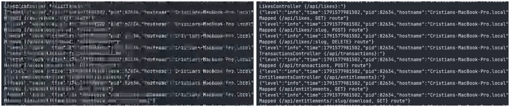
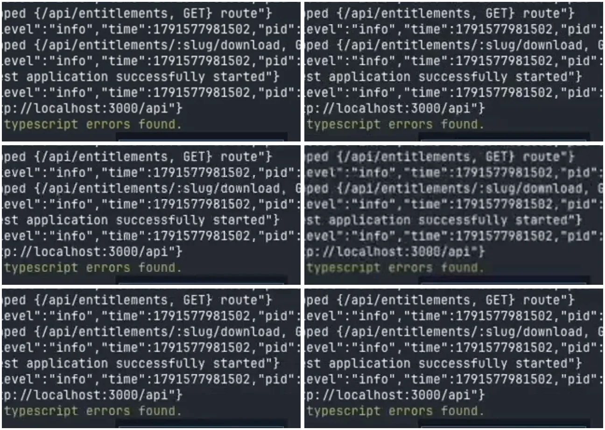
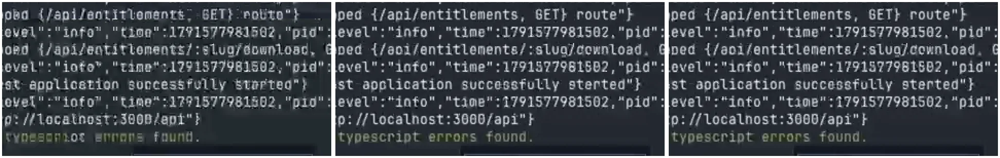
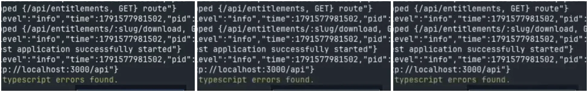

# Encoding benchmark 2026-10: export quality without FFmpeg

> **Status: decision taken, not implemented.** The owner chose the settings below on 2026-10-13
> after watching the sample files. `main` still exports with 2 s keyframes and a target bitrate
> (`export-worker.ts`). The change is a follow-up to NIW2-218 (the export presets work, PRs
> #283–#288); this page is the evidence it builds on.

## One-minute summary

- **Problem.** A 2:51 terminal recording exported with the old "GitHub" row came out at
  852×480 and 245 kbps. The text was unreadable.
- **Question.** Can the encoder Kaipu already uses (mediabunny → WebCodecs → VideoToolbox on
  macOS) reach the size and quality of x264, or does Kaipu need to ship FFmpeg?
- **Answer, on these two recordings and this one Mac.** Two encoder settings close the gap:
  - **`keyFrameInterval: 10`**. Mediabunny's default is a keyframe every 2 s. On mostly-static
    screen content those full frames dominate the file.
  - **`bitrateMode: 'quantizer'`**. Constant quantizer (constant quality per frame, like x264's
    CRF) instead of variable bitrate.
- With both, AVC on the hardware encoder at **q30, 24 fps, 1080p** came out **12–13% smaller** than
  x264 `-preset slow -crf 28` at 24 fps, with very slightly softer text. At **q28** it was
  **5–7% larger** and the text was indistinguishable in the crops.
- The 171 s terminal recording drops from **18.70 MB** (old export settings, 15 fps) to **5.95 MB**
  (chosen settings, 24 fps), **−68%**, with cleaner text.
- **Decision:** AVC (H.264) hardware, quantizer 30, keyframe every 10 s, 24 fps, 1080p. No FFmpeg.
- **Limits:** two recordings, one Mac (Apple M5, VideoToolbox). Windows, Linux and Intel Macs are
  unmeasured. VMAF is not tuned for text, so every verdict also used zoomed crops and the
  owner's eye.

Reusable, product-agnostic lessons from this benchmark (the keyframe default, quantizer mode,
what VideoToolbox ignores) live in the knowledge hub:
[WebCodecs export encoding for screen recordings](https://github.com/csdev19/general-knowledge/blob/main/desktop/webcodecs-export-encoding.md).
This page keeps Kaipu's numbers.



_Left: the in-app export that started this (852×480, 245 kbps), upscaled to 1080p. Right: the
chosen settings, same moment (21.1 s). Crop at 1:1 of a 1920×1080 frame._

## Decisions

| Decision                                                          | Why                                                                                                                                                            | ADR                                                                               |
| ----------------------------------------------------------------- | -------------------------------------------------------------------------------------------------------------------------------------------------------------- | --------------------------------------------------------------------------------- |
| Keep exporting through mediabunny/WebCodecs; do not bundle FFmpeg | With two settings the hardware path matches x264-slow size and look on these recordings, encodes as fast or faster, and avoids license, size and signing costs | Reuses [ADR 0001](/architecture/decisions/0001-mediabunny-over-ffmpeg). No change |
| AVC (H.264) MP4, not HEVC                                         | HEVC was ~20% smaller but Chrome and Firefox can only play it with hardware decode; a shared file must play everywhere                                         | None                                                                              |
| `keyFrameInterval: 10`                                            | Keyframes every 2 s cost up to 2.7× in size on the terminal clip at the same quantizer                                                                         | None                                                                              |
| Quantizer mode, q30                                               | Constant quality; spends bits only where the screen changes                                                                                                    | None                                                                              |
| 24 fps                                                            | 15 fps stutters on Kaipu's zoom animations; the owner saw it on every 15 fps file, including x264                                                              | None                                                                              |
| 1080p, never 720p                                                 | 720p is what smudged small text at every bitrate tried                                                                                                         | None                                                                              |

## Open questions

- **Windows and Linux.** Does Chromium's Media Foundation path (NVENC, Quick Sync, AMF) accept
  `bitrateMode: 'quantizer'`? Does it respect a 10 s keyframe interval? Not measured. The export
  must probe with `VideoEncoder.isConfigSupported` and fall back to a bitrate with 10 s keyframes.
- **Software fallback.** Where only Chromium's software H.264 (OpenH264) is available, text came
  out broken and the bitrate was ignored. What Kaipu does there is open: refuse, warn, or the
  optional lazy FFmpeg that ADR 0001 already allows.
- **Size estimates.** Quantizer mode has no target bitrate, so the export sheet cannot compute a
  size from `bitrate × duration`. Options: a per-content MB/min table from this benchmark, a
  short probe encode, or mediabunny ≥ 1.52's quantizer-with-bitrate fallback. Not decided.
- **Fast motion.** Both recordings are mostly static. A ~2-minute clip with fast window switching,
  scrolling and video playback would show whether q30 balloons on motion. Not recorded yet.
- **Intel Macs.** VideoToolbox on Intel uses a different hardware block. Not measured.
- **Why WebCodecs VBR undershoots.** VideoToolbox through WebCodecs at a 2 Mbps target produced
  ~0.98 Mbps at 15 fps and ~1.56 Mbps at 24 fps on the web demo, while ffmpeg's
  `h264_videotoolbox` landed on its targets. Observed, not explained. It does not affect the
  decision, which drops the bitrate target.

## Out of scope

- Changing the live capture encoder (this is about exports).
- HEVC, VP9 or AV1 as defaults.
- Legal advice: the licensing notes below are a summary to bring to a lawyer, not a conclusion.

---

## Method

### Machine and software

| Item             | Value                                                                                  |
| ---------------- | -------------------------------------------------------------------------------------- |
| Machine          | Apple M5, 10 cores, 24 GB RAM                                                          |
| OS               | macOS 26.6.2 (build 25G83)                                                             |
| Electron         | 39.8.10 (Chromium 142.0.7444.265) — the version the app ships on this branch point     |
| Mediabunny       | 1.49.0 (the version in the repo)                                                       |
| Hardware encoder | VideoToolbox, reached through WebCodecs with `hardwareAcceleration: 'prefer-hardware'` |
| FFmpeg           | 9.0.1 (Homebrew), with libx264 r3222 (core 165), libvmaf 3.2.0                         |

### Source recordings

Two real Kaipu recordings, both 2560×1440 H.264 with variable frame rate (~47–48 fps average):

| Name here         | What it shows                                                               | Duration | Size      | Video bitrate |
| ----------------- | --------------------------------------------------------------------------- | -------- | --------- | ------------- |
| Web demo (`gen`)  | A web app in a browser: tab switching, page headings, Kaipu zoom animations | 78.0 s   | 125.16 MB | 12.7 Mbps     |
| Terminal (`term`) | Scrolling server logs in small monospace text                               | 171.06 s | 47.90 MB  | 2.1 Mbps      |

The in-app export that started the investigation was the terminal recording exported with the
old "GitHub ≤ 10 MB" row: 852×480, 244.6 kbps video, ~23.9 fps, 7.42 MB including audio.

The owner also had a reference exported earlier by hand with ffmpeg libx264 from the web demo
(`-crf 28`, default preset with keyint 250): 1920×1080, 24 fps, 806.7 kbps video, 64 kbps AAC,
**8.55 MB** total.

### Harness

A throwaway Electron app (`main.js` + `page.mjs`, outside the repo) opened a hidden
`BrowserWindow`, imported the repo's mediabunny build, and transcoded each variant inside
Electron's own Chromium — the same WebCodecs path the app uses, not Node and not ffmpeg:

1. `CanvasSink` decodes source frames at fixed timestamps (`start + i / fps + 0.01`) into a
   1920×1080 (or 1280×720) canvas, letterboxed with `fit: 'contain'`.
2. `CanvasSource` encodes each canvas with the variant's settings into an MP4 (`fastStart:
'in-memory'`), or WebM for VP9.
3. Quantizer mode on mediabunny 1.49 needed two hooks, because 1.49 only accepts `constant` or
   `variable`: `onEncoderConfig` rewrites the WebCodecs config to `bitrateMode: 'quantizer'` and
   removes `bitrate`, and every `add()` passes `{ avc: { quantizer: q } }` (or `hevc`, `vp9`,
   `av1`). Mediabunny ≥ 1.52 exposes this directly (see
   [the code section](#the-two-settings-in-code)).
4. Before encoding, `VideoEncoder.isConfigSupported` records whether the config is supported.
5. Encode time is wall clock from the first decoded frame to `finalize()`. **It includes decoding
   the source and drawing the canvas**, not just the encoder.

### Two rounds

- **20 s segments** (source 20–40 s), 15 fps, 1920×1080, video only. To give every encoder
  identical pixels, both segments were first rendered to a near-lossless 1080p15 intermediate
  (`libx264 -crf 4`), then:
  - every WebCodecs variant encoded from that intermediate through the canvas;
  - a near-lossless WebCodecs reference (`WCREF`: AVC hardware, quantizer 4, 26.5 MB / 32.4 MB)
    was made the same way;
  - x264 variants encoded **from `WCREF`**, so x264 saw the same canvas-processed frames.
- **Full length**, video only, from the original recordings, at 15 fps and at 24 fps.

### Metrics and visual checks

- SSIM, PSNR and VMAF (libvmaf 3.2.0, default model) against `WCREF`, frame-aligned by index
  (`setpts=N/15/TB`). These are in `metrics3.csv`; the VMAF column below comes from there.
- **VMAF is a perceptual score trained on natural video, not on text.** Every verdict also used
  crops: 640×300 regions at 1:1, and 2× nearest-neighbour zooms of small terminal text right
  after a screen change, where encoders struggle most.
- Caveat: `WCREF` is itself an AVC-hardware encode, which may slightly favour the AVC-hardware
  variants in the metrics. The visual checks do not share that bias.
- Two earlier metric passes were discarded: one against an ffmpeg-made lossless reference
  (the canvas and ffmpeg scale differently, so every score was depressed), one against the CRF-4
  intermediate before `WCREF` existed.

## Results — round 0: the ffmpeg VideoToolbox matrix

Before the WebCodecs harness existed, a first matrix used ffmpeg's `h264_videotoolbox` (the same
hardware encoder, a different code path) on 20 s segments, VBR at a target bitrate, keyframes at
ffmpeg's default. Verdicts are from crops of the terminal segment.

| Variant                                     | Web demo MB/min | Terminal MB/min | Small text (terminal) |
| ------------------------------------------- | --------------- | --------------- | --------------------- |
| 480p · 24 fps · 250 kbps (old GitHub floor) | 1.95            | 1.92            | Unreadable, blocks    |
| 720p · 15 fps · 800 kbps                    | 5.83            | 5.93            | Readable, smudges     |
| 720p · 15 fps · 1.2 Mbps                    | 8.52            | 8.91            | Clean                 |
| 720p · 30 fps · 1.2 Mbps                    | —               | 9.07            | Unreadable, blocks    |
| 720p · 30 fps · 1.8 Mbps                    | —               | 13.50           | Readable, ghosting    |
| 1080p · 15 fps · 1.2 Mbps                   | 8.81            | 8.93            | Smudged               |
| 1080p · 15 fps · 2 Mbps                     | 14.21           | 15.82           | Clean                 |
| 1080p · 30 fps · 3 Mbps                     | 21.20           | 21.41           | Smudged               |
| 1080p · 30 fps · 4 Mbps                     | —               | 28.94           | Smudged               |

What it taught: at a fixed bitrate, **frame rate matters more than resolution** for text, because
the bits per frame halve when fps doubles. This led to the 15 fps tiers in #288. The owner's
review later showed 15 fps was the wrong floor for Kaipu (see [15 vs 24 fps](#15-vs-24-fps)).

Full-length versions of the two tiers, made with ffmpeg VideoToolbox from the web demo with audio:
Light (720p15, 1.2 Mbps, 64 kbps AAC) **12.11 MB**, Sharp (1080p15, 2 Mbps, 128 kbps AAC)
**20.43 MB**. The owner's x264 copy of the same recording was **8.55 MB** and looked as good or
better. That gap is what started the WebCodecs benchmark.

## Results — round 1: 20 s segments in Electron's WebCodecs

Variant names: `avc-hw` = AVC with `prefer-hardware` (VideoToolbox); `avc-sw` = AVC with
`prefer-software` (OpenH264); `hevc-hw` = HEVC hardware; `vp9-sw` / `av1-sw` = software VP9 / AV1;
`0.8M`/`1.2M`/`2M` = VBR target; `qNN` = quantizer; `kfi10` = keyframe every 10 s; no `kfi` =
mediabunny's default 2 s. All 1920×1080 at 15 fps unless the name says 720. MB/min = 20 s size × 3.
Encode times for x264 come from an earlier, equivalent run on the CRF-4 intermediate; the final
x264 files (encoded from `WCREF`) were not timed. `n/m` = not measured.

| Variant                                      | Web demo: MB (MB/min) | VMAF     | Encode s | Terminal: MB (MB/min) | VMAF     | Encode s |
| -------------------------------------------- | --------------------- | -------- | -------- | --------------------- | -------- | -------- |
| `avc-hw-1080-2M` (old Balanced)              | 2.45 (7.3)            | 94.1     | 1.21     | 3.87 (11.6)           | 87.9     | 1.19     |
| `avc-hw-720-1.2M` (old Light)                | 1.47 (4.4)            | 85.7     | 0.83     | 2.19 (6.6)            | 58.1     | 0.87     |
| `avc-hw-1080-1.2M`                           | 1.58 (4.7)            | 86.8     | 1.14     | 2.70 (8.1)            | 81.4     | 1.18     |
| `avc-hw-1080-0.8M`                           | 1.17 (3.5)            | 81.8     | 1.15     | 1.98 (6.0)            | 74.3     | 1.17     |
| `avc-hw-1080-0.8M-kfi10`                     | 1.15 (3.4)            | 83.4     | 1.15     | 1.42 (4.3)            | 87.7     | 1.17     |
| `avc-hw-1080-1.2M-kfi10`                     | 1.54 (4.6)            | 88.6     | 1.14     | 1.66 (5.0)            | 90.0     | 1.16     |
| `avc-hw-1080-2M-kfi10`                       | 2.45 (7.4)            | 95.1     | 1.15     | 2.18 (6.5)            | 93.5     | 1.18     |
| `avc-hw-1080-q30-kfi2`                       | 2.18 (6.5)            | 95.6     | 1.26     | 3.44 (10.3)           | 89.7     | 1.26     |
| `avc-hw-1080-q26-kfi10`                      | 2.72 (8.2)            | 97.0     | 1.25     | 1.75 (5.2)            | 93.7     | 1.27     |
| `avc-hw-1080-q28-kfi10`                      | 2.29 (6.9)            | 96.5     | 1.26     | 1.50 (4.5)            | 92.6     | 1.25     |
| **`avc-hw-1080-q30-kfi10`**                  | **1.93 (5.8)**        | **95.5** | 1.28     | **1.27 (3.8)**        | **90.5** | 1.27     |
| `avc-hw-1080-q32-kfi10`                      | 1.61 (4.8)            | 94.3     | 1.25     | 1.08 (3.2)            | 87.7     | 1.27     |
| `avc-hw-1080-q34-kfi10`                      | 1.34 (4.0)            | 92.9     | 1.26     | 0.92 (2.8)            | 84.1     | 1.24     |
| `avc-hw-720-q28-kfi10`                       | 1.39 (4.2)            | 88.7     | 0.86     | 0.89 (2.7)            | 63.3     | 0.89     |
| `avc-sw-1080-0.8M`                           | 2.33 (7.0)            | 79.1     | 1.09     | 2.11 (6.3)            | 69.0     | 0.90     |
| `avc-sw-1080-1.2M`                           | 2.39 (7.2)            | 79.3     | 1.09     | 2.11 (6.3)            | 69.0     | 0.92     |
| `hevc-hw-1080-0.8M`                          | 1.27 (3.8)            | 87.9     | 1.22     | 2.02 (6.1)            | 75.6     | 1.23     |
| `hevc-hw-1080-1.2M`                          | 1.55 (4.6)            | 90.9     | 1.23     | 2.23 (6.7)            | 78.4     | 1.23     |
| `hevc-hw-1080-q30-kfi10`                     | 1.54 (4.6)            | 95.7     | 1.33     | 1.08 (3.3)            | 90.8     | 1.37     |
| `hevc-hw-1080-q32-kfi10`                     | 1.25 (3.8)            | 94.6     | 1.34     | 0.93 (2.8)            | 87.9     | 1.35     |
| `hevc-hw-1080-q34-kfi10`                     | 1.03 (3.1)            | 93.1     | 1.33     | 0.79 (2.4)            | 84.6     | 1.38     |
| `vp9-sw-1080-0.8M`                           | 2.18 (6.5)            | 58.6\*   | 1.07     | 5.44 (16.3)           | 84.8     | 0.99     |
| `vp9-sw-1080-1.2M`                           | 2.42 (7.3)            | 60.2\*   | 1.14     | 7.99 (24.0)           | 90.6     | 1.07     |
| `vp9-sw-1080-q30-kfi10`                      | 4.11 (12.3)           | 64.5\*   | 1.15     | 1.70 (5.1)            | 88.8     | 0.92     |
| `vp9-sw-1080-q38-kfi10`                      | 2.84 (8.5)            | 61.7\*   | 1.12     | 1.16 (3.5)            | 81.3     | 0.91     |
| `vp9-sw-1080-q45-kfi10`                      | 2.02 (6.0)            | 58.1\*   | 1.07     | 0.80 (2.4)            | 70.6     | 0.90     |
| `av1-sw-1080-0.8M`                           | 1.73 (5.2)            | 88.5     | 1.38     | 3.34 (10.0)           | 79.2     | 1.19     |
| `av1-sw-1080-1.2M`                           | 2.09 (6.3)            | 91.0     | 1.35     | 4.05 (12.2)           | 82.6     | 1.39     |
| `av1-sw-1080-q30-kfi10`                      | 3.45 (10.4)           | 96.2     | 1.36     | 1.25 (3.8)            | 87.5     | 0.94     |
| `av1-sw-1080-q38-kfi10`                      | 2.29 (6.9)            | 93.5     | 1.37     | 0.90 (2.7)            | 80.3     | 1.09     |
| `av1-sw-1080-q45-kfi10`                      | 1.60 (4.8)            | 89.1     | 1.32     | 0.62 (1.9)            | 69.4     | 1.09     |
| `x264-slow-crf26`                            | 2.41 (7.2)            | 96.9     | 2.31     | 1.82 (5.5)            | 94.9     | 2.32     |
| `x264-slow-crf28`                            | 2.02 (6.0)            | 96.3     | 2.19     | 1.59 (4.8)            | 94.1     | 2.18     |
| `x264-slow-crf30`                            | 1.72 (5.2)            | 95.5     | 2.10     | 1.40 (4.2)            | 93.0     | 2.13     |
| `x264-slow-crf32`                            | 1.47 (4.4)            | 94.4     | 2.12     | 1.23 (3.7)            | 91.5     | 2.02     |
| `x264-slow-crf34`                            | 1.27 (3.8)            | 92.9     | n/m      | 1.07 (3.2)            | 89.6     | n/m      |
| `x264-slow-still-crf28` (`-tune stillimage`) | 2.30 (6.9)            | 96.6     | n/m      | 1.68 (5.0)            | 94.3     | n/m      |

\* VP9 on the web demo: the VP9 output's frames do not line up with the reference during motion
(per-frame PSNR alternates between ~55 dB and ~15 dB). The cause was not found. **Treat those
VMAF values as invalid**; the terminal VP9 numbers and the VP9 crops are fine.

Not in the table:

- `latencyMode: 'quality'`, `contentHint: 'text'` and `contentHint: 'detail'` on `avc-hw-1080-2M`
  were accepted, and produced **the same size and the same SSIM/PSNR/VMAF to six decimals** as the
  baseline on both clips. The bitstreams are not byte-identical, but there is no measurable effect.
  `quality` is already WebCodecs' default latency mode.
- `avc-sw` with quantizer: `isConfigSupported` returned **not supported**.
- `avc-sw` on the terminal clip produced the **identical video bitstream** at 0.8 and 1.2 Mbps:
  the software encoder ignored the bitrate.

### Verdicts from the crops

| Variant                         | Small text                                                         |
| ------------------------------- | ------------------------------------------------------------------ |
| `avc-hw-1080-2M` (old Balanced) | Clean when static; slight smudge during motion                     |
| `avc-hw-720-1.2M` (old Light)   | **Smudged.** "time" reads like "tine"; ghosting on URLs            |
| `avc-hw` 1.2 Mbps               | Readable, ringing                                                  |
| `avc-hw` 0.8 Mbps               | Smudged                                                            |
| `avc-hw` 0.8 Mbps, kfi 10       | Readable                                                           |
| `avc-hw` 2 Mbps, kfi 10         | Clean                                                              |
| `avc-sw` (OpenH264)             | **Broken**: garbled glyphs                                         |
| `vp9-sw` VBR                    | Readable, but up to 2.7× over the target size on the terminal clip |
| `vp9-sw` q38, kfi 10            | Readable                                                           |
| `av1-sw` VBR                    | Readable, overshoots the target size                               |
| `av1-sw` q38 / q45              | Mostly clean / soft                                                |
| `hevc-hw` 0.8 / 1.2 Mbps        | Smudged / readable                                                 |
| `avc-hw` q26–q32, kfi 10        | Clean                                                              |
| `avc-hw` q34, kfi 10            | Clean-ish                                                          |
| `hevc-hw` q30–q34, kfi 10       | Clean                                                              |
| `x264` crf26–crf34              | Clean                                                              |
| `x264 -tune stillimage`         | No gain over plain crf28                                           |



_2× nearest-neighbour zoom of terminal text one second into the segment, right after a screen
change. Top row: near-lossless reference (32.4 MB), x264 slow crf28 (1.59 MB). Middle: old
Balanced, 1080p 2 Mbps (3.87 MB); old Light, 720p 1.2 Mbps (2.19 MB) — the smudged one. Bottom:
AVC hardware q30 + 10 s keyframes (1.27 MB); q28 + 10 s keyframes (1.50 MB). Sizes are for the
20 s segment._



_All three targeted 0.8 Mbps. Left: `prefer-software` (OpenH264), 2.11 MB — garbled. Middle:
hardware with the default 2 s keyframes, 1.98 MB — smudged. Right: hardware with 10 s keyframes,
1.42 MB — readable. Same encoder, same target, 28% smaller and cleaner: the keyframes were eating
the budget._

### What round 1 showed

- **Keyframes dominate on static screens.** At q30 the terminal segment is 3.44 MB with 2 s
  keyframes and 1.27 MB with 10 s keyframes: **2.7×** for the same quality setting. On the web
  demo the gap is smaller (1.13×) because more of the screen changes between keyframes.
- **Quantizer beats VBR at the same size.** `avc-hw` q30 kfi10 is smaller than `avc-hw` 2 Mbps on
  both clips and scores higher VMAF.
- **Against x264 slow at matched quality**, AVC hardware with both settings was roughly 5–12%
  larger; HEVC hardware was roughly 10–15% smaller.
- **Speed is not the differentiator on 20 s clips:** 1.1–1.4 s for every WebCodecs variant
  (decode included) vs 2.0–2.3 s for x264 slow.

## Results — round 2: full-length files

Video only, 1920×1080 (720p where named), from the original recordings. MB are decimal
(1 MB = 1,000,000 bytes). Encode time as above (decode included). All sizes re-checked with
`ffprobe` on 2026-10-13.

### Web demo, 78.0 s

| File                                  | Settings                                       | fps | Size          | MB/min | Video kbps | Encode |
| ------------------------------------- | ---------------------------------------------- | --- | ------------- | ------ | ---------- | ------ |
| `full-gen_avc-hw-2M-today`            | AVC hw, 2 Mbps VBR, 2 s keyframes (old export) | 15  | 9.59 MB       | 7.38   | 983        | 4.4 s  |
| `full-gen_avc-hw-2M-today-24fps`      | same, at 24 fps                                | 24  | 15.26 MB      | 11.74  | 1,564      | 6.9 s  |
| `full-gen_avc-hw-720-1.2M-today`      | AVC hw 720p, 1.2 Mbps VBR (old Light)          | 15  | 5.74 MB       | 4.41   | 588        | 3.2 s  |
| `full-gen_avc-hw-q30-kfi10`           | AVC hw q30, kfi 10                             | 15  | 5.70 MB       | 4.39   | 584        | 4.8 s  |
| `full-gen_avc-hw-q28-kfi10`           | AVC hw q28, kfi 10                             | 15  | 6.85 MB       | 5.27   | 702        | 4.7 s  |
| **`full-gen_avc-hw-q30-kfi10-24fps`** | **AVC hw q30, kfi 10 (chosen)**                | 24  | **6.96 MB**   | 5.35   | 713        | 7.5 s  |
| `full-gen_avc-hw-q28-kfi10-24fps`     | AVC hw q28, kfi 10                             | 24  | 8.41 MB       | 6.47   | 862        | 7.6 s  |
| `full-gen_hevc-hw-q30-kfi10`          | HEVC hw q30, kfi 10                            | 15  | 3.96 MB       | 3.05   | 406        | 5.1 s  |
| `full-gen_x264-slow-crf28-15fps`      | x264 slow crf28                                | 15  | 7.07 MB       | 5.43   | 723        | n/m    |
| `full-gen_x264-slow-crf28-24fps`      | x264 slow crf28, `-g 240`                      | 24  | 7.89 MB       | 6.07   | 807        | 21.9 s |
| Owner's x264 copy (`pr216`)           | x264 crf28, keyint 250, + 64 kbps AAC          | 24  | 8.55 MB total | 6.58   | 807        | —      |

### Terminal, 171.0 s

| File                                   | Settings                                       | fps | Size        | MB/min | Video kbps | Encode |
| -------------------------------------- | ---------------------------------------------- | --- | ----------- | ------ | ---------- | ------ |
| `full-term_avc-hw-2M-today`            | AVC hw, 2 Mbps VBR, 2 s keyframes (old export) | 15  | 18.70 MB    | 6.56   | 874        | 9.5 s  |
| `full-term_avc-hw-2M-today-24fps`      | same, at 24 fps                                | 24  | 25.91 MB    | 9.09   | 1,211      | 15.2 s |
| `full-term_avc-hw-q30-kfi10`           | AVC hw q30, kfi 10                             | 15  | 5.48 MB     | 1.92   | 256        | 10.2 s |
| **`full-term_avc-hw-q30-kfi10-24fps`** | **AVC hw q30, kfi 10 (chosen)**                | 24  | **5.95 MB** | 2.09   | 278        | 16.3 s |
| `full-term_avc-hw-q28-kfi10-24fps`     | AVC hw q28, kfi 10                             | 24  | 7.13 MB     | 2.50   | 333        | 16.2 s |
| `full-term_hevc-hw-q30-kfi10`          | HEVC hw q30, kfi 10                            | 15  | 4.55 MB     | 1.60   | 212        | 11.1 s |
| `full-term_x264-slow-crf28-15fps`      | x264 slow crf28                                | 15  | 6.36 MB     | 2.23   | 296        | n/m    |
| `full-term_x264-slow-crf28-24fps`      | x264 slow crf28, `-g 240`                      | 24  | 6.82 MB     | 2.39   | 317        | 17.6 s |

`full-term_avc-hw-q30-kfi10-24fps`, both `*-today-24fps` files and the two 24 fps x264 timings
were added on 2026-10-13 while writing this page, with the same harness and commands.

### Comparisons that matter

| Comparison                                      | Web demo        | Terminal         |
| ----------------------------------------------- | --------------- | ---------------- |
| Chosen (q30, 24 fps) vs x264 slow crf28, 24 fps | **−11.9%**      | **−12.7%**       |
| AVC q28, 24 fps vs x264 slow crf28, 24 fps      | +6.6%           | +4.6%            |
| Chosen vs old export settings at 15 fps         | −27%            | **−68%**         |
| Chosen vs old export settings at 24 fps         | −54%            | −77%             |
| Old settings vs q30 kfi10, both 15 fps          | 1.68×           | **3.41×**        |
| Encode time, chosen vs x264 slow (24 fps)       | 7.5 s vs 21.9 s | 16.3 s vs 17.6 s |

On encode time: the hardware path was 2.9× faster on the web demo and only ~7% faster on the
terminal recording. The terminal number is dominated by decoding the ~48 fps source in the page;
ffmpeg alone needed 5.2 s just to decode and scale it. x264 used all ten CPU cores; CPU use of the
hardware path was not measured.



_Full-length files at 24 fps, terminal at 21.1 s, 2× zoom. Left: x264 slow crf28 (6.82 MB).
Middle: AVC hardware q28 + 10 s keyframes (7.13 MB). Right: AVC hardware q30 + 10 s keyframes
(5.95 MB)._

Visual verdicts on the 24 fps files (crops at 2×): terminal at 21.1 s, x264 crf28 and AVC q28 are
both clean with no difference to point at; web demo at 28.3 s (tab titles during a zoom) and
62.5 s (page heading), x264 crf28, AVC q28 and AVC q30 are all clean, and q30 is very slightly
softer on a small URL. A second terminal crop at 50 s landed on an empty screen and shows nothing,
so only one terminal moment was compared. The terminal q30 24 fps file was not reviewed by the
owner; it was made after the decision to fill the gap in this table.

## 15 vs 24 fps

Round 0 suggested 15 fps was enough for screen recordings: at a fixed bitrate, fewer frames means
more bits per frame and sharper text. The owner watched the full-length files and found that
**every 15 fps file stutters on Kaipu's zoom animations and other motion — including x264**. The
24 fps file felt smooth. The stutter comes from the frame rate, not the encoder.

Kaipu's exports carry animated zooms and are demos where the presenter moves quickly, so the
floor is **24 fps**, even for recordings without zooms. In quantizer mode the cost is modest,
because unchanged frames are cheap: q30 went from 5.70 to 6.96 MB (+22%) on the web demo and
from 5.48 to 5.95 MB (+9%) on the terminal recording.

## The owner's verdicts (2026-10-13)

In the order they were given:

1. **Old tiers (ffmpeg VideoToolbox Light 12.11 MB / Sharp 20.43 MB vs his x264 copy 8.55 MB):**
   Light and his x264 copy looked very similar, but the x264 one was much smaller. If nothing in
   the current stack could match it, he was fine with shipping FFmpeg.
2. **Full-length review:** the 24 fps file is noticeably smoother on zooms and animations; HEVC
   is "discarded, if it can't play in Chrome it's useless"; the 15 fps files stutter.
3. A naming mix-up (`x264` vs `avc-hw` in similar file names) briefly read as "x264 looks best".
   He then confirmed: **the best-looking file was `full-gen_avc-hw-q30-kfi10-24fps.mp4`** — Kaipu's
   own encoder with the two settings, not x264.

## What was rejected and why

| Option                               | Measured or read                                                                                              | Why not                                                                                                                                                                                                  |
| ------------------------------------ | ------------------------------------------------------------------------------------------------------------- | -------------------------------------------------------------------------------------------------------------------------------------------------------------------------------------------------------- |
| **HEVC** (hardware)                  | Measured: ~20% smaller than AVC at the same quantizer, clean text                                             | Read: Safari plays it; Chrome (from 107) and Firefox (from 137) only with hardware decode, "partial" on caniuse. A file shared in a GitHub comment must play in any browser. Possible later as an opt-in |
| **VP9** (software, WebM)             | Measured: VBR overshot the target up to 2.7×; quantizer mode readable but larger than AVC q30 on the web demo | No size or quality win over AVC hardware; WebM support in Safari is recent (macOS 16, iOS 17.4)                                                                                                          |
| **AV1** (software)                   | Measured: VBR overshot; quantizer q38 decent                                                                  | No win over AVC hardware; Safari plays AV1 only with hardware decode (M3 / A17 Pro and newer)                                                                                                            |
| **OpenH264** (`prefer-software` AVC) | Measured: garbled text, ignored the bitrate, quantizer not supported                                          | Unusable for text. Also what Chromium falls back to without hardware                                                                                                                                     |
| **720p**                             | Measured: smudged at 1.2 Mbps VBR and at q28                                                                  | Resolution was the wrong lever; 1080p with a higher quantizer is smaller and sharper                                                                                                                     |
| **15 fps**                           | Measured size win; owner saw stutter                                                                          | See [15 vs 24 fps](#15-vs-24-fps)                                                                                                                                                                        |
| **`contentHint`** (`text`, `detail`) | Measured: no effect on VideoToolbox                                                                           | Ignored by this encoder path                                                                                                                                                                             |
| **`latencyMode: 'quality'`**         | Measured: no effect                                                                                           | Already the WebCodecs default                                                                                                                                                                            |
| **`-tune stillimage`** (x264)        | Measured: 6–14% larger than plain crf28, same VMAF                                                            | No gain                                                                                                                                                                                                  |
| **Shipping FFmpeg + x264**           | Read and estimated, see below                                                                                 | Costs outweigh a 5–7% size difference                                                                                                                                                                    |

Playback facts in this table were read, not tested: caniuse
([HEVC](https://caniuse.com/hevc), [WebM](https://caniuse.com/webm), [AV1](https://caniuse.com/av1)).
GitHub accepts `.mp4`, `.mov` and `.webm` attachments, up to 10 MB on free plans and 100 MB on
paid plans ([GitHub docs](https://docs.github.com/en/get-started/writing-on-github/working-with-advanced-formatting/attaching-files)).

## What shipping FFmpeg would cost

None of this was measured; it is what the decision weighed.

- **License.** Kaipu is `AGPL-3.0-only` (root `package.json` and `LICENSE`). x264 is GPL
  ([videolan.org](https://www.videolan.org/developers/x264.html); commercial licences exist). If
  x264 is "GPLv2 or later", as its source headers state, it is compatible with AGPLv3; a bundled
  binary is arguably mere aggregation anyway. The concrete obligations would be shipping or
  offering the corresponding FFmpeg/x264 source and build scripts, and the notices. **Unverified;
  needs a lawyer's reading.** It would also complicate any future dual-licensed closed edition.
- **Patents.** Today Apple's VideoToolbox does the H.264 encoding. Distributing Kaipu's own H.264
  encoder could bring the AVC patent pool (administered by Via LA, formerly MPEG LA) into scope.
  **Unverified; needs legal review.**
- **LGPL FFmpeg without x264 gains nothing**: its H.264 encoders on macOS are
  `h264_videotoolbox` (what Kaipu already uses) and `libopenh264` (the worst encoder measured here).
- **Size.** ADR 0001 cites ~50–80 MB per architecture for full builds. A minimal x264-only build
  is smaller but has to be built and maintained per architecture (arm64 + x64, or universal).
- **Signing.** Every bundled Mach-O executable must be signed with the hardened runtime and pass
  notarization.
- **ffmpeg.wasm** avoids native binaries but is ~25× (multi-thread) to ~50× (single-thread)
  slower than native per its own [benchmark](https://ffmpegwasm.netlify.app/docs/performance).
- **ADR 0001** already allows FFmpeg "only as an optional, lazy, on-demand tool for offline
  post-processing — never embedded by default". Bundling it in the normal export path would mean
  superseding that decision. An opt-in, lazily downloaded x264 export would fit as written. Its
  reopen case would be the open question about machines with only a software encoder.

## The two settings in code

What `main` does today (`export-worker.ts`): `codec: "avc"`, a `bitrate`, and
`hardwareAcceleration: "prefer-hardware"`. No `keyFrameInterval` (so 2 s), no `bitrateMode` (so
`variable`).

On mediabunny ≥ 1.52, the quantizer is a first-class option (from the
[v1.52.0 announcement](https://mediabunny.dev/blog/quantizer-support) and the 1.52 typings;
**not yet run in Kaipu**). The `bitrate` doubles as the fallback when the platform encoder cannot do
quantizer mode:

```ts
import { CanvasSource, Quality } from "mediabunny";

const videoSource = new CanvasSource(canvas, {
  codec: "avc",
  quality: new Quality({ quantizer: 30, bitrate: 2_000_000 }),
  keyFrameInterval: 10, // seconds; the default is 2
  hardwareAcceleration: "prefer-hardware",
});
```

What the benchmark actually ran, on mediabunny 1.49:

```ts
const videoSource = new CanvasSource(canvas, {
  codec: "avc",
  bitrate: 1_000_000, // placeholder, removed below
  keyFrameInterval: 10,
  hardwareAcceleration: "prefer-hardware",
  onEncoderConfig: (config) => {
    config.bitrateMode = "quantizer";
    delete config.bitrate;
  },
});
// for every frame:
await videoSource.add(timestamp, duration, { avc: { quantizer: 30 } });
```

## Reproducing it

The harness, plans, outputs, metrics and grids were kept in the session scratch directory and are
not in the repo. To re-run:

1. Write a minimal Electron main script that opens a hidden `BrowserWindow`
   (`nodeIntegration: true, contextIsolation: false, backgroundThrottling: false`) and loads a
   page that imports the repo's `mediabunny/dist/bundles/mediabunny.mjs`.
2. In the page, for each variant: `Input` + `CanvasSink` (fit `contain`) → draw onto an
   `OffscreenCanvas` → `CanvasSource` → `Output(Mp4OutputFormat)` → `BufferTarget`; time it with
   `performance.now()`.
3. Run it with the repo's Electron binary:
   `PLAN=plan.json node_modules/.bun/electron@39.8.10/node_modules/electron/dist/Electron.app/Contents/MacOS/Electron main.js`.
4. x264 references:
   `ffmpeg -i <src> -an -vf "fps=24,scale=1920:1080" -c:v libx264 -preset slow -crf 28 -g 240 -pix_fmt yuv420p out.mp4`.
5. Metrics:
   `ffmpeg -i <variant> -i <reference> -lavfi "[0:v]scale=1920:1080:flags=bicubic,setpts=N/15/TB,format=yuv420p[d];[1:v]setpts=N/15/TB,format=yuv420p[r];[d][r]libvmaf" -f null -`.

## Related

- [ADR 0001: Mediabunny over FFmpeg](/architecture/decisions/0001-mediabunny-over-ffmpeg)
- [Recording pipeline](/desktop/recording-pipeline)
- Knowledge hub: [WebCodecs export encoding for screen recordings](https://github.com/csdev19/general-knowledge/blob/main/desktop/webcodecs-export-encoding.md)
- Mediabunny: [Quantizer support in v1.52.0](https://mediabunny.dev/blog/quantizer-support)
