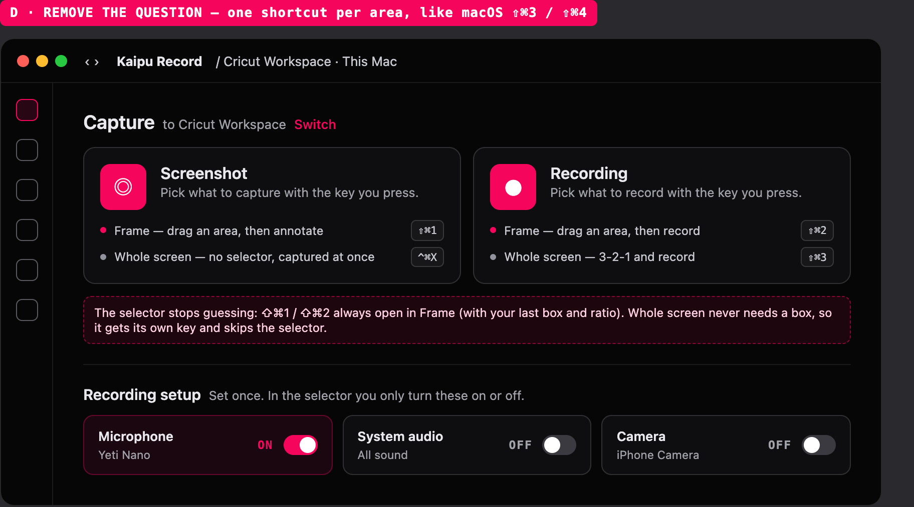
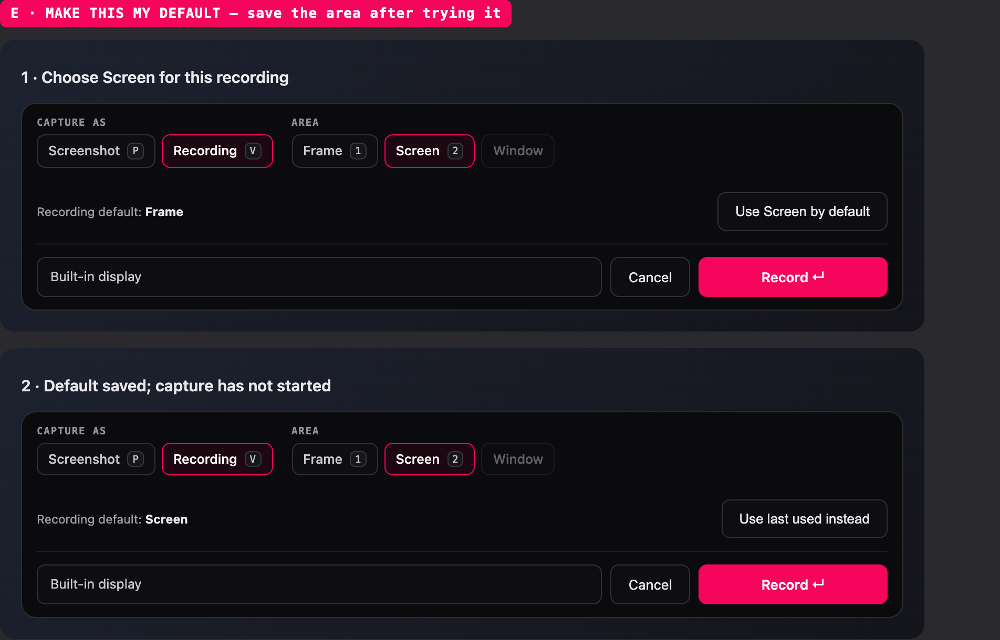

# Capture — choose and show the default area

> **Status: 🔵 Proposed.** Design options only, no code. The owner picks one (or a mix)
> before anything is built. Mock source: `src/assets/capture-default-mode/mock.html`.

## Summary

Today ⇧⌘1 and ⇧⌘2 open the selector in the **last used** area, one memory per intent
(screenshot and recording are separate), and the recording one also remembers the
Frame ratio. The Capture page shows that memory as a read-only line on each card
("LAST USED · FRAME"). Nothing lets the person choose a fixed default, and nothing in
the selector says which chip was pre-selected or why.

| Option        | Where the choice lives                                  | Where the default shows                    | Cost                                |
| ------------- | ------------------------------------------------------- | ------------------------------------------ | ----------------------------------- |
| A — your idea | New "Selector opens with" panel on the Capture page     | Panel + a DEFAULT tag on the selector chip | New section, new setting per intent |
| B             | Inside the selector: pin a chip                         | Pin icon on the chip                       | Hidden gesture (right-click / D)    |
| C             | The card's "Last used" line becomes a dropdown          | The card line + (optionally) the A tag     | Smallest: reuses an existing slot   |
| D             | Nowhere: one shortcut per area                          | The shortcuts themselves                   | A new global shortcut (⇧⌘3)         |
| E             | Explicit save action beside the current selector choice | Persistent default line in the selector    | One extra row; separate save action |

**Recommendation: C, with the DEFAULT tag from A in the selector.** It answers both
halves of the request (pick it, and see it) without adding a section to a page that
already has three, and it keeps "Last used" as the first option, so nobody's current
behaviour changes until they choose.

## What comparable tools do

- **macOS Screenshot (⇧⌘5)** keeps the choice inside the capture toolbar: Options ▸
  "Remember Last Selection", and the toolbar highlights the last mode the next time
  it opens ([Apple support](https://support.apple.com/en-asia/guide/mac-help/mh26782),
  [MacMost](https://macmost.com/live-using-the-screenshot-tool-on-your-mac.html)).
  macOS also splits areas by key: ⇧⌘3 whole screen, ⇧⌘4 area.
- **CleanShot X** remembers the last area and exposes "Capture Previous Area" as its own
  action/shortcut rather than a default toggle
  ([CleanShot features](https://cleanshot.com/features),
  [shortcut list](https://www.pie-menu.com/shortcuts/cleanshot)).
- **Snagit** has no "default" toggle either: the global shortcut uses whatever the
  Capture window is set to, and saved presets get their own shortcuts
  ([Snagit presets](https://www.techsmith.com/learn/tutorials/snagit/presets),
  [capture hotkeys](https://www.techsmith.com/learn/tutorials/snagit/change-global-hotkey/)).

So users coming from these tools expect either "it remembers" (all three) or "a
different key for a different area" (macOS, Snagit). None of them uses a separate
settings panel for this. A and C are new to them; B and D match what they know.

## A — Your idea: a "Selector opens with" panel

A panel below Recording setup, one box per intent: Area (Frame / Screen / Window soon),
Ratio for Frame, and a "Remember the last one I used instead" switch. In the selector,
a small **DEFAULT** tag sits on the chips the selector opened with, so the person can
tell "this is what I chose" from "this is what I clicked last time".

- **For:** everything about capture lives on one page and is explicit; the tag answers
  "why did it open in Frame?".
- **Against:** a third section on the page, with a ratio row that is only meaningful
  for Frame; and it duplicates the card's "LAST USED" line, which now has to say
  "Opens in" to stay true.

## B — Set it where you use it: pin inside the selector

Right-click a chip (or press D on it) to pin it; a pinned chip carries a small pin icon
and is what the selector opens with next time. "Open in the last one I used" is the
third menu entry.

- **Why it should be this way:** the moment someone notices "I always switch to
  Screen" is inside the selector, not on the Capture page. macOS puts its "Remember
  Last Selection" exactly there, so it is where a Mac user looks.
- **Against:** right-click and a letter key are invisible until someone tells you;
  the hint row helps, but it is the least discoverable of the four.

## C — No new section: the card line becomes the control (recommended)

The cards already show "LAST USED · FRAME". Rename it to "OPENS IN · Frame ▾" and make
it a dropdown: **Last used** (with the current value) / Frame / Screen / Window (soon).
Screenshot and Recording keep separate defaults, because they already have separate
cards and separate memories.

- **Why it should be this way:** the slot exists, it is already where the person reads
  the default, and it sits next to the shortcut it affects (⇧⌘1 / ⇧⌘2). No layout
  change, no new section pushing Recording setup down, and "Last used" first keeps
  today's behaviour for everyone who never opens the menu.
- **Against:** a small dashed underline is a quiet affordance; the ratio is not
  chooseable here (it stays "last used"). Pair it with A's DEFAULT tag in the selector
  so the default is also visible where the capture happens.

## D — Remove the question: one shortcut per area

⇧⌘1 / ⇧⌘2 always open the selector in Frame, with the last box and ratio. Whole screen
does not need a box, so it does not need the selector: screenshots already have it
(Instant, ^⌘X), and recordings get ⇧⌘3 (countdown, then record).

- **Why it should be this way:** a "default" exists only because one key serves two
  areas. macOS has trained Mac users on ⇧⌘3 = whole screen, ⇧⌘4 = area for twenty
  years. The selector then has one job (drawing a box) and the whole-screen path gets
  faster, not just pre-selected.
- **Against:** one more global shortcut to register and to avoid conflicts with
  (⇧⌘3 is the macOS screenshot key, so it would need a different default or an
  opt-in); the Screen chip in the selector becomes a rarely used escape hatch.

## E — Make this my default: promote a choice explicitly

The selector separates a temporary area choice from a persistent preference. After
switching to Screen, the person sees “Recording default: Frame” beside **Use Screen
by default**. Saving immediately changes that line to “Recording default: Screen”;
it does not start recording. **Use last used instead** restores automatic memory.
This is an explicit promotion command, rather than B's per-chip pin gesture or C's
independent settings menu: try the area first, then decide whether to keep it.

- **Why it should be this way:** shortcut users can fix the next opening without
  leaving the selector. The text names the intent and saved area, while the pink
  chip means only the current selection. A one-off Screen capture does not overwrite
  a fixed Frame default. The two states above deliberately show that distinction.
- **Against:** a permanent settings row taxes every capture for a rare preference
  change. Saving and capturing are separate actions; someone can save and then
  cancel, expecting cancellation to undo everything. The save must therefore be
  immediate and visibly acknowledged, with an accessible status announcement.
- **Contract:** start existing users in Last used. Save only Frame/Screen, separately
  per intent, never the display, rectangle, ratio, audio or camera settings. Ratio
  continues to follow recording memory. Changing the intent refreshes the default
  line and action scope. In Last used, show “Recording default: Last used · Frame”
  (with the resolved area), plus “Use Frame by default”. In fixed mode, show the
  promotion action only when the current area differs; keep the restore action
  available as well. Cancel closes the selector without reverting an explicit save.
  Cards and tray rows remain launch actions and show the same resolved policy.
- **Versus C (design judgement, not a usability result):** E wins for shortcut-only
  access and clear separation of current versus saved state; C wins for compactness
  and choosing a default before opening the selector. Both preserve existing memory
  and leave ratio independent. Prefer E for this request, subject to testing whether
  its permanent row is worth the recurring space cost.

## Review notes (gpt-6.1-sol)

1. **The current-behaviour summary is broadly right, but “last used” needs a precise
   write boundary.** `use-capture-entry-actions.ts` sends no mode when opening either
   intent and reads separate settings. `use-recording-mode.ts` explicitly says a
   mode-chip change can write memory, not only a completed take. Define whether
   switching and cancelling updates Last used; do not imply “last captured”. These
   hooks alone do not prove the selector lacks a selected-state highlight. Distinguish
   a highlight for the current chip from an explanation of why it opened there.
2. **The competitor conclusion overreaches.** Apple's “Remember Last Selection” does
   not establish an explicit fixed-area preference; remembering a selection and
   pinning an area mode are different contracts.
   Toolbar placement does not establish that Mac users know B's right-click/D
   gesture. [Apple's guide](https://support.apple.com/guide/mac-help/mh26782/mac)
   does not establish that expectation. The [CleanShot feature list](https://cleanshot.com/features)
   confirms multiple capture modes, but does not establish the absence of a default
   setting. [TechSmith's hotkey guide](https://support.techsmith.com/hc/en-us/articles/360029399351-Change-the-Global-Hotkey-in-Snagit-Video)
   supports previous Capture Window settings, and its
   [preset guide](https://support.techsmith.com/hc/en-us/articles/360002743452-Capture-Modes-in-Snagit-Windows)
   supports saved settings per shortcut on Windows. Neither proves a negative for
   every Mac version. Treat “none uses a separate panel” and inferred user expectations
   as unverified, rather than reasons to prefer B/D.
3. **A's picture exposes conflicting controls.** Area and ratio remain visually
   actionable beside “Remember the last one I used instead”. What happens when that
   switch is on? Disable the fixed controls or make policy an exclusive choice.
   Screenshot ratio also expands scope beyond the described recording memory.
   Its two pink DEFAULT tags compete with selection and the primary action. A tag
   that marks what opened is not necessarily a fixed default: use policy text for
   Last used, and specify what remains marked after a temporary switch.
4. **B is not just less discoverable; its scope is ambiguous.** The picture pins Free
   as well as Frame although only A is said to configure ratio. The menu does not
   name Screenshot versus Recording. Define keyboard focus for D, its unpin/restore
   behavior, and whether intent switching changes the displayed pin. The crosshair-like
   glyph is not a self-explanatory pin.
5. **C's compactness has interaction costs.** In the PNG the long Recording value
   nearly consumes its card width; the small uppercase dashed line is easy to miss.
   A dropdown inside a launch card needs a separate focus target and must never
   launch capture on click or keyboard activation. Its menu is visibly detached below
   the card, covering Instant/setup. Test anchoring and longer translated values.
   Keeping Last used first does not itself preserve behavior: storage migration and
   the unset-policy fallback do. The picture also omits the recommended selector tag,
   so C + A has not actually been evaluated as one rendered design.
6. **D changes the task and removes a useful checkpoint.** It forces existing Screen
   users onto a new path instead of letting them choose a default. Whole-screen
   recording still needs a display choice and a chance to check microphone/camera;
   “does not need a box” is not a reason to skip the selector. The conflicting macOS
   shortcut is a shipping blocker for that proposed binding, not merely extra cost.
   Its last-box promise also needs separate implementation evidence.
7. **Recommendation:** retain C as the compact baseline, but I would choose E for a
   shortcut-led workflow because the preference can be changed where the mismatch
   occurs, with an explicit persistent action. Validate C and E with the same task:
   keep Frame as default, capture Screen once, cancel another Screen selection,
   then reopen both intents. Specify fixed-policy persistence, Last used update
   timing, unavailable-mode fallback, and whether defaults are local to This Mac
   before implementation. No mock is evidence that these behaviors already work.

## Open questions

1. Should the default be per intent (screenshot vs recording), as today's memory is?
   All four mocks assume yes.
2. Should the ratio be part of the default, or keep remembering the last one? Only A
   lets the person pick it.
3. Where does the setting live in storage: next to the existing remembered mode in
   main (one field per intent: `"last" | CaptureMode`)? To check before building.

## Out of scope

- Window capture (still "soon").
- Changing what Instant (^⌘X) does.
