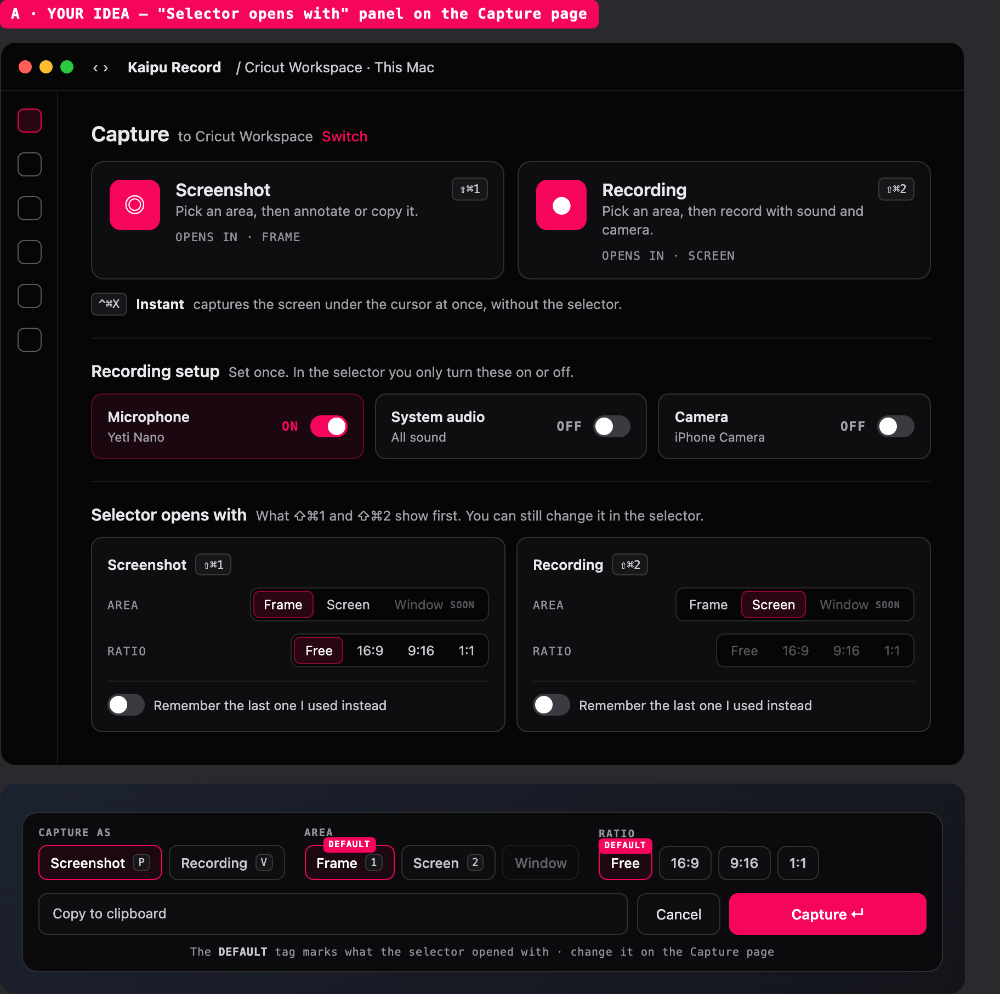
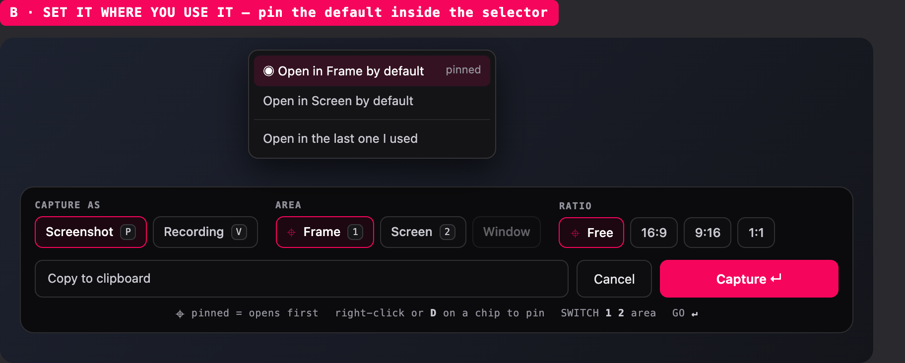
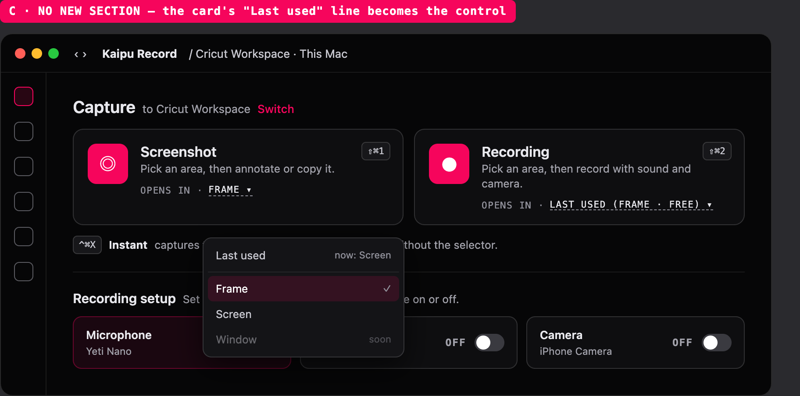

# Capture — choose and show the default area

> **Status: 🔵 Proposed.** Design options only, no code. The owner picks one (or a mix)
> before anything is built. Mock source: `src/assets/capture-default-mode/mock.html`.

## Summary

Today ⇧⌘1 and ⇧⌘2 open the selector in the **last used** area, one memory per intent
(screenshot and recording are separate), and the recording one also remembers the
Frame ratio. The Capture page shows that memory as a read-only line on each card
("LAST USED · FRAME"). Nothing lets the person choose a fixed default, and nothing in
the selector says which chip was pre-selected or why.

| Option        | Where the choice lives                              | Where the default shows                    | Cost                                |
| ------------- | --------------------------------------------------- | ------------------------------------------ | ----------------------------------- |
| A — your idea | New "Selector opens with" panel on the Capture page | Panel + a DEFAULT tag on the selector chip | New section, new setting per intent |
| B             | Inside the selector: pin a chip                     | Pin icon on the chip                       | Hidden gesture (right-click / D)    |
| C             | The card's "Last used" line becomes a dropdown      | The card line + (optionally) the A tag     | Smallest: reuses an existing slot   |
| D             | Nowhere: one shortcut per area                      | The shortcuts themselves                   | A new global shortcut (⇧⌘3)         |

**Recommendation: C, with the DEFAULT tag from A in the selector.** It answers both
halves of the request (pick it, and see it) without adding a section to a page that
already has three, and it keeps "Last used" as the first option, so nobody's current
behaviour changes until they choose.

## What comparable tools do

- **macOS Screenshot (⇧⌘5)** keeps the choice inside the capture toolbar: Options ▸
  "Remember Last Selection", and the toolbar highlights the last mode the next time
  it opens ([Apple support](https://support.apple.com/en-asia/guide/mac-help/mh26782),
  [MacMost](https://macmost.com/live-using-the-screenshot-tool-on-your-mac.html)).
  macOS also splits areas by key: ⇧⌘3 whole screen, ⇧⌘4 area.
- **CleanShot X** remembers the last area and exposes "Capture Previous Area" as its own
  action/shortcut rather than a default toggle
  ([CleanShot features](https://cleanshot.com/features),
  [shortcut list](https://www.pie-menu.com/shortcuts/cleanshot)).
- **Snagit** has no "default" toggle either: the global shortcut uses whatever the
  Capture window is set to, and saved presets get their own shortcuts
  ([Snagit presets](https://www.techsmith.com/learn/tutorials/snagit/presets),
  [capture hotkeys](https://www.techsmith.com/learn/tutorials/snagit/change-global-hotkey/)).

So users coming from these tools expect either "it remembers" (all three) or "a
different key for a different area" (macOS, Snagit). None of them uses a separate
settings panel for this. A and C are new to them; B and D match what they know.

## A — Your idea: a "Selector opens with" panel

A panel below Recording setup, one box per intent: Area (Frame / Screen / Window soon),
Ratio for Frame, and a "Remember the last one I used instead" switch. In the selector,
a small **DEFAULT** tag sits on the chips the selector opened with, so the person can
tell "this is what I chose" from "this is what I clicked last time".

- **For:** everything about capture lives on one page and is explicit; the tag answers
  "why did it open in Frame?".
- **Against:** a third section on the page, with a ratio row that is only meaningful
  for Frame; and it duplicates the card's "LAST USED" line, which now has to say
  "Opens in" to stay true.

## B — Set it where you use it: pin inside the selector

Right-click a chip (or press D on it) to pin it; a pinned chip carries a small pin icon
and is what the selector opens with next time. "Open in the last one I used" is the
third menu entry.

- **Why it should be this way:** the moment someone notices "I always switch to
  Screen" is inside the selector, not on the Capture page. macOS puts its "Remember
  Last Selection" exactly there, so it is where a Mac user looks.
- **Against:** right-click and a letter key are invisible until someone tells you;
  the hint row helps, but it is the least discoverable of the four.

## C — No new section: the card line becomes the control (recommended)

The cards already show "LAST USED · FRAME". Rename it to "OPENS IN · Frame ▾" and make
it a dropdown: **Last used** (with the current value) / Frame / Screen / Window (soon).
Screenshot and Recording keep separate defaults, because they already have separate
cards and separate memories.

- **Why it should be this way:** the slot exists, it is already where the person reads
  the default, and it sits next to the shortcut it affects (⇧⌘1 / ⇧⌘2). No layout
  change, no new section pushing Recording setup down, and "Last used" first keeps
  today's behaviour for everyone who never opens the menu.
- **Against:** a small dashed underline is a quiet affordance; the ratio is not
  chooseable here (it stays "last used"). Pair it with A's DEFAULT tag in the selector
  so the default is also visible where the capture happens.

## D — Remove the question: one shortcut per area

⇧⌘1 / ⇧⌘2 always open the selector in Frame, with the last box and ratio. Whole screen
does not need a box, so it does not need the selector: screenshots already have it
(Instant, ^⌘X), and recordings get ⇧⌘3 (countdown, then record).

- **Why it should be this way:** a "default" exists only because one key serves two
  areas. macOS has trained Mac users on ⇧⌘3 = whole screen, ⇧⌘4 = area for twenty
  years. The selector then has one job (drawing a box) and the whole-screen path gets
  faster, not just pre-selected.
- **Against:** one more global shortcut to register and to avoid conflicts with
  (⇧⌘3 is the macOS screenshot key, so it would need a different default or an
  opt-in); the Screen chip in the selector becomes a rarely used escape hatch.

## Open questions

1. Should the default be per intent (screenshot vs recording), as today's memory is?
   All four mocks assume yes.
2. Should the ratio be part of the default, or keep remembering the last one? Only A
   lets the person pick it.
3. Where does the setting live in storage: next to the existing remembered mode in
   main (one field per intent: `"last" | CaptureMode`)? To check before building.

## Out of scope

- Window capture (still "soon").
- Changing what Instant (^⌘X) does.
