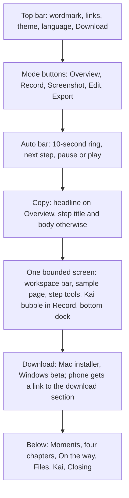
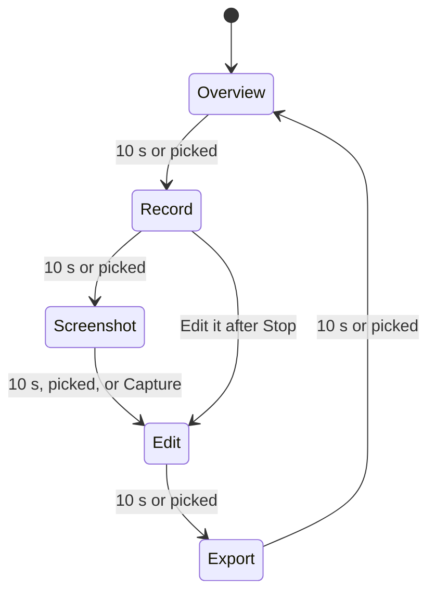

# Interactive landing hero

**Status: 🟢 Ready for owner validation · 2026-11-21.** Implemented on branch `landing-interactive-hero-stage`, integrated with current `main`. Code is committed; production release remains pending. This page preserves the approved design and diagrams.

## Summary

The home page opens with one interactive demo. The page's own content is the screen: Record films it, Screenshot selects from it, Edit annotates and trims it, and Export packages it. A visitor picks a step or watches the demo play itself every 10 seconds. Recording, capture, editing and export actions are simulated; download links open the real installer. The demo never requests a camera, microphone or screen, never reads or writes files, and never uploads anything.

The hero, the top bar, the mobile sticky download and Kai's position changed. The other sections keep their content.

## Owner-approved decisions

| Decision                                                                                                                                 | Why                                                                                            | Record                                       |
| ---------------------------------------------------------------------------------------------------------------------------------------- | ---------------------------------------------------------------------------------------------- | -------------------------------------------- |
| One screen. Record, Screenshot, Edit and Export all act on the hero's own content, not on separate miniature widgets.                    | The owner rejected disconnected widgets on desktop.                                            | None                                         |
| The promise is "From your screen. To the world." (ES "De tu pantalla. Al mundo."). "world" ("mundo") carries a Kaipu-pink marker stroke. | Owner-approved landing promise.                                                                | [Brand identity](/marketing/brand-identity/) |
| The demo advances Overview, Record, Screenshot, Edit, Export every 10 seconds, with pause and resume. A visitor's pick always wins.      | Owner-approved polish.                                                                         | None                                         |
| Kai is the simulated webcam presenter in the Record step. Kai's section sits after Files and before Closing.                             | The owner wanted feature chapters before the Kai story, with the origin story unchanged.       | [Brand identity](/marketing/brand-identity/) |
| Export destinations mirror the desktop app. An export produces a file the visitor takes elsewhere. Nothing is uploaded.                  | Owner-approved: richer destinations based on the desktop app, with no direct publishing claim. | None                                         |
| Workspaces are a simulated folder choice (Personal or Work).                                                                             | Makes workspace folders understandable without touching the visitor's files.                   | None                                         |

The owner has said the supplied details are enough to implement. No further design input is pending.

## Layout

The diagram shows reading order in the DOM, not exact columns. Desktop columns are set in `apps/web-hono/src/components/home/hero.module.css`.

- The home page turns off the chapter rail (`chapterNav={false}`) to avoid duplicate navigation.
- The Product link was removed from the top bar, because the wordmark already returns home.
- On a phone, the copy and download buttons come before the compact screen.
- The sticky download button is hidden while the hero is in view and returns below it. This is a parent adjustment after the mobile Export check. It was not in the owner's approval list.

## Mode flow

Any mode button switches to that mode at once, from any state, and restarts the 10-second countdown. Capture in Screenshot opens the image editor on that capture.

## Behaviour by step

**Overview.** The brand statement is the headline. "world" has a pink marker stroke behind it. Each part of the headline is its own message key, so a language can move the marker to the word that carries the idea. Subtle motion: selection corners, a cursor and a capture scan. Reduced motion shows the static version. No sample screen is shown.

**Record.** The sample page is the recorded screen. Kai (the plain fox artwork) sits in a circular bubble, standing in for the webcam. A timer counts up. Pause and resume, Stop, and the microphone and camera toggles change local state only. After Stop, the demo shows "Saved in {folder} · {time}", with Edit it (opens the video editor) and Record again. The workspace cannot be switched while a recording is live or paused.

**Screenshot.** Drag over the sample page to choose an area. A click or a tiny drag keeps a default area. Full screen is the other choice. Capture opens the image editor with that selection. The selection shows its size in pixels on a sample 1920 × 1080 screen.

**Edit.** Two tools. Image: pencil, arrow and text, with undo and reset; arrows shorter than a small threshold are dropped. Video: a 30-second sample clip with start and end handles (each keeps at least 2 seconds), a playhead, and play. Marks and trim persist across steps until reset.

**Export.** Destinations come from the desktop app's groups:

- YouTube, at 1440p or 4K.
- Reels · TikTok · Shorts, at 9:16.
- LinkedIn · Feeds, at 1:1.
- GitHub · Jira · Linear, the Light tier.
- Slack · Discord · Email, the Balanced tier.
- Archive copy, full quality, no size estimate.
- Custom: MP4, GIF or PNG at 1080p, 1440p or 4K.

Format and resolution update the estimated size. Export runs a simulated progress bar and then shows "Added to {workspace} · {folder}". Nothing is written or uploaded.

**Workspaces.** Two choices, Personal and Work. The demo shows the active workspace's folder in the workspace bar and in the save and export messages. The default is `~/Movies/Kaipu Record`, and Work is `~/Movies/Kaipu Record — Work`. Switching is locked while a recording is in progress or an export is running.

**Auto demo.**

- A countdown ring shows the seconds left and the next step. A pause or play button sits beside it.
- Holds stop the countdown. A hold ends, or the step changes, and a full 10 seconds starts again.
  - Pointer down on the demo, or a mouse hovering over the screen.
  - Keyboard focus inside the demo, or on the mode buttons.
  - The workspace menu is open.
  - Record is paused or stopped.
  - Screenshot has a selection other than the default.
  - Edit has marks, a trimmed clip, or a clip playing.
  - Export is working or done.
- Away: the tab is hidden, or less than 15 % of the hero is visible. The countdown does not run.
- Reduced motion starts the demo paused. The visitor can press play.

## Simulated boundary and figures

- No camera, microphone, screen, file, upload or publish access. Recording is a timer. Saving is a message.
- Every figure is sample data or an estimate: the 1920 × 1080 screen, the 30-second clip, file sizes and destination sizes. They come from the app's rules, not from measurements.
- A size estimate is not a guarantee that a platform accepts the file. The demo uses the app's own GitHub limits, 10 MB on Free and 100 MB on paid plans (decimal MB), as constants. It does not confirm them against GitHub.
- The demo label reads "Interactive demo".
- The demo makes no direct-publishing claim for YouTube, GitHub, Jira or Linear.

## App sources for the demo's facts

- `apps/kaipu-record/src/renderer/src/features/prepare/destinations.ts`: destinations and groups. Email is its own row here.
- `apps/kaipu-record/src/renderer/src/features/video-editor/export/export-presets.ts`: presets, bitrates and GitHub limits.
- `apps/kaipu-record/src/main/workspaces/registry.ts`: workspace folders and the active one.
- `apps/web-hono/src/components/home/hero-stage-model.ts`: the demo's pure rules (trim, estimates and destination figures). These copy the values above.

**Known deviation.** The demo puts email under the chat row ("Slack · Discord · Email", ES "Correo") instead of giving it its own row. The preset is the same, Balanced. Jira and Linear appear only as examples in the lightweight-file group, which is how the desktop module describes them.

Copy lives under `landing.homeStage*` in `packages/i18n/messages/{en,es}.json`. Those catalogs hold the wording. This page does not keep a second copy.

## Sample page download

The sample page's download is a real `DownloadLink` in Record, Edit video and Export, using `downloadUrls.macArm64`, `target="_blank"` and `rel="noopener noreferrer"`. The original page and demo stay open. Analytics uses the `hero-demo` placement.

Screenshot and Edit image keep the sample pill decorative because those surfaces handle selection and drawing. The main hero downloads remain real links in every mode.

Parent verification through the public tunnel intercepted the `.dmg` request without downloading the binary. The installer URL was `https://updates.kaipu.app/download/latest/kaipu-arm64.dmg`; the original page remained on the demo and Pause still changed to Resume.

## Verification

Each row names who ran the check. "This pass" is the docs-only work that produced this page. The other rows were run earlier, by the parent agent or an implementation worker, and were not rerun for this page.

| Check                                                                                                         | Result                                                                             | Source                           |
| ------------------------------------------------------------------------------------------------------------- | ---------------------------------------------------------------------------------- | -------------------------------- |
| `bun run check-types` in `apps/web-hono`                                                                      | exit 0, after the last mobile correction                                           | Parent, 2026-11-21               |
| `bun run build` in `apps/web-hono`                                                                            | exit 0, after the last mobile correction                                           | Parent, 2026-11-21               |
| Web tests (423 passing, 49 files) after merging current main; earlier i18n tests (22 passing)                 | Web: exit 0 on M5 and Mac mini at commit `9d0168309`; i18n: worker-reported exit 0 | Parent and earlier worker report |
| `git diff --check`                                                                                            | exit 0                                                                             | Parent, after the polish         |
| Public tunnel: Export, then GitHub, Jira and Linear selected; document width 390 px on a 390 px phone         | observed                                                                           | Parent, after the polish         |
| Captures inspected: desktop Record, Screenshot and Edit (second iteration); corrected desktop Export (polish) | inspected                                                                          | Parent                           |
| Mobile Export recaptured through the tunnel after the sticky-download change                                  | recaptured                                                                         | Parent                           |
| Docs site build, `bun run build` in `apps/documentation`                                                      | exit 0, 452 pages; only warning: sitemap skipped (no `site` option)                | This pass                        |

The tunnel and the dev server on `localhost:3002` are temporary. Neither is evidence of a production deployment.

**Captures.** `.evidence/landing-polish/` holds `export-desktop.png`, `export-mobile-stage.png` and `export-mobile.png`. Captures from earlier iterations are not in this worktree.

**Final viewport verification:** parent measured Overview at 1440×900, 1366×768, 1280×800 and 2000×1250 after the merge. The footnote bottom was respectively 852.875, 720.875, 752.875 and 1077.875 px, inside each viewport. Implementation worker also measured all five modes at those sizes. The headline size is retained. Short desktop Export panels scroll their options while keeping the export action visible.

**Mac mini validation:** a clean tracked-source archive of `9d0168309` passed web types, all 423 web tests and production build (exit 0). The validation ran in an isolated temporary directory without changing the mini's existing checkout or copying generated environments. The repository has no `validate_on_mini.sh`, so equivalent web-only checks ran directly.

**Implementation choices:** live recording advances after 10 seconds as part of the requested automatic demonstration. Explicit pause, stopped recording and visitor interactions hold it. Email is grouped with chat in the compact demo because both use the same preset. The mobile sticky download remains hidden while the hero is visible, keeping its controls usable. These are recorded implementation choices, not questions requiring another design round.

**Still open:** rendered Mermaid visual review; full keyboard/language/theme browser audit; final owner acceptance and production release validation. Diagram syntax checking and docs build are recorded separately from visual review.

## Out of scope

- Real capture, uploads, file access and publishing integrations (YouTube, GitHub, Jira, Linear).
- Changes to the rest of the home page, beyond Kai's position.
- Any claim that a platform accepts an exported file.

## Review hardening

The final interaction fixes release stale keyboard/hover holds after removed controls, keep export progress inside its visible footer, prevent hiding an active export, and preserve the original destination of completed recordings and exports when the active workspace changes. On touch devices, the image canvas scrolls until a drawing tool is explicitly selected. Both outer and sample download links switch at 980px: smaller viewports navigate to the download section; desktop sample links open the installer separately.

The independent review used Wachiman and a second-provider Codex pass. The concrete findings were addressed with regression tests; local-only review logs and the ledger are outside the source tree. Final check results belong to the delivery report rather than a second live status tracker in this design page.

## Mobile presentation iteration — implemented locally for owner validation

The owner annotated the phone layout: the demo label, tab row and verbose countdown consume the first screen, while the actual product preview sits below the download action and a long Mac-installation note. A mobile visitor must first understand that Kaipu captures screens and edits videos and images.

The next mobile composition puts explicit product/category copy first, uses a compact feature grid as the mode selector, gives the interactive screen nearly the phone's full width, and places the download-options CTA after the demonstration. The countdown becomes a small secondary control rather than a separate headline-sized band. Desktop keeps its reviewed stage, layout and compatibility-footnote fit. Mobile Overview should expose a useful product preview immediately.

Acceptance: inspect first viewports at 360, 390, 400 and 430px (plus a narrow320px overflow check); show meaningful product content before scrolling past a large CTA; keep touch/keyboard interactions, autoplay holds, workspace/export snapshots and locale parity; no horizontal overflow. The implementation keeps one mode-control tree and restyles it into a 2×2 feature grid below 1080px. Mobile has stable localized category/title, a compact ring/pause control, a near-full-width screen and the CTA below it. Overview gets a decorative product preview with no interactive controls or timers; the actual steps remain interactive. Desktop retains its original overview and tabs.

Mobile implementation worker reported all 451 web tests and 22 i18n tests passing, types exit 0 and touched-file lint/format clean. Browser captures cover English at 360/390/400px and Spanish at 390px. The stage starts at 348px on 390×844 and 337px on 400×844; no horizontal overflow was observed from 320 to 430px. Export remains taller to preserve its complete options. Parent inspected mobile Overview in English/Spanish and mobile Export, and reran the production build. New mobile changes remain uncommitted during this owner-preview iteration.

Mobile CTA correction: the owner noted that the page does not send a link. The button now says “View downloads” / “Ver descargas”, uses a download icon and navigates to the existing `#download` options. The note names Mac and Windows beta, without promising email delivery.
