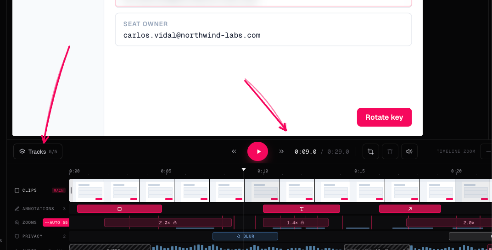
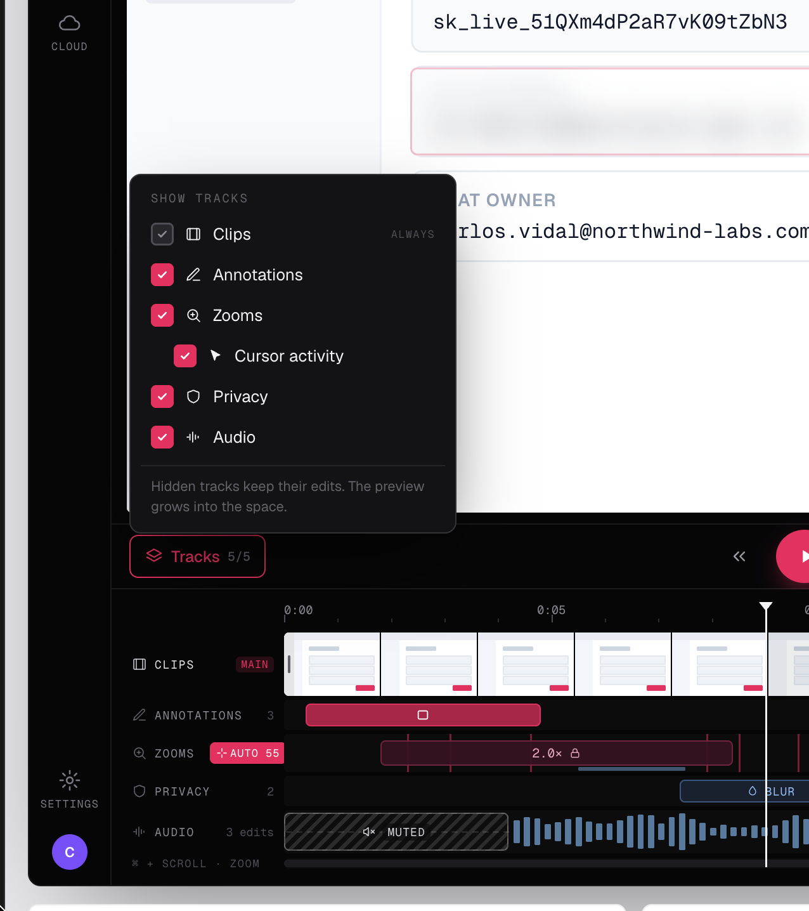
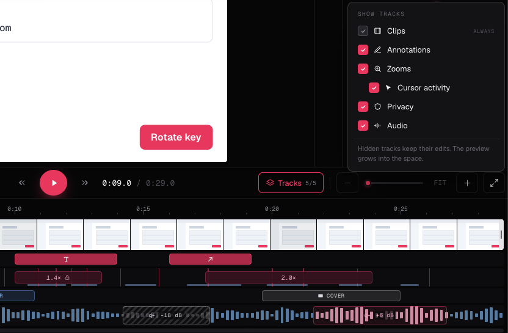

# Editor transport bar, Tracks popover, speed, timeline zoom and backgrounds — design

**Status: 🔵 Proposed · 2026-11-06.** Owner decisions taken on 2026-11-06 over three mocks (below);
nothing is implemented. Ticket:
[NIW2-663](https://linear.app/niway/issue/NIW2-663/video-editor-transport-bar-with-cutdeletemutespeed-tracks-popover),
which absorbs [NIW2-610](https://linear.app/niway/issue/NIW2-610/video-editor-zoom-the-timeline-with-horizontal-scroll)
(timeline zoom) and [NIW2-612](https://linear.app/niway/issue/NIW2-612/video-editor-choose-which-timeline-lanes-are-visible)
(visible lanes). ADRs:
[0050](/architecture/decisions/0050-track-visibility-is-view-state-hidden-lanes-keep-their-edits/)
(track visibility is view state; amends 0040) and
[0051](/architecture/decisions/0051-the-video-background-is-the-screenshot-beautify-drawn-as-the-outermost-step/)
(backgrounds, new).

The [timeline v2 design](/specs/2026-10-31-editor-timeline-v2-design/) (2026-10-31) is **parked**
by the owner's decision of 2026-11-06. This design does not build on it and does not block it;
where the two overlap (which lanes show, Activity inside Zooms) section 8 says what v2 would have
to take from here.

## Summary (one minute)

The editor's actions today are split three ways: undo/redo, Add image, split, delete and Export
in the title bar; the tool groups on a rail beside the video; mute, play, the time and fullscreen
on a transport bar under the video. The owner wants **everything that acts on the timeline next to
play**, the header kept for the global actions, and the vertical space of the video protected as
lanes keep arriving. Five things change, each its own PR in one stack. **Transport bar**: a
`Tracks n/m` trigger on the left; rewind, play, forward and the time in the centre; split, delete,
mute and a speed button on the right, then the timeline zoom and fullscreen. **Tracks popover**:
one checkbox per lane the recording has, Clips always on, "Cursor activity" nested under Zooms;
hiding a lane changes nothing in the preview or the export, only what the timeline draws, and the
choice is remembered per user. **Speed**: 0.5× to 2× on the preview only. **Timeline zoom**: 1×
fits the recording as today; above it every lane stretches together, scrolls together and follows
the playhead. **Backgrounds**: the screenshot editor's presets and its padding, radius and shadow,
drawn behind the composed picture as the outermost step of the preview, the MP4 and the GIF, saved
in the session, and part of the export fingerprint.

| #   | Decision                                                                                                                                                                                                                                                                                        | Why                                                                                                                                                                                                                                                      | ADR         |
| --- | ----------------------------------------------------------------------------------------------------------------------------------------------------------------------------------------------------------------------------------------------------------------------------------------------- | -------------------------------------------------------------------------------------------------------------------------------------------------------------------------------------------------------------------------------------------------------- | ----------- |
| 1   | **Five PRs in one stack, in this order**: (1) transport bar, (2) Tracks popover, (3) speed, (4) timeline zoom, (5) backgrounds. Each merges bottom-up on its own.                                                                                                                               | Owner: "varios PR uno tras otro en un stack". (1) is pure layout and every later PR adds a control to it; (5) is the only one that touches the composer, so it goes last and cannot block the rest.                                                      | —           |
| 2   | **Timeline actions live on the transport bar; global actions stay in the header.** Split, delete, mute and speed move next to play. Undo/redo, Add image and Export stay in the title bar. The tool rail (select, annotate, zoom, privacy, audio, camera, cursor) does not move.                | Owner gap 2: "los que son globales puedes dejarlos arriba". Split and delete act on the playhead and the selection, which is the timeline's state; the rail is for adding things, not acting on them.                                                    | —           |
| 3   | **Track visibility is view state, per user, not part of the scene.** Hiding a lane never changes the preview or the export; the edits stay drawn and burned in. Clips cannot be hidden. The set is saved in the app's settings store under `editor.hiddenTracks`, keyed by lane key.            | Owner gap 3 and the mock's own copy: "Hidden tracks keep their edits." NIW2-612 asked for the same. This differs from timeline v2's `removedTracks` (edits hidden from the export); that model is parked with that spec.                                 | 0050 (new)  |
| 4   | **Audio is hideable; mute stays a separate control.** The Audio lane joins the popover like any other. Hiding it hides the mute ranges from the timeline only.                                                                                                                                  | Owner gap 3: "ponerle mute". ADR 0040 said Audio is always shown; 0050 amends that line.                                                                                                                                                                 | 0050        |
| 5   | **"Cursor activity" is a child of Zooms** and means the activity marks. Unchecking it hides the marks; unchecking Zooms hides both. The Activity lane row disappears: the marks draw inside the Zooms lane, under the blocks.                                                                   | Owner gap 4 ("supongo") and the mock. The marks explain where auto-zooms come from and mean nothing without the zooms. Folding the row in is the one thing taken from timeline v2's decision 9, because the mock already shows it.                       | 0050        |
| 6   | **A lane a user turns on stays on, even when empty.** The trigger's `n/m` counts visible lanes over the lanes this recording has (Webcam only with a camera, Zooms always, Activity only with a cursor track).                                                                                  | Owner gap 5. View state has no reason to second-guess the user; the count is honest about what can be shown.                                                                                                                                             | 0050        |
| 7   | **Playback speed is preview-only**: 0.5×, 1×, 1.5×, 2× on a cycling button next to mute, applied as `video.playbackRate` and as a multiplier on the slide clock. Not saved in the session; resets to 1× on open.                                                                                | Owner: "un botón de velocidad para tener un x2 … para que pase rápido o más lento el video con el timeline". The export has no speed; the file plays at 1× and nothing in the request says otherwise. A saved speed would surprise the next open.        | —           |
| 8   | **Timeline zoom is a pixels-per-second scale plus a scroll offset**, kept in one `TimelineView` object every lane reads. 1× = fit; max = 1 s ≥ 240 px. `−`, slider, `FIT`, `+` on the transport bar; ⌘/Ctrl + scroll zooms around the pointer; plain horizontal scroll pans; playback follows.  | NIW2-610 verbatim. One conversion in one place is what keeps a drag at 4× landing on the time under the pointer; every lane already receives a shared `layout`, so a shared view is the same shape.                                                      | —           |
| 9   | **The background is a scene field** `scene.background: VideoBackground` with the screenshot editor's `BackgroundId`, `padding`, `radius` and `shadow`, default `none / 0 / 0 / 0` (today's picture). Saved in the session additively (version 1 stays).                                         | Owner gap 6: "que sean los mismos para hacerlo bonito". It is content, not view: the export draws it, so it is part of the edit like a zoom. Additive like `webcam` and `cursor`.                                                                        | 0051 (new)  |
| 10  | **The background is drawn as the outermost step**: `frame → redactions → annotations → zoom crop → framing → webcam → background`. The composed picture is inset by the padding, clipped to the radius, given the shadow, and the background fills the rest of the output canvas.               | Owner gap 7: the order stays. Everything the editor already draws is a picture; the background is a frame around that picture, as the screenshot compositor does it (`bg + padding + shot`). Putting it anywhere earlier would zoom or crop the padding. | 0051        |
| 11  | **The padding keeps the output size and shrinks the picture.** A 1920×1080 preset stays 1920×1080; with padding the picture inside is smaller. Fixed-canvas presets (Vertical, Square) apply the background on their target canvas, replacing the black or blurred letterbox when `bg ≠ none`.  | The output size is the preset's promise (YouTube 1440p, Square). Growing the canvas would break every preset's size and the size meter. The letterbox is already a background; the user's choice wins over the default one.                              | 0051        |
| 12  | **Preview and export share one pure geometry** `backgroundFrame(bg, outputW, outputH) → { pictureRect, radius, shadow }`; the preview draws it with CSS on the stage, the composer with canvas, both from the same numbers, scaled like the screenshot compositor scales display px to natural. | The screenshot editor already keeps a preview and a compositor in step with one model (`backgrounds.ts`, `compositor.ts`); the video editor reuses the model and the rule.                                                                               | 0051        |
| 13  | **Export reuse**: `BACKGROUND_COMPOSE_REVISION = "bg1"` is added to the edit fingerprint when `bg ≠ none`. With `bg = none` the three numbers are kept but not drawn, the sliders are disabled, and the scene fingerprints exactly as today.                                                    | Same rule as `wc2` and `cursor3`: an export made before the background existed must not be reused for a scene that has one, and a plain scene must keep matching its old exports.                                                                        | reuses 0003 |
| 14  | **The Tracks popover and the background panel are the two new UI areas**, declared in `ui-map.ts` (`editorVideo.tracksPopover`, `editorVideo.background`) with catalog states, per ADR 0046. Transport gains `speed` and `zoomed` states.                                                       | Every desktop UI PR declares its areas and states; the catalog is how the owner QAs without a build.                                                                                                                                                     | reuses 0046 |

## Open questions

Defaulted on 2026-11-06; each stands unless its "revisit if" triggers.

1. **Speed values.** 0.5×, 1×, 1.5×, 2×. Revisit if the owner wants 0.25× for frame-accurate
   work or 3×+ for skimming; the list is a constant.
2. **Where the background controls live.** Default: a "Background" section at the top of the
   inspector when nothing is selected (where Detection lives today), with the swatches and the
   three sliders of the screenshot editor's beautify panel. Revisit if the owner wants it as a
   tool on the rail or as a transport-bar button like the mock's arrows suggest; the panel is the
   same component either way.
3. **Whether the webcam sits inside or outside the padding.** Default: inside (it is composed
   before the background, so it shrinks with the picture and never covers the padding). Revisit
   if the owner wants the bubble over the background edge, which means moving it after the
   background and adjusting `clampWebcamCenter`.
4. **Persistence key for hidden tracks.** Default: per user, in the settings store, like
   NIW2-612 asked. Revisit if the owner wants it per recording; then it goes to the session as
   view state the parser ignores on export.
5. **Timeline zoom maximum.** Default: 240 px per second (a 30 fps frame is 8 px). Revisit after
   trying it on a 10-minute recording; the maximum is a constant.
6. **Rewind/forward buttons.** Default: skip 5 s, and ⇧ skips to the previous/next cut. Revisit if
   the owner prefers frame stepping on the buttons (the keyboard keeps ←/→ for frames).

## Out of scope

- Timeline v2's camera sections, transitions, media overlays and `removedTracks` (parked spec).
- Export speed (a 2× file), speed ramps, or saving the preview speed.
- Custom colours, image or blurred-video wallpapers, per-clip backgrounds, animated backgrounds.
- A background that changes the output size or aspect.
- Reordering lanes, lane heights, collapsing lanes to a thin bar.
- Vertical zoom, minimap, or zoom presets beyond `FIT`.
- Moving the tool rail, undo/redo, Add image or Export.

## Failures this must protect against

Input for tests; each line is at least one test.

1. Hiding a lane changes the export or the preview → `export-plan.ts` and the preview never read
   `hiddenTracks`; a test exports the same plan with every lane hidden and with none.
2. A selection lands on a hidden lane and goes invisible (zoom clicked on the preview, Delete on
   the keyboard) → the lane is shown again when an item on it is selected; test on the page's
   `selectKind` wiring.
3. Clips hidden by a stale setting → the parser of `editor.hiddenTracks` drops `clips` and
   unknown keys.
4. `n/m` counts a lane the recording cannot show → the count is over `availableTracks({ hasCursorTrack,
hasWebcam })`, tested for a take without camera and without cursor track.
5. The activity marks survive Zooms being hidden → marks render inside `ZoomLane`, so there is
   nothing to draw when the lane is gone; the "Cursor activity" checkbox is disabled, not
   changed, while Zooms is off, so the stored choice survives.
6. Speed leaks into the export → `ExportPlan` has no speed field; the composer and the workers
   never read the playback hook. Test: exporting at 2× produces the same plan as at 1×.
7. Speed and slides disagree → the slide clock multiplies elapsed wall time by the speed; a 3 s
   slide at 2× holds 1.5 s of wall time; test on `usePreviewPlayback` with a fake clock.
8. A seek while at 2× resets the rate → `playbackRate` is reapplied after every `src` change and
   on `loadedmetadata`; test that the rate survives entering and leaving a slide.
9. A drag at 4× moves by the 1× amount → every `clientX → time` conversion goes through
   `TimelineView.timeAt(clientX)`; a test with `scale = 4, scroll = 120` for trim, edge drag,
   window change and seek.
10. The playhead leaves the visible window while playing → the strip scrolls when the playhead
    passes 80 % of the visible width; test on the pure `followPlayhead(view, t)`.
11. Zoom around the pointer drifts → `zoomAt(view, factor, anchorClientX)` keeps the time under
    the pointer at the same pixel; tested at the left edge, the centre and the right edge.
12. Thumbnails gap at high zoom → `thumbnailsForRange` takes the visible range and the scale, and
    asks for more tiles as the block widens; test that no visible block has a gap over 72 px.
13. Preview and export disagree on the picture rect → one `backgroundFrame()`; a test samples it
    at 1920×1080, 1080×1920 and 1080×1080 and compares the composer's draw call against the
    preview's CSS values.
14. The padding is zoomed or cropped → the composer applies the background after `framing` and
    after the webcam, on the final canvas; a quality test with a 2× zoom checks the padding
    pixels are the background colour at every corner.
15. A fixed-canvas preset keeps its letterbox under a background → with `bg ≠ none` the framer's
    `padding: "black" | "blur"` is bypassed and the background paints; `bg = none` keeps today's
    letterbox byte for byte.
16. An old export is reused for a scene with a background → `bg1` in the fingerprint; a plain
    scene's fingerprint is unchanged (snapshot test on both).
17. A session with a wrong background shape crashes the parser → unknown `bg` → `none`; numbers
    clamped to `PADDING_RANGE`, `RADIUS_RANGE` and `SHADOW_RANGE` (the screenshot editor's
    constants, reused, not copied); non-finite → 0; absent → the default.
18. The GIF ignores the background → the GIF worker uses the same composer; a GIF frame test
    checks a corner pixel.
19. A new lane added later eats the video's height → `availableTracks` is the one list a new lane
    registers in, and a new lane is hidden by default unless its PR argues otherwise; test that
    an unknown lane key defaults to hidden.

## Acceptance criteria

PR 1 — transport bar:

- [ ] The transport bar shows, left to right: `Tracks n/m` (disabled, PR 2 enables it), rewind,
      play/pause, forward, `0:09.0 / 0:29.0`, split, delete, mute, fullscreen.
- [ ] Split and delete are gone from the title bar; undo/redo, Add image and Export are still
      there; the tool rail is unchanged.
- [ ] Split and delete keep their shortcuts, disabled states and `aria-label`s; the Delete-key
      fix of NIW2-659 still passes.
- [ ] The play button stays optically centred at 1180 px and 1440 px with every control shown.
- [ ] Rewind/forward skip 5 s; ⇧ + rewind/forward jump to the previous/next cut.

PR 2 — Tracks popover:

- [ ] On a take with a cursor track and no camera, `Tracks 6/6` opens "Show tracks" with Clips
      (checked, disabled, "Always"), Annotations, Zooms, Cursor activity (nested), Privacy and
      Audio; Webcam is listed only when the take has a camera; without a cursor track the trigger
      reads `5/5` and Cursor activity is absent.
- [ ] Unchecking Zooms hides the lane and the marks; the preview still zooms; the export is
      byte-identical to the one with the lane shown.
- [ ] The trigger reads `4/6` after hiding two lanes; closing and reopening the editor keeps
      them hidden; a different recording shows the same choice.
- [ ] Clicking a zoom on the preview while Zooms is hidden shows the lane again, selected.
- [ ] The Activity row is gone; its marks draw under the zoom blocks.

PR 3 — speed:

- [ ] A `1×` button next to mute cycles 1× → 1.5× → 2× → 0.5× → 1×; playback and the playhead
      follow; a slide holds `duration / speed` seconds.
- [ ] Reopening the editor starts at 1×; the exported MP4 plays at 1×.

PR 4 — timeline zoom:

- [ ] `−`, slider, `FIT`, `+` on the transport bar; `FIT` returns to 1× and scroll 0.
- [ ] At 4× every lane is 4× wider, scrolls together, labels stay fixed; ⌘ + scroll zooms around
      the pointer; horizontal scroll pans; while playing, the view follows the playhead.
- [ ] A trim at 4× lands on the time under the pointer; the thumbnail strip has no blank gaps.

PR 5 — backgrounds:

- [ ] The inspector (nothing selected) shows the nine swatches and the padding, radius and
      shadow sliders of the screenshot editor; `none` with zeros is the default and looks like
      today.
- [ ] Choosing `magenta`, padding 48, radius 16, shadow 24 shows the picture inset on a gradient
      in the preview; the MP4 (Balanced and Vertical) and the GIF show the same, pixel-sampled.
- [ ] A zoom, a blur and the camera stay inside the picture; the padding never zooms.
- [ ] An export made before PR 5 is not offered for reuse once a background is set; a plain scene
      keeps reusing its old export.
- [ ] Closing and reopening restores the background; an older build opens the session.

## 1. Where this comes from

### 1.1 The mocks and the owner's decisions

Three mocks (Claude Design, 2026-11-06), copied into the docs assets:







The owner's answers of 2026-11-06, cited by number in the table:

1. The "scenes dropdown" is the Tracks popover: a place to add or remove levels, because more
   levels are coming and none should take space from the video.
2. Add image stays up; the global actions stay up.
3. The volume button is mute; add a speed button for 2×.
4. "Cursor activity" under Zooms: yes.
5. `n/m` counts visible lanes; an empty lane the user enables stays enabled.
6. Backgrounds: the same ones as the screenshot editor.
7. Layer order: the one we have, top to bottom.
8. Ignore the previous (timeline v2) spec for now.
9. Follow the transport-bar mock (the first image).
10. Also: a timeline zoom, and a speed control.

### 1.2 What the repo already has

- `pages/video-editor/video-editor-page.tsx` renders the transport (`editorVideo.transport`, a
  `1fr auto 1fr` grid: mute | play | time + counts + fullscreen), the `EditorToolRail` beside the
  video, `EditorToolbar` into the header through `HeaderActions`, and `TimelineStrip` with
  `extraLanes` built inline: Activity (with a cursor track), Zooms, Webcam (with a camera),
  Privacy, Audio.
- `components/editor-toolbar.tsx`: undo, redo, Add image, split (`Scissors`), delete (`Trash2`),
  status chips, Export.
- `components/timeline-strip.tsx` and `timeline-geometry.ts`: the whole duration maps to the lane
  width (`timeToFraction` / `fractionToTime`); no scale, no scroll.
- `use-preview-playback.ts`: `play/pause/seek/toggleMute`; a wall-clock slide timer
  (`consumed` + `anchorAt`); no rate.
- `features/screenshots/beautify/backgrounds.ts`: `BACKGROUND_IDS`, `BACKGROUNDS` (css for the
  preview + `paint` for the canvas), `BeautifyState { bg, padding, radius, shadow }`,
  `frameRadius`, `DEFAULT_BEAUTIFY`; `beautify-panel.tsx` (swatches + three sliders);
  `annotations/compositor.ts` draws `bg + padding + shot` scaled from display px.
- `export/compose-output-frame.ts`: `createOutputComposer` with `framing?: OutputFraming`
  (`view` canvas → target canvas, `fit | fill`, `padding: "black" | "blur"`); the GIF worker uses
  the same composer. `export-reuse.ts` tags fingerprints with `cursor3` / `wc2`.
- `session.ts`: version 1, additive keys (`webcam`, `cursor`), invalid parts dropped singly.
- `shared/ui-map.ts`: `editorVideo` areas `transport { paused, playing }`, `toolbar`,
  `inspector`, `timeline`, lanes. ADR 0046 requires every new area and state to be declared.
- Linear: NIW2-610 (timeline zoom, with acceptance criteria this design adopts) and NIW2-612
  (visible lanes, per user, hide-only). Both are absorbed by NIW2-663.

### 1.3 What the state of the art does

- Screen Studio frames the recording on a wallpaper with a shadow around the picture
  ([Look & Feel](https://screen.studio/guide/background)); CANVID sets the gap between the
  recording and the background with a padding, and 0 % removes the background
  ([Video Background Editor](https://www.canvid.com/support/editing/video-background-editor)).
  Decision 11 is CANVID's rule: padding insets the picture inside a fixed canvas.
- Every desktop NLE (Premiere, Final Cut, CapCut, DaVinci) keeps split/delete on or next to the
  timeline and puts track visibility in a per-track toggle or a track menu, remembered per
  project or per app, never in the exported content. Decisions 2 and 3.
- Timeline zoom in those editors is a scale plus a scroll with ⌘/Ctrl + wheel around the pointer
  and follow-playhead while playing. Decision 8.

## 2. Transport bar (PR 1)

The bar keeps its three-column grid; the side clusters grow:

```
[ Tracks 5/5 ]                 « ▶ »  0:09.0 / 0:29.0                 ✂  🗑  🔈  1×  │  −  ●──  FIT  +  │  ⛶
```

- **Left**: the Tracks trigger (PR 2), then the zoom and privacy counts that live on the right
  today move here, so the right cluster holds only actions.
- **Centre**: rewind, play/pause, forward, the time. Rewind/forward skip 5 s; ⇧ jumps to the
  previous/next cut boundary (`layout` entries). Open question 6.
- **Right**: split, delete, mute, speed (PR 3), a separator, the timeline zoom (PR 4), a
  separator, fullscreen.

`EditorToolbar` loses `onSplit`, `splitDisabled`, `onDeleteSelected`, `deleteDisabled`; they move
to a new `TransportBar` component (`components/transport-bar.tsx`) that owns the whole row, so
the page stops rendering transport JSX inline. The shortcuts (`SPLIT_SHORTCUT`,
`editShortcuts().remove`) and the `isEditingTarget` guard from NIW2-659 are untouched: the
handlers only change the button they hang from. `uiArea("editorVideo.transport")` moves to the
component's root. The header keeps `editorVideo.toolbar` with undo/redo, Add image, status and
Export.

Width: at the editor's 1180 px floor, the right cluster is ~9 icon buttons plus the slider
(~380 px) and the left ~160 px; the centre needs ~220 px. It fits without compaction; if PR 4's
slider makes it tight, `useCompactRow` (the screenshot toolbar's hook) hides the slider and keeps
`−`/`+`.

## 3. Tracks popover (PR 2)

### 3.1 Model

```ts
// features/video-editor/tracks.ts — pure
export const TRACK_KEYS = ["clips", "annotations", "zooms", "activity", "webcam", "privacy", "audio"] as const;
export type TrackKey = (typeof TRACK_KEYS)[number];
/** Never hideable. */
export const ALWAYS_SHOWN: readonly TrackKey[] = ["clips"];
/** The lanes a recording can show, in lane order. */
export function availableTracks(input: { hasCursorTrack: boolean; hasWebcam: boolean }): TrackKey[];
/** Drops `clips` and unknown keys; keeps `activity` as stored (Zooms shown, marks off is a
 *  valid choice). While `zooms` is hidden the marks are hidden with it and the child checkbox
 *  is disabled, unchanged. */
export function parseHiddenTracks(raw: unknown): TrackKey[];
export function visibleCount(available: TrackKey[], hidden: TrackKey[]): { shown: number; total: number };
```

`activity` is a child: it appears only when `zooms` is visible and counts as its own row in `n/m`
when the take has a cursor track (the mock shows `5/5` for Clips, Annotations, Zooms, Privacy,
Audio with Cursor activity nested and not counted — the design counts rows the user can toggle
independently, so Cursor activity is counted when it exists; the trigger would read `6/6` on a
take with a cursor track). Open question: none; it is a count.

### 3.2 Persistence

`editor.hiddenTracks: TrackKey[]` in the app settings store (where `exportQuality` lives), read
through the existing settings hook, written on every toggle. Per user, not per recording
(NIW2-612 and open question 4). The session is untouched.

### 3.3 Behaviour

- The page filters `extraLanes` by key before passing them; Annotations is the overlay lane
  inside `TimelineStrip`, which gains a `showOverlays` prop. The Activity row is removed and
  `ZoomLane` gets `marks` and `showMarks`.
- Selecting an item whose lane is hidden (a zoom from the preview, a mute from a shortcut) calls
  `showTrack(key)` first, so the selection is never invisible (failure 2).
- The popover is a `ToolFlyout`-style menu anchored to the trigger: `role="menu"` with
  `menuitemcheckbox` rows, Esc closes, focus returns to the trigger. Footer copy: "Hidden tracks
  keep their edits. The preview grows into the space."
- i18n keys under `videoEditor`: `tracks`, `showTracks`, `trackAlways`, `trackCursorActivity`,
  `tracksHint`, in `en.json` and `es.json`.

## 4. Playback speed (PR 3)

`usePreviewPlayback` gains `speed: number` and `setSpeed(s)`. On a clip, `video.playbackRate =
speed`, reapplied on `loadedmetadata` and after every programmatic `src` change (failure 8). On a
slide, the rAF clock advances `(now − anchorAt) · speed` (failure 7). The time display, the
playhead and `subscribeTime` are unchanged because they read timeline time, which the rate already
scales. Muted ranges are evaluated per frame as today.

`SPEEDS = [0.5, 1, 1.5, 2]`; the button shows `1×` and cycles 1 → 1.5 → 2 → 0.5 → 1. Not saved.
Analytics: one event `editor_speed_changed { speed }`, because whether anyone uses 0.5× decides
open question 1.

## 5. Timeline zoom (PR 4)

### 5.1 Model

```ts
// components/timeline-view.ts — pure
export interface TimelineView {
  /** Pixels per timeline second. 1× = laneWidth / duration. */
  scale: number;
  /** Pixels scrolled from the start. 0 at 1×. */
  scroll: number;
  laneWidth: number;
  duration: number;
}
export const MAX_PX_PER_SECOND = 240;
export function fitView(laneWidth: number, duration: number): TimelineView;
export function timeAt(view: TimelineView, clientX: number, laneLeft: number): number;
export function xOf(view: TimelineView, t: number): number;
export function zoomAt(view: TimelineView, factor: number, anchorClientX: number, laneLeft: number): TimelineView;
export function panBy(view: TimelineView, dx: number): TimelineView;
export function followPlayhead(view: TimelineView, t: number): TimelineView;
export function visibleRange(view: TimelineView): { start: number; end: number };
```

`timeToFraction` / `fractionToTime` stay for callers that mean "fraction of the whole"; every
pointer conversion in `timeline-strip.tsx`, the lanes' edge drags, `onWindowChange` and the ruler
seek move to `timeAt` (failure 9). Blocks are positioned with `xOf`, so a lane's content is wider
than its cell and the cell scrolls (`overflow-x: auto` on the lanes column only; labels stay in
column 1). The ruler's ticks come from `visibleRange`.

### 5.2 Controls

`−` / `+` step the scale by √2 around the centre of the visible window; the slider maps
`[fit, MAX]` logarithmically; `FIT` resets. ⌘/Ctrl + wheel calls `zoomAt` around the pointer;
a horizontal wheel or a trackpad pan calls `panBy`. While playing, `followPlayhead` scrolls when
the playhead passes 80 % of the visible width, and stops following after the user pans until the
next play. The view lives in page state (not saved).

`thumbnailsForRange` takes the visible range and the scale, and the thumbnail hook requests tiles
for the visible blocks at the current width (failure 12).

## 6. Backgrounds (PR 5)

### 6.1 Model

```ts
// features/video-editor/background.ts — pure, worker-safe
import type { BackgroundId } from "../screenshots/beautify/backgrounds";
export interface VideoBackground {
  bg: BackgroundId;       // "none" = today's picture
  /** PADDING_RANGE (0–96), RADIUS_RANGE (0–28) and SHADOW_RANGE (0–100) from the screenshot
   *  editor, read at a 1080 px-high reference and scaled with the output (section 6.1). */
  padding: number;
  radius: number;
  shadow: number;
}
export const DEFAULT_BACKGROUND: VideoBackground = { bg: "none", padding: 0, radius: 0, shadow: 0 };
export function parseBackground(raw: unknown): VideoBackground;
/** `bg !== "none"`. With `none`, padding, radius and shadow are stored but never drawn (preview
 *  or export): the MP4 has no alpha, so there is nothing honest to paint around the picture. */
export function hasBackground(b: VideoBackground): boolean;
/** The picture's rectangle inside an output of w×h, plus the scaled radius and shadow. */
export function backgroundFrame(b: VideoBackground, w: number, h: number): { picture: Rect; radius: number; shadow: number };
```

`scene.background` is additive in session version 1; absent → the default (section 6.4). The
`BACKGROUNDS` table and `BackgroundPaint` are imported from the screenshot editor's
`backgrounds.ts` — the file has no DOM dependency, so the export worker can bundle it. If the
bundler pulls React in through that path, the table moves to `shared/backgrounds.ts` and both
editors import it; the ids and paints do not change.

`padding`, `radius` and `shadow` are expressed at a 1080 px-high reference and scaled by
`h / 1080` for any output, so a preset at 1440p shows the same proportions as the preview
(decision 12).

### 6.2 Composer

`createOutputComposer` gains `background?: VideoBackground`. When `hasBackground`:

1. The existing pipeline composes the picture exactly as today onto a **picture canvas** of the
   output size (for framed presets, the framer's target; otherwise `ctx`'s canvas).
2. The final canvas is filled with the background paint (solid, or the 135° gradient the
   screenshot compositor uses; `none` never reaches this step, see `hasBackground`).
3. The picture canvas is drawn into `backgroundFrame().picture` with a rounded-rect clip of
   `radius` and a drop shadow of `shadow` (`ctx.shadowBlur`, the screenshot's shadow colour).

For framed presets the framer's `padding: "black" | "blur"` is skipped and the background paints
the letterbox too (decision 11). The GIF worker passes the same option.

The webcam is composed in step 1, so it stays inside the picture (open question 3). The cursor,
redactions, annotations and zoom all happen in step 1 and never see the padding (failure 14).

### 6.3 Preview

`PreviewStage` gets a `background` prop. The stage wraps `.content` in a `.frame` element whose
`background` is `BACKGROUNDS[bg].css`, and `.content` gets `inset`, `border-radius` and
`box-shadow` from `backgroundFrame()` computed at the stage's displayed size — the same numbers
the composer uses, in display px. The webcam layer and the annotation layer are inside
`.content` and move with it. The ambient glow (NIW2-616) stays behind `.frame`.

### 6.4 Session, fingerprint, inspector

- `session.ts`: `background` parsed by `parseBackground`; unknown `bg` → `none`; numbers clamped
  to the ranges above; absent → default. Older builds ignore the key.
- `export-reuse.ts`: `BACKGROUND_COMPOSE_REVISION = "bg1"` joins the fingerprint tag when
  `hasBackground`; the normalised scene already hashes the field.
- Inspector: a "Background" section when nothing is selected, built from the screenshot editor's
  `BeautifyPanel` with the `VideoBackground` state (same swatches, same sliders, same i18n keys
  under `screenshots` reused through the panel). The three sliders are disabled while
  `bg = none`, so a user never moves a slider and sees nothing change. Undo covers it (one history step per committed
  slider change, like the zoom inspector).
- `ui-map.ts`: `editorVideo.background { default, set }`; catalog states for both.

## 7. PR stack, order and difficulty

| PR  | Content                                                                                                            | Depends on | Difficulty | Estimate |
| --- | ------------------------------------------------------------------------------------------------------------------ | ---------- | ---------- | -------- |
| 1   | `TransportBar` component, split/delete moved, rewind/forward, counts moved left, catalog states                    | main       | Low        | 1 day    |
| 2   | `tracks.ts`, popover, settings key, lane filtering, Activity marks into Zooms, select-shows-lane, i18n, catalog    | PR 1       | Medium     | 2 days   |
| 3   | `speed` in the playback hook, slide clock, button, analytics event                                                 | PR 1       | Low        | 1 day    |
| 4   | `timeline-view.ts`, every conversion through it, scroll + follow, wheel zoom, controls, thumbnails by range, tests | PR 1       | High       | 3–4 days |
| 5   | `background.ts`, composer step, GIF, preview frame, session, `bg1`, inspector section, quality tests, catalog      | PR 1       | Medium     | 2–3 days |

PRs 2, 3 and 4 are independent of each other but stack on 1 for the merge order the owner asked
for; a conflict between them is confined to `transport-bar.tsx`. PR 5 is last because it is the
only one that changes exported pixels. Each PR ends with "How to test it yourself" seeded from
its acceptance criteria above, and the plan (`plans/` on the docs site, `apps/documentation/src/content/docs/plans/`) splits
the five into tasks.

## 8. What this does to the timeline v2 spec

The v2 spec is parked, not superseded. If it is picked up again:

- Its phase B ("tracks on demand", `removedTracks`, hidden from the export) conflicts with ADR
  0050 (hidden = view only). Reopening it means reopening 0050; the likely resolution is that
  "remove" becomes a destructive edit with undo, and "hide" stays what this design makes it.
- Its decision 9 (Activity inside Zooms) is done here.
- Its "+ Add track" menu is the Tracks popover; new lanes (Overlay, media audio) register in
  `availableTracks` and default to hidden (failure 19).

## 9. Sources

Repo (read on `main` at `103b7d1e`, 2026-11-06): `pages/video-editor/video-editor-page.tsx`
(transport, rail, header actions, `extraLanes`), `components/{editor-toolbar,timeline-strip,
timeline-geometry,preview-stage,zoom-lane,activity-lane}.tsx`, `use-preview-playback.ts`,
`session.ts`, `export/{compose-output-frame,compose-frame,export-plan,export-reuse,gif-worker}.ts`,
`features/screenshots/beautify/{backgrounds,beautify-panel}.ts(x)`,
`features/screenshots/annotations/compositor.ts`, `shared/ui-map.ts`; Linear NIW2-610, NIW2-612;
the parked [timeline v2 design](/specs/2026-10-31-editor-timeline-v2-design/).

External: [Screen Studio — Look & Feel](https://screen.studio/guide/background),
[CANVID — Video Background Editor](https://www.canvid.com/support/editing/video-background-editor).

Not verified: whether the export worker's bundle stays free of React when it imports
`backgrounds.ts` (section 6.1 names the fallback); whether `playbackRate` above 1 keeps audio
pitch-corrected in Chromium on macOS (expected yes, `preservesPitch` defaults to true); the
width budget of the transport bar at 1180 px with the slider (section 2 names the fallback).
