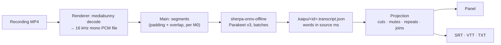

> 🟡 In progress: [NIW2-818](https://linear.app/niway/issue/NIW2-818/local-transcription-with-parakeet-transcript-panel-and-subtitle-export).
> Design agreed with the owner in chat on 2026-11-15. This page is the build's source; the
> phases below replace sub-issues (the Linear workspace hit its free issue limit).
> Research, kept verbatim: [backlog/local-transcription](/backlog/local-transcription/).
> Amended the same day with the owner's two additions (an onboarding offer and Transcribe
> buttons on videos) and the M0 outcomes; the build is a stack of five PRs: M0, M1, M1b, M2, M3.

## Summary (one minute)

Kaipu transcribes a recording **on the user's machine** with NVIDIA Parakeet TDT 0.6B v3, the
model the owner already ships in invisible-assistant and measured ahead of Whisper on Spanish
(4.54% vs 6.91% WER on FLEURS es_419) at about a third of the latency. The engine is the same
sherpa-onnx prebuilt package (v1.13.8 verified; M0 also measures v2.0.1), used through its **batch CLI** `sherpa-onnx-offline`
rather than its websocket server: a whole recording is a batch job, the CLI opens no network
port, and it returns token durations. The model (~640 MB) is downloaded **once, after install,
with the user's visible consent**; after that, transcription works offline.

The renderer decodes the recording's audio once to 16 kHz mono PCM; main owns the job from
there (segments, CLI batches, progress, cancel, resume). Words are stored once per recording in
`.kaipu/<id>.transcript.json`, in that recording's own source time, and **never rewritten by an
edit**. One projection module maps them through the edit — cuts, mutes, repeated footage, joined
recordings — and both the editor's **Transcript panel** and the **SRT / VTT / TXT** exports read
from it. The first version transcribes the existing mixed track (mic and system audio are mixed
at capture); a separate mic track, word corrections and burned-in captions are later phases.

| #   | Decision                                                                                                                                                                                                                                            | Why                                                                                                                                                                                                                               | ADR                                                                                                                             |
| --- | --------------------------------------------------------------------------------------------------------------------------------------------------------------------------------------------------------------------------------------------------- | --------------------------------------------------------------------------------------------------------------------------------------------------------------------------------------------------------------------------------- | ------------------------------------------------------------------------------------------------------------------------------- |
| 1   | Parakeet TDT 0.6B v3 int8 is the default model; the catalog holds several (Handy-style)                                                                                                                                                             | Measured best on Spanish and fast; v2 is English-only; the owner wants users able to try others                                                                                                                                   | [0062 (new)](/architecture/decisions/0062-speech-recognition-runs-in-a-bundled-sherpa-onnx-cli-with-a-downloaded-pinned-model/) |
| 2   | Engine: sherpa-onnx `sherpa-onnx-offline` CLI at one pinned release (v1.13.8 verified, M0 also measures v2.0.1), bundled and signed; not the websocket server, not the Node addon                                                                   | Same runtime and model that already work; no listening port (the server binds `*:<port>`, measured); the addon fails inside Electron                                                                                              | 0062 (new)                                                                                                                      |
| 3   | The model is downloaded once after install, with consent, pinned revision and SHA-256 per file; offline afterwards                                                                                                                                  | 640 MB in every installer is too much; the owner accepts one visible download                                                                                                                                                     | 0062 (new)                                                                                                                      |
| 4   | The renderer decodes to a 16 kHz PCM file once; main owns the job                                                                                                                                                                                   | Decoding needs WebCodecs (renderer); a long job must survive the editor closing and resume without duplicates                                                                                                                     | 0062 (new)                                                                                                                      |
| 5   | Words stored once per recording, in source time (ms), in a `.kaipu` companion; never rewritten by edits                                                                                                                                             | Edits are cheap and reversible only if the transcript does not depend on them; the companion moves with the recording                                                                                                             | [0065 (new)](/architecture/decisions/0065-a-transcript-is-stored-per-recording-in-source-time-and-projected-through-the-edit/)  |
| 6   | One projection (word → 0..n timeline occurrences) feeds the panel and every export                                                                                                                                                                  | Cuts, mutes and repeats must behave the same everywhere; a muted word must never leak into text                                                                                                                                   | 0065 (new)                                                                                                                      |
| 7   | First version transcribes the single mixed track                                                                                                                                                                                                    | It is what the file has; works for voice-over recordings; a mic-only track is its own phase                                                                                                                                       | —                                                                                                                               |
| 8   | The transcript panel is a new state of the right column; the open flags (`cursorInspectorOpen`, `capturesOpen`) become one `sidePanel` value. The export sheet (`exportSheetOpen`) is a sheet over the page, not a column panel, and stays as it is | Hand-cleared booleans already need ~9 call sites; a third would make two panels open at once likely                                                                                                                               | —                                                                                                                               |
| 9   | Exports in M3: SRT, VTT, TXT from the projection; burned-in captions later                                                                                                                                                                          | SRT is accepted everywhere; burn-in needs caption-driven frame scheduling the exporter lacks                                                                                                                                      | —                                                                                                                               |
| 10  | Free, behind the `transcription` flag; macOS arm64 first, "unavailable" elsewhere                                                                                                 | Local features are never charged ([filesystem-first monetization](/desktop/filesystem-first-monetization/)); M1 stages an arm64-only CLI and the x64 app carries none, so nothing ships on x64 yet | —                                                                                                                               |
| 11  | Onboarding offers the model in its own step (after Shortcuts, before Done) with size and location; "Download in background" starts the download and moves on, "Not now" moves on                                                                    | The owner wants the model offered at the first run; onboarding must never wait for 640 MB                                                                                                                                         | —                                                                                                                               |
| 12  | Each video gets a "Transcribe" action (Library card and detail, and the editor); no model → it offers the download first; a transcribed video shows as done                                                                                         | One entry point where the user already is; the label says what Parakeet does (it transcribes, it does not translate)                                                                                                              | —                                                                                                                               |
| 13  | Segmentation is fixed 30 s windows with 3 s overlap, `midpoint-dedupe` at the overlap, four segments per CLI call                                                                                                                                   | Measured in M0: faster, fewer empty-with-speech and lower word error than energy VAD ([ADR 0062 "M0 results"](/architecture/decisions/0062-speech-recognition-runs-in-a-bundled-sherpa-onnx-cli-with-a-downloaded-pinned-model/)) | 0062 (new)                                                                                                                      |

## Open questions

1. **Monetization doc.** [Filesystem-first monetization](/desktop/filesystem-first-monetization/)
   lists "Transcripción + resumen AI" under the paid tier and, in the same page, says local
   features are never charged. This design treats local transcription as free; the doc's paid
   line should become "cloud transcription / AI summary" when someone next edits it.
2. **"Traducciones" in the owner's reply.** The owner wrote that the download "is for the
   automatic translations". Read here as transcriptions; translation is out of scope until the
   owner says otherwise. The same message asked for a "translate" button on videos. Parakeet
   only transcribes, so the action is labelled **Transcribe** (es "Transcribir"). Renaming it is
   a copy change in the `transcription` message namespace; nothing else depends on the word.

## Out of scope

- A separate microphone track at capture (later phase; see "Later phases").
- Correcting words, deleting text to cut video, filler-word removal, speaker labels.
- Burned-in captions and soft subtitle tracks inside the exported MP4 (mediabunny writes only
  `wvtt`, whose player support is unverified).
- Whisper or other models beyond the two Parakeet entries (the catalog allows them later).
- Windows and Intel Mac engines; translation; cloud transcription.

## Failures this must protect against

Each line is a risk found by the weak-point attacks
([engine](/backlog/local-transcription/7-attack-engine-pipeline/),
[model and panel](/backlog/local-transcription/8-attack-transcript-model-and-panel/)), judged
real against the repo, with the phase that covers it. None has been observed in Kaipu.

1. **Muted speech leaks as text.** A word partly inside a muted range stays in the panel or an
   export. Rule: any overlap with a mute, or a whole-audio mute, hides the word. (M2, M3)
2. **Repeated footage loses words or seeks to the wrong copy.** `timelineTimeAtSource` returns
   only the first occurrence. Projection returns every occurrence. (M2)
3. **Silent holes.** Parakeet v3 returned empty text on real speech in the owner's benchmark.
   A segment with speech energy and no words is stored as an unresolved interval and shown. (M1, M2)
4. **The job dies with the editor.** Main owns the job from the PCM file; closing the editor does
   not stop it; a crash resumes per segment without duplicates. (M1)
5. **Unbounded memory.** One hour of 16 kHz float32 is 230 MB; decode is written to disk in
   chunks, and CLI calls run one batch at a time. (M0 measures, M1 builds)
6. **The transcript detaches from its recording.** Rename, cross-workspace move, reconcile and
   delete each list companions explicitly; a job that ends after a move must not write to the old
   place. (M1)
7. **Word ends invented across pauses.** A word ending where the next begins spans a long pause.
   End = last token start + its duration (the CLI returns durations). (M1)
8. **Segment cuts drop or duplicate words.** "At silences" and "at most N seconds" conflict in
   continuous speech; M0 chooses padding, overlap and reconciliation with numbers. (M0, M1)
9. **A network port.** The websocket server listens on every interface; the CLI listens on none.
   (M1, by design)
10. **Imports without decodable audio.** Checked before the job starts; a clear "no audio" or
    "unsupported audio" state. (M1, M2)
11. **Stale exports.** Export reuse fingerprints the scene only; when captions are burned in
    (later phase) the transcript revision joins the fingerprint. SRT/VTT/TXT are not reused. (later)
12. **Captions frozen over a still screen.** The exporter composes fill frames only for webcam or
    floating images (`export-clip-frames.ts`). Burn-in must drive frame scheduling. (later)
13. **Caption memory.** Reusing full-frame overlay rasters for 1,000 cues at 4K is ~31 GiB
    (calculated). Burn-in uses cue-sized rasters. (later)
14. **Corrections lost on regeneration.** Word ids change on every run, so corrections become a
    separate layer anchored by source time range and replaced text, re-matched by overlap after a
    re-run, never edits to the generated words. (later, schema leaves room in M1)
15. **Mixed track picks up background audio.** Music or a video playing is transcribed too and
    overlapping speech can be lost. Accepted for the first version; the mic track phase fixes it
    for new recordings.
16. **Download interrupted or tampered.** `.partial` staging, SHA-256 per file, one rename at the
    end; the engine never sees a half-installed model. (M1)
17. **The bundled binary is missing in a release.** The release workflow fails without the CLI and
    its library, as it already does for the Swift helpers. (M1)

## Acceptance criteria

- [ ] On a fresh install with the flag on, the app offers the Parakeet v3 download showing size
      and location; after it completes, transcription works with the network off.
- [ ] A 60-minute recording transcribes on an Apple Silicon Mac with visible progress, a working
      cancel, and the editor responsive throughout.
- [ ] The Transcript panel shows only words of the edited video: cut footage absent, a word
      overlapping a mute absent, repeated footage listed once per repeat.
- [ ] Clicking a word moves the playhead to that occurrence; during playback the spoken word is
      highlighted.
- [ ] SRT, VTT and TXT exports match the panel's words and follow the edited timeline.
- [ ] `.kaipu/<id>.transcript.json` follows its recording through rename, move to another
      workspace and library reconcile.
- [ ] With the binary or model missing, or on an unsupported platform, the panel says
      "unavailable" and nothing crashes.
- [ ] Onboarding shows the Parakeet download offer with size and location; choosing "Download in
      background" finishes onboarding at once and the download continues.
- [ ] A video in the Library and in the editor has a Transcribe action; with no model it offers
      the download, with the model it starts the job, and a transcribed video shows as done.

## Pipeline



**Probe, 2026-11-15, M5 Pro** (owner's machine, two short TTS clips, English and Spanish, 12.4 s
of audio, the runtime and model installed by invisible-assistant): both transcribed word-perfect
with punctuation; RTF 0.025; 1.78 s wall time including model load; peak RSS 1.24 GB. Output is
one JSON line per input file with `text`, `tokens`, `timestamps`, `durations`, `ys_log_probs`
and an empty `words` array. The websocket server on the same machine listened on `*:<port>`
(lsof). Two TTS clips are not a long-recording measurement; M0 is.

## Transcript file (schema version 1)

```json
{
  "schemaVersion": 1,
  "model": { "id": "parakeet-tdt-0.6b-v3-int8", "revision": "<hf sha>", "files": { "encoder.int8.onnx": "<sha256>" } },
  "engine": { "name": "sherpa-onnx-offline", "version": "1.13.8" },
  "media": { "contentHash": "<sha256 base64>", "durationMs": 3600000 },
  "createdAt": "2026-11-15T00:00:00Z",
  "segments": [{ "id": "s1", "startMs": 0, "endMs": 18400, "status": "ok" }],
  "unresolved": [{ "startMs": 912000, "endMs": 925500, "reason": "empty-with-speech" }],
  "words": [{ "id": "w1", "segmentId": "s1", "text": "Hoy", "startMs": 0, "endMs": 320, "logProb": -0.00002 }]
}
```

- Times are integer ms in the recording's own source time; joined recordings add their axis offset
  at projection time, never in the file.
- `text` carries the model's punctuation and capitalization.
- `logProb` is the mean token log-probability of the word, not a calibrated confidence.
- A media hash mismatch marks the transcript stale; it is never silently re-timed.
- Corrections (later) live in a separate `corrections` array anchored by source time range and
  the replaced text, because word ids do not survive a new run.

## Phases

One PR each, in order; each PR names NIW2-818 and its phase.

### M0 — spike on long recordings (no product code)

**Outcome (2026-11-15).** Fixed 30 s windows with 3 s overlap, `midpoint-dedupe`, four segments
per CLI call, stay on sherpa-onnx v1.13.8 (v2.0.1 gives nothing on speed, memory or timing). The
60-minute input is a 54-minute and a 6-minute recording joined, one run each, under load; the
numbers and what they do not show are in ADR 0062 "M0 results". Silero VAD was not measured.

Measure Parakeet v3 through `sherpa-onnx-offline` on whole Kaipu recordings and record the
numbers in [ADR 0062](/architecture/decisions/0062-speech-recognition-runs-in-a-bundled-sherpa-onnx-cli-with-a-downloaded-pinned-model/) "M0 results".

- Segmentation: energy VAD with padding and overlap vs fixed windows with overlap vs
  `sherpa-onnx-vad-with-offline-asr` (Silero). Which loses or duplicates fewest boundary words.
- Batch size: segments per CLI call vs the ~1.5 s model load and progress granularity.
- Total time and peak memory of the process tree for 5, 20 and 60 minutes.
- Empty results on segments with speech.
- Word timing from `timestamps` + `durations` against a few hand-marked words.
- Renderer decode of 60 min to 16 kHz PCM with mediabunny: time and memory.
- sherpa-onnx v1.13.8 against v2.0.1 on the same inputs: output format, speed, memory; pin one.

Criteria:

- [ ] A script in `apps/kaipu-record/scripts/spikes/transcription-m0/` runs end to end on a given
      recording and prints time, peak RSS, segment count and empty-with-speech count.
- [ ] Results for a 5, a 20 and a 60 minute recording are in ADR 0062, with the machine named.
- [ ] The chosen segmentation and batch size are written in ADR 0062 with the numbers behind them.
- [ ] No transcript text from the owner's recordings is committed; only metrics.

### M1 — engine, model download and the transcript file

- **Catalog:** id, label, languages, size, pinned revision, per-file SHA-256, capabilities (word
  timestamps). Parakeet v3 int8 (default) and Parakeet v2 int8 (English).
- **Consented download** to `userData/models/<id>/`: size and location shown, progress, cancel,
  `.partial` staging, hashes, one rename; deletable from settings.
- **Engine:** `sherpa-onnx-offline` + `libonnxruntime` (arm64) in `resources/native/`, asar
  unpacked, signed, `--version` handshake, release workflow check. Missing = "unavailable".
  The Mac release builds arm64 and x64 apps, and its helper check today requires universal
  binaries (`lipo -archs`, `release-desktop.yml`). The engine check is per build instead: the
  arm64 app must carry an arm64 CLI and library; the x64 app carries none and shows
  "unavailable". An x64 engine is the later Intel phase.
- **Job in main:** renderer writes the PCM file to `.kaipu/tmp`; main segments, runs CLI batches,
  reports progress per segment, cancels, resumes after a crash without duplicate segments. One job
  at a time. Segments are fixed 30 s windows with 3 s overlap, four per CLI call. In each overlap
  the cut is the midpoint (`midpoint-dedupe`): the earlier segment keeps the words that start
  before it, the later one the words that start after it, so a word on the boundary appears
  exactly once. M0 counted 93 adjacent duplicate words in 8,490 at 60 minutes. A plain cut loses
  a word the two runs time on opposite sides of it and cannot tell a duplicate from a real
  repeat ("no no"), so M1 first pairs the two runs' words in each overlap (same text, starts
  within 250 ms, in order) and keeps one word per pair from the side its midpoint is on; unpaired
  words follow the cut. The job has its
  own supervisor, because `runHelperProcess` is one-shot with a 16 MB stdout cap.
- **Words:** token grouping at a leading space or `▁`; start = first token start; end = last token
  start + duration; offset by segment start; integer ms.
- **File:** schema above, validated on read; registered in every companion path (rename, move,
  cross-workspace move, reconcile, delete); writes revalidate the item before committing.
- **Input check** for no audio / undecodable audio.
- **Flag** `transcription` in `FLAG_NAMES` / `FLAG_DEFAULTS`, default off; M1 introduces it,
  M2 and M3 sit behind it.

Criteria:

- [ ] With the flag on and no model, the app offers the download with size and location; cancel
      leaves nothing the engine can load.
- [ ] With the model installed and the network off, transcribing writes a transcript file that
      validates.
- [ ] Unit tests: token→word grouping (including the last word's end), segment offsetting,
      unresolved intervals, overlap reconciliation (a word straddling a boundary appears exactly
      once), schema parse and reject.
- [ ] Rename, cross-workspace move and reconcile keep the transcript with its recording (tests
      beside the existing companion tests).
- [ ] Killing the CLI mid-job ends failed or resumable, never hung; cancel stops within seconds.
- [ ] The release workflow fails if the arm64 app lacks the CLI or its library, or if either is not
      arm64.
- [ ] The download prompt, its progress and the model entry in settings are in the ui-map with a
      catalog state each, with es and en messages.

### M1b — onboarding offers the model

A step `transcription` between Shortcuts and Done in the onboarding
(`apps/kaipu-record/src/renderer/src/features/onboarding/`). It exists only when the
`transcription` flag is on, the engine is available and the default model is not installed; in
every other case the onboarding is unchanged.

- Shows the model label, its size and the folder it installs to, and the CC-BY-4.0 credit.
- **"Download in background"** starts the download and moves to Done at once; **"Not now"** moves
  to Done. Neither waits: the download continues after onboarding closes, and the Settings >
  Transcription page shows its progress and any failure.
- ui-map area `onboarding.transcription` with a catalog state, es and en messages.

Criteria:

- [ ] With the flag on, the engine available and no model, the step appears with size and
      location; with the flag off, an unavailable engine or an installed model it does not.
- [ ] "Download in background" calls the download once and advances without waiting for it;
      "Not now" advances and never calls it.
- [ ] The step is in the ui-map with a catalog state; the i18n parity test passes.

### M2 — Transcript panel and Transcribe buttons

- **Transcribe buttons.** A "Transcribe" action on a video in the Library (the card and the item
  detail) and in the editor. With no model it opens the download offer first; with the model it
  starts the job. While a job runs the control shows progress; a video with a transcript shows as
  done (a "Transcript" affordance instead of "Transcribe"). The label is a copy decision, see open
  question 2.
- `sidePanel` replaces the right-column open flags (`cursorInspectorOpen`, `capturesOpen`);
  `transcript` is a new value. The export sheet is not part of it.
- Projection module beside `source-time.ts`: word → 0..n occurrences; mute overlap rule;
  whole-audio mute; repeats; joined recordings by offset when the base has `source-axis.ts`.
- Panel: paragraphs with start time, click to seek to an occurrence, current word highlighted via
  `subscribeTime` (no full re-render per frame), search, copy.
- States: flag off; model missing (offer download); downloading; transcribing (progress, cancel);
  done; done with unresolved intervals; stale (the recording's media hash no longer matches: the
  old words stay readable, marked out of date, with a re-transcribe action); failed; no audio;
  unavailable.
- ui-map area, a catalog state per panel state, es and en messages; ui-map areas and catalog
  states for the Transcribe control in each place it lives (no model, ready, running, done).

Criteria:

- [ ] Transcribe on a Library video and in the editor: no model → the download offer; model →
      the job starts; a transcribed video shows as done.
- [ ] Projection tests: cut footage, partial mute, whole mute, repeated footage (two occurrences,
      two seek targets), slides, joined recordings when present.
- [ ] Click seeks; playback highlight follows the audio.
- [ ] One right-column panel open at a time (test over the open and close paths).
- [ ] Every panel state in the UI catalog; `ui-catalog/coverage.test.ts` and the i18n parity test
      pass.

### M3 — SRT, VTT and TXT export

- From the projection, so exports equal the panel.
- Cue builder: ≤ 42 characters per line, ≤ 2 lines, ≤ ~20 characters per second, ~0.8 s minimum,
  ~7 s maximum; break at sentence punctuation, at pauses over ~0.6 s, and at every timeline
  discontinuity (cut, change of recording); rebuilt from surviving words.
- SRT (comma ms), WebVTT (`WEBVTT`, dot ms), UTF-8; TXT as paragraphs.

Criteria:

- [ ] Tests: SRT and VTT syntax, cue limits, a cut inside a sentence splits the cue, muted words
      absent, repeated footage twice in timeline order.
- [ ] An exported SRT plays in sync beside the exported video in QuickTime or VLC (manual check in
      the PR).

### Later phases (tickets when the Linear limit allows)

- **Mic track:** the recorder also writes the microphone alone (`.kaipu/<id>.mic.m4a`, like the
  webcam's own track in ADR 0037); transcription prefers it and labels mic vs system.
- **Corrections:** edit a word in the panel; a correction layer survives regeneration.
- **Burned-in captions:** caption-driven frame scheduling, cue-sized rasters, final-output
  coordinates, transcript revision in the export fingerprint.
- **More models:** Whisper through sherpa-onnx (token timestamps need exports with attention
  outputs, `--whisper-enable-token-timestamps`); a model picker like Handy's.
- **Windows and Intel Mac:** the same CLI from sherpa-onnx's win-x64 and osx-x64 builds.

## What the repo already says

- [Product growth backlog](/backlog/product-growth/): P1 "Captions: Parakeet TDT v3 transcript
  with timestamps, correction, SRT/VTT export."
- [AI and automation](/marketing/ai-and-automation/): "Transcription runtime: Parakeet, not
  Whisper"; "transcription stays local".
- [ADR 0021](/architecture/decisions/0021-tag-sync-on-events-with-server-version/) states in its
  context that Kaipu is local-first: a user without an account keeps every feature offline,
  forever. Transcription meets that only after the one-time model download; ADR 0062 records this
  as an explicit exception, and the app keeps working as before until the download happens.
- [ADR 0055](/architecture/decisions/0055-text-recognition-is-a-port-served-by-the-os-engine-on-each-platform/) (text recognition is a port) — same shape: a port in main, a per-platform backend,
  "unavailable" as the failure.
- [ADR 0037](/architecture/decisions/0037-webcam-is-its-own-track-and-the-bubble-is-excluded-from-capture/) (webcam on its own track) — the pattern for the later mic track.
- Hub: [local speech-to-text](https://github.com/csdev19/general-knowledge/blob/main/desktop/local-speech-to-text.md)
  — the addon fails in Electron; run as a sidecar; pin models by SHA-256.

## State of the art

- [Cap](https://cap.so/docs/recording/studio-mode) ships local Parakeet and Whisper with
  active-word captions and SRT/VTT export; local alone is not a differentiator.
- [Screen Studio](https://screen.studio/guide/captions) transcribes the microphone only and refuses
  without one.
- [Premiere](https://helpx.adobe.com/in/premiere/desktop/edit-projects/edit-video-using-text-based-editing/overview-of-text-based-editing.html)
  and [Final Cut](https://support.apple.com/en-gb/guide/final-cut-pro/vere399dab5e/mac) keep the
  transcript tied to source media and warn that captions can drift after edits — the reason for
  decision 5.
- [sherpa-onnx releases](https://github.com/k2-fsa/sherpa-onnx/releases): active, Apache-2.0;
  the [Parakeet v3 model card](https://huggingface.co/nvidia/parakeet-tdt-0.6b-v3): 25 European
  languages, automatic language detection, punctuation, CC-BY-4.0.
- A [FluidAudio report](https://github.com/FluidInference/FluidAudio/issues/842) shows
  conversational Latin American Spanish turning into English-sounding words, upstream too — a
  risk to watch, not a measured Kaipu result.
- [Netflix timed text](https://partnerhelp.netflixstudios.com/hc/en-us/articles/217350977-English-Timed-Text-Style-Guide)
  sets the cue limits used in M3; [YouTube](https://support.google.com/youtube/answer/2734698)
  accepts SRT and VTT uploads.
