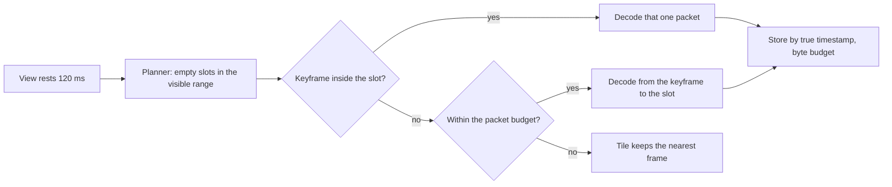

# Video editor — a filmstrip that shows each tile's own time at any zoom

- **Status:** proposed (2026-11-16). Tracker: [NIW2-844](https://linear.app/niway/issue/NIW2-844/video-editor-the-filmstrip-shows-what-happens-at-each-tiles-own-time).
- **ADRs:** [timeline thumbnails are stored per file by true timestamp and decoded keyframe first for the visible range](/architecture/decisions/0064-timeline-thumbnails-are-stored-by-true-timestamp-and-decoded-keyframe-first/).

## Summary (one minute)

The editor decodes 24 frames per recording and never more. On a 30-minute recording that is one
frame every 77 seconds, so at 2,000% zoom the visible 90 seconds repeat one or two far-away frames:
the owner saw a white page in the tiles while the preview showed dark text. After this change, when
the timeline rests after a zoom or a scroll, the editor decodes one frame for each visible tile, from
inside that tile's own stretch of time. Kaipu recordings have a keyframe every 2 seconds (measured),
so most tiles cost one decoded frame. Decoding runs in a worker, one job at a time, inside a 48 MB
budget, and pauses during playback and export.

## What changes

| Thing                         | Today                                                      | After                                                                          |
| ----------------------------- | ---------------------------------------------------------- | ------------------------------------------------------------------------------ |
| Frames per file               | 24, fixed, decoded once                                    | 24 at open, plus one per visible tile when zoomed in                           |
| What a tile shows at 2,000%   | The nearest of the 24, up to 77 s away on a 30-minute take | A frame from inside the tile's own time span                                   |
| Where decoding runs           | Main thread                                                | A dedicated worker, one job at a time                                          |
| Memory bound                  | 16 strips of 24 frames                                     | 48 MB of thumbnail bytes in total, least recently used evicted first           |
| When decoding happens         | When the editor opens                                      | Also 120 ms after the view rests; never during playback or export              |
| Tile lookup                   | Nearest frame anywhere in the file                         | Inside the tile's span, else nearest inside the clip, else nearest in the file |
| Tile rendering on a new frame | The whole strip re-renders                                 | Only the tiles of that file, in batches, after the image is decoded            |

## Decisions

| #   | Decision                                                                                                                                                                                                                                  | Why                                                                                                                                                                                                                      | ADR        |
| --- | ----------------------------------------------------------------------------------------------------------------------------------------------------------------------------------------------------------------------------------------- | ------------------------------------------------------------------------------------------------------------------------------------------------------------------------------------------------------------------------ | ---------- |
| 1   | A tile is correct when its frame comes from inside the tile's own time span. The exact frame at the tile's centre is not required                                                                                                         | Owner decision. It is what the user perceives, and it lets one keyframe serve a tile                                                                                                                                     | 0064 (new) |
| 2   | Frames live in one store per media file, keyed by the frame's true timestamp in that file's own time. Zoom only changes how many frames are wanted                                                                                        | Cuts, moves and joins never invalidate a frame. Frames decoded at one zoom serve every other zoom. Follows the rule that only media readers translate time (ADR 0058)                                                    | 0064 (new) |
| 3   | Keyframe first: a slot is filled by decoding the single key packet inside it when there is one; only otherwise by decoding from the previous keyframe forward                                                                             | Measured on 8 recordings: a keyframe every 2.0 s, worst gap 3.05 s. A 30-minute take at 2,000% has 5-second tiles, so each tile costs one frame instead of up to 300                                                     | 0064 (new) |
| 4   | An exact decode is planned before it runs: the packets between the keyframe and the target are counted, and a target over 300 packets is skipped. The tile keeps the nearest frame                                                        | mediabunny has no packet limit and no guaranteed mid-decode cancel. A file with a single keyframe would otherwise decode minutes of video for one tile. Owner decision: such a tile shows the nearest frame, never empty | 0064 (new) |
| 5   | The memory bound is enforced, not derived: 48 MB of thumbnail bytes across all files, least recently used file first, and one media file open for decoding at a time with its read cache capped                                           | Trimming makes the same zoom ask for finer frames of the original, so zoom does not bound the count. Each open file can also hold a 64 MiB read cache by default                                                         | 0064 (new) |
| 6   | Demux, decode and JPEG encoding run in one dedicated worker with a priority queue: visible tiles first, then one screen of margin                                                                                                         | The work happens exactly while the user zooms and scrolls. A worker removes it from the main thread instead of tuning time slices. Same worker pattern as export, GIF, colors and PDF                                    | 0064 (new) |
| 7   | Requests start 120 ms after the view rests, from a subscription to the timeline view store, never from a React render. A newer request cancels the older one. Nothing decodes during playback or export, and hidden lanes request nothing | The strip re-renders on every scroll tick, so a loader driven by render would fire on each one. Playback and export need the decoder. Hidden lanes are view state (ADR 0050)                                             | —          |
| 8   | Tiles stay `img` elements. Each file's tiles subscribe to that file's store, frames are published at most every 150 ms, each frame keeps one object URL, and a tile switches image only after the new image is decoded                    | Smallest change that keeps arrivals from re-rendering the whole strip, and no blank flash when a finer frame replaces a coarse one                                                                                       | —          |
| 9   | Nothing in the design reads the 20x zoom cap                                                                                                                                                                                              | The owner may raise the cap later. Cost per view is bounded by the visible tiles on the keyframe path and by the visible seconds on the exact path, and the visible seconds shrink as zoom grows                         | —          |
| 10  | No disk cache in the first version. The store is cleared on workspace switch                                                                                                                                                              | Owner decision. The 24-frame strip still loads at open. Media caches are cleared on workspace switch (ADR 0032)                                                                                                          | —          |
| 11  | Ships behind the release flag `zoom-filmstrip`, on for the owner's devices. Flag off runs today's code                                                                                                                                    | The budgets must be proven on the owner's 54-minute take before everyone gets it                                                                                                                                         | —          |

## Layers

| #   | What it builds                                                                                                                                                                                                                                                  | Criteria                             | Risk      | Depends on |
| --- | --------------------------------------------------------------------------------------------------------------------------------------------------------------------------------------------------------------------------------------------------------------- | ------------------------------------ | --------- | ---------- |
| 1   | Pure logic, no decoding: the per-file frame store with the byte budget and eviction, the slot planner for a visible range and tile span, and the tile lookup rule. Unit tests only                                                                              | AC3, AC4, AC5                        | 🟢 Low    | —          |
| 2   | The thumbnail worker: opens one file by Range through the media protocol, fills slots keyframe first, plans and caps exact decodes, encodes JPEG, cancels a stale job. Starts with a probe that a worker can read a moov-at-end file through the media protocol | AC8, part of AC5                     | 🔴 High   | 1          |
| 3   | Editor wiring behind the flag: view-store subscription with the 120 ms rest, pause on playback and export, hidden lanes, per-file tile subscription, decoded-before-swap, clear on workspace switch, Clips and Webcam rows, joined recordings                   | AC1, AC2, AC6, AC7, AC10, AC11, AC12 | 🟡 Medium | 1, 2       |
| 4   | Measurement in the real app on the Mac mini against the budgets, with the numbers recorded, and the reference doc                                                                                                                                               | AC9                                  | 🟡 Medium | 3          |

If the probe in layer 2 fails, the design changes and needs the owner's OK before layer 2 continues.

## Open questions

- **Webcam files.** No webcam file was found in the recordings folder, so their keyframe spacing is
  not measured. The design does not depend on it (decision 4 covers any spacing), but AC2's 500 ms
  does. Default: measure in layer 2 and report.
- **Worker access to the media protocol.** The export and GIF workers read through `BlobSource`, not
  by Range through the media protocol, and `lib/media-url.ts` reads `window`. Not verified that a
  worker can do Range reads there. Default: the probe that opens layer 2.
- **Process memory.** The 48 MB budget counts thumbnail bytes. Decoder surfaces and the images
  Chromium decodes for visible tiles are not counted and not measured. Default: measure process and
  GPU memory in layer 4 and report before the flag opens to everyone.

## Out of scope

- Showing a frame in the preview when the pointer hovers the timeline.
- Thumbnails that reflect the zoom effect, the background or the cursor.
- Raising the timeline zoom cap.
- A disk cache. Reopen condition: reopening the 54-minute take needs more than 1 second to show the
  24-frame strip.
- Drawing the lane on one canvas instead of `img` tiles. Reopen condition: layer 4 measures a
  frame-time regression that the per-file subscription does not remove.

## Failures this must protect against

- A tile shows a frame from before a cut, from outside its clip, when a frame inside the clip exists.
- A file with one keyframe, or keyframes minutes apart, makes one tile decode minutes of video.
- Continuous scrolling starts a decode on every tick.
- A stale job keeps decoding after the user moved away, and its frames arrive late.
- Exploring many recordings, or one recording after heavy trimming, grows the store without bound.
- Several files stay open, each holding its read cache.
- A frame arriving re-renders every clip block of the strip.
- A tile goes blank between the coarse and the finer frame.
- Decoding competes with playback or export for the decoder.
- A recording whose timestamps jump (one measured file reports 17.8 hours for 6.9 GB) breaks slot
  planning.
- The store survives a workspace switch and shows frames of another workspace's file.
- With the flag off, anything differs from today.

## Acceptance criteria

- [ ] **AC1** On a 30-minute recording at 2,000% zoom, 500 ms after the view rests, every visible Clips tile shows a frame whose timestamp is inside that tile's time span.
- [ ] **AC2** The same holds for the Webcam row, with the webcam file's offset applied.
- [ ] **AC3** At fit zoom the editor decodes no more than the 24 frames per file it decodes today.
- [ ] **AC4** A tile never shows a frame from outside its clip's source range when the store has one inside it, and a tile is never empty when the file has any frame.
- [ ] **AC5** Thumbnail bytes held never exceed 48 MB, and at most one media file is open for thumbnail decoding at a time.
- [ ] **AC6** No decode job starts while the preview plays or an export runs.
- [ ] **AC7** Scrolling without stopping starts no decode, and a new request cancels the job in flight.
- [ ] **AC8** On a file with a single keyframe, no tile triggers a decode of more than 300 packets, and its tiles show the nearest available frame.
- [ ] **AC9** In the real app on the 54-minute take: no main-thread task over 50 ms caused by the filmstrip, and scroll and zoom frame times at the 95th percentile not worse than main. The measured numbers are recorded in the PR.
- [ ] **AC10** Switching workspace empties the store.
- [ ] **AC11** With the flag off, the filmstrip decodes and shows exactly what it does today.
- [ ] **AC12** A tile changes its image only after the new image is decoded: no blank frame between the two.

---

## Measurement: keyframe spacing (2026-11-16)

Read from container metadata with mediabunny's `EncodedPacketSink` (`getFirstKeyPacket`,
`getNextKeyPacket`, `metadataOnly`), under 2 seconds per file. Script: `/tmp/kaipu-gop/measure.ts` on
the owner's machine, not committed.

| Recording                           | Duration                    | Frame size | Frame rate | Key packets | Interval s (min / median / p95 / max) |
| ----------------------------------- | --------------------------- | ---------- | ---------- | ----------- | ------------------------------------- |
| 2026-11-05 20.35.12                 | 54.2 min                    | 1920x1080  | 59.9       | 1622        | 1.99 / 2.00 / 2.02 / 2.48             |
| 2026-11-05 20.35.12, YouTube export | 54.2 min                    | 2560x1440  | 59.9       | 1625        | 1.98 / 2.00 / 2.00 / 2.02             |
| 2026-11-13 14.02.01                 | 33.8 min                    | 1914x1042  | 57.8       | 978         | 0.41 / 2.02 / 2.33 / 3.05             |
| 2026-11-14 15.04.52                 | 31.7 min                    | 1914x1042  | 60.0       | 951         | 0.66 / 2.00 / 2.00 / 2.12             |
| 2026-11-14 15.04.52, YouTube export | 30.8 min                    | 2560x1440  | 60.0       | 925         | 1.99 / 2.00 / 2.00 / 2.01             |
| 2026-10-05 12.51.30                 | 18.1 min                    | 2560x1440  | 48.0       | 544         | 0.04 / 2.00 / 2.00 / 2.02             |
| 2026-11-05 09.55.40                 | unreliable (reports 17.8 h) | 1916x1044  | 60.0       | 32055       | 1.00 / 2.00 / 2.00 / 2.02             |
| Short take, 2026-09-29              | 17.7 s                      | 2560x1440  | 45.7       | 10          | 0.04 / 2.00 / 2.02 / 2.02             |

All files are AVC. Walking with `verifyKeyPackets` on the 33.8-minute file returned the same 978 key
packets. No webcam file was in the folder.

## How the pieces work

**Slots.** The planner takes the visible range, one screen of margin on each side, and the tile span
at the current zoom (visible seconds divided by visible tiles). It rounds the span down to a step of
0.25 s times a power of two and lists the slots `[n × step, (n + 1) × step)` in range, in the file's
own time. A slot is filled when the store holds a frame whose timestamp is inside it. Because the
steps are powers of two, a slot at one zoom is the union of slots at a finer zoom: frames decoded at
any zoom fill slots at every coarser one.

**Filling a slot.** The worker asks for the key packet at or before the slot's end. If its timestamp
is inside the slot, it decodes that packet alone. If not, it counts the packets from that keyframe to
the first frame inside the slot; at 300 or fewer it decodes forward to it, and above 300 it skips the
slot. Slots are processed in timestamp order so a packet is never decoded twice
(`canvasesAtTimestamps`). Frames are stored under their true timestamp, never under the slot's.

**Lookup.** For a tile the editor picks, in order: the frame nearest the tile's centre among frames
inside the tile's span; else the nearest among frames inside the clip's source range; else the
nearest in the file. The lookup is a binary search over the file's sorted timestamps.

**Cost.** On the keyframe path a view change costs one decoded frame per visible tile per lane,
about 17 on a 1,240 px lane. On the exact path it costs at most the visible seconds of video, and the
visible seconds are the duration divided by the zoom: a 2-minute take at 2,000% shows 6 seconds.

**Eviction.** The store counts the bytes of the JPEG blobs it holds. Over 48 MB it drops whole files,
least recently used first; if the current file alone is over, it drops that file's frames farthest
from the visible range. An evicted frame's object URL is revoked.

## State of the art

- Premiere Pro's continuous thumbnails follow the timeline zoom
  ([Adobe](https://community.adobe.com/announcements-732/now-in-beta-smoother-faster-timeline-311888)),
  and users report them generating slowly
  ([bug report](https://community.adobe.com/bug-reports-728/continuous-video-thumbnails-generate-significantly-slower-after-premiere-pro-25-1640163)).
- DaVinci Resolve sets the thumbnail count from zoom and track height
  ([manual](https://ltbits.github.io/davinci-resolve-manuals/DR18/DR18-RM04-TheCutPage.pdf)); Final
  Cut Pro from the filmstrip width
  ([Apple](https://support.apple.com/guide/final-cut-pro/verb8e5d346/mac)).
- Kdenlive shows a thumbnail per frame at maximum zoom, and has an open complaint that changing the
  scale re-reads every clip ([issue](https://invent.kde.org/multimedia/kdenlive/-/issues/970)).
- Kapwing keeps thumbnails in memory in front of IndexedDB and calls quick decode on pan and zoom
  critical ([web.dev](https://web.dev/case-studies/kapwing)).
- mediabunny gives `CanvasSink.canvasesAtTimestamps` (resize at decode, canvas pool, no packet
  decoded twice) and `EncodedPacketSink.getKeyPacket`
  ([media sinks guide](https://mediabunny.dev/guide/media-sinks)). It has no cache, no zoom levels,
  no packet limit.

## Sources and unverified claims

- The 24-frame strip, the tile width of 72 px, the zoom model and the render-per-scroll-tick are read
  from `use-source-thumbnails.ts`, `components/timeline-geometry.ts`, `components/timeline-view.ts`
  and `components/timeline-strip.tsx` at `origin/main` on 2026-11-16.
- The 64 MiB default read cache and the absence of a packet limit were read in the installed
  mediabunny source (`source.ts`, `media-sink.ts`) by an independent reviewer; not re-checked against
  the mediabunny documentation.
- The 2-second keyframe default of the encoder was read in mediabunny's `media-source.ts`; the table
  above is the measurement.
- Not verified: worker Range reads through the media protocol, webcam file keyframe spacing, process
  and GPU memory, decoder contention with the preview.
