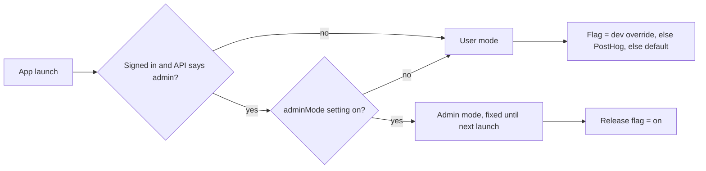

# Admin mode — an admin account switches the desktop app between User and Admin mode

- **Status:** proposed (2026-11-21). Tracker: [NIW2-900](https://linear.app/niway/issue/NIW2-900/admin-mode-an-admin-account-switches-the-desktop-app-between-user-and).
- **ADRs:** [an admin account switches the desktop between User mode and Admin mode](/architecture/decisions/0067-an-admin-account-switches-the-desktop-between-user-and-admin-mode/) (new), which amends [flags are a typed registry; release flags are owner-only](/architecture/decisions/0049-flags-are-a-typed-registry-with-state-in-our-api-labs-is-user-opt-in/).

## Summary (one minute)

Today the owner's production installs get every unreleased feature because PostHog targets their two
device ids, and nothing on screen says so. After this change, everyone runs in User mode by default.
An account on the API's admin allowlist sees an "Admin mode" switch in Settings → App. Turning it on
and restarting forces every release flag on, and a "👑 Admin" badge sits in the title bar and the tray
menu says so. Turning it off and restarting shows the app exactly as users get it. The permission comes
from the server, the switch is only a preference, and the mode never changes mid-session.

<!-- visual: admin-mode-mock -->

## What changes

| Thing                          | Today                                                  | After                                                                |
| ------------------------------ | ------------------------------------------------------ | -------------------------------------------------------------------- |
| Who gets release flags in prod | The owner's two device ids, through PostHog conditions | An admin account in Admin mode; PostHog targets nobody until rollout |
| Admin concept in the API       | None (only the Console's own allowlist)                | `ADMIN_USER_IDS` in server-hono; `admin` in `/me/entitlements`       |
| Seeing the app as a user       | Edit PostHog conditions                                | Switch Admin mode off and restart                                    |
| What tells you the mode        | Nothing                                                | "👑 Admin" badge in the title bar and a check line in the tray menu  |
| Flag evaluation order          | dev override → PostHog → default                       | dev override → Admin mode → PostHog → default                        |

## Decisions

| #   | Decision                                                                                                                        | Why                                                                                        | ADR        |
| --- | ------------------------------------------------------------------------------------------------------------------------------- | ------------------------------------------------------------------------------------------ | ---------- |
| 1   | The permission is decided on the server from `ADMIN_USER_IDS` and returned as `admin` in `GET /api/v1/me/entitlements`          | The client never grants itself access; the endpoint is already read on every session check | 0067 (new) |
| 2   | `admin` is stored with the session in main, bound to its user id, cleared on sign-out, kept offline until the next good check   | An answer for one account must never apply to another                                      | 0067 (new) |
| 3   | `adminMode` in settings is a preference; effective mode = `adminMode && admin`, computed at launch and fixed for the session    | Settings can be edited by hand; the screenshot editor latches flags at mount               | 0067 (new) |
| 4   | Changing the switch asks for a restart ("Restart now")                                                                          | One mode for every window and main; switching live costs more than it gives                | 0067 (new) |
| 5   | Admin mode forces release flags only; platform checks and plan entitlements still apply                                         | Labs flags stay user opt-in; a flag never unlocks what the OS or plan does not allow       | 0067 (new) |
| 6   | "👑 Admin" badge after the product name in the title bar, "Admin mode" row in Settings → App for admins, check line in the tray | The mode must be visible, including in capture-only workflows                              | 0067 (new) |
| 7   | The PostHog device-id conditions are removed after the owner runs the new build on both installs                                | Otherwise User mode still gets the flags through PostHog                                   | 0067 (new) |

## Layers

| #   | What it builds                                                                                                                                                                                                 | Criteria                     | Risk      | Depends on |
| --- | -------------------------------------------------------------------------------------------------------------------------------------------------------------------------------------------------------------- | ---------------------------- | --------- | ---------- |
| 1   | API: `ADMIN_USER_IDS` parsing, `admin` in the entitlements response and its domain schema, tests                                                                                                               | AC1, AC2                     | 🟢 Low    | —          |
| 2   | Desktop core: `admin` in the stored session (user-bound, cleared on sign-out), `adminMode` setting, launch-time effective mode, flag evaluation order, IPC to expose the effective mode and the restart, tests | AC3, AC4, AC5, AC6, AC7, AC8 | 🟡 Medium | 1          |
| 3   | Desktop UI: title-bar badge, Settings → App row with "Restart to apply", tray check line, i18n, ui-map areas and catalog states                                                                                | AC9, AC10, AC11              | 🟢 Low    | 2          |

## Open questions

- None. The owner approved the mock, restart-to-apply, the tray line and the crown badge (2026-11-21).

## Out of scope

- Per-flag toggles in production, impersonating another user, roles beyond admin, an admin page in the
  app, Labs (ADR 0049), percentage rollouts.
- Removing the PostHog device-id conditions: a manual step for the owner after installing the build.

## Failures this must protect against

- A non-admin account (or a signed-out app) with `adminMode: true` written by hand into `settings.json`
  gets Admin mode.
- An `admin: true` answer for account A arrives after A signed out and B signed in, and B gets Admin mode.
- The badge shows one mode while an open screenshot editor or main's capture flag runs the other,
  because the mode changed mid-session.
- Admin mode turns on a feature its platform check forbids (for example `image-text` on Windows) or
  bypasses a plan entitlement.
- A missing or empty `ADMIN_USER_IDS` makes everyone admin, or crashes the entitlements route.
- The tray or a capture started from a shortcut runs in Admin mode with no visible indicator.
- User mode still gets release flags because the PostHog device-id conditions were left in place.

## Acceptance criteria

- [ ] **AC1** `GET /api/v1/me/entitlements` returns `admin: true` for a user id listed in `ADMIN_USER_IDS` and `admin: false` otherwise; a server test covers listed, unlisted, empty and missing variable.
- [ ] **AC2** A missing or empty `ADMIN_USER_IDS` makes nobody admin, and the route still answers 200.
- [ ] **AC3** The desktop stores `admin` with the session; an answer whose user id differs from the current session's is discarded; sign-out clears it (unit tests on the auth store).
- [ ] **AC4** Effective Admin mode is `adminMode && admin`, computed once at launch; a test shows `adminMode: true` with `admin: false` (and signed out) evaluates every flag as in User mode.
- [ ] **AC5** Changing `adminMode` during a session does not change any flag value until relaunch (test on the flag client).
- [ ] **AC6** In Admin mode every release flag in `FLAG_NAMES` reads `true`; the dev override still wins in a dev build; in User mode the order is PostHog then default (tests on `flagState`).
- [ ] **AC7** Admin mode does not bypass platform checks: a platform-gated feature stays off on an unsupported platform with its flag forced on (test on the gate).
- [ ] **AC8** Main and every window read the same effective mode for the session (main exposes it; windows read it through IPC at load).
- [ ] **AC9** In Admin mode the main window's title bar shows "👑 Admin" after "Kaipu Record"; in User mode the title bar is unchanged (catalog states for both).
- [ ] **AC10** Settings → App shows the "Admin mode" row only when the account is admin; toggling it shows "Restart to apply" with a **Restart now** button that relaunches the app (catalog state; not shown for non-admin).
- [ ] **AC11** The tray menu shows an "Admin mode" line with a check while Admin mode is effective, and no line for non-admin accounts.

---

## Detail

### Where the pieces live today

- Flags: `FLAG_NAMES` / `FLAG_DEFAULTS` in `apps/kaipu-record/src/shared/analytics.ts`; `flagState()` in
  `apps/kaipu-record/src/renderer/src/features/analytics/analytics-client.ts` (override → PostHog →
  default); `useFlag` re-renders on PostHog `onFeatureFlags`.
- Overrides: `apps/kaipu-record/src/shared/flag-overrides.ts`, refused when packaged.
- Session: `apps/kaipu-record/src/main/infrastructure/auth-store.ts` (`StoredSession`, `auth.enc`);
  entitlements fetched in `apps/kaipu-record/src/main/services/auth-client.ts`; shape in
  `apps/kaipu-record/src/shared/entitlements.ts`.
- Server: `apps/server-hono/src/modules/me/me.router.ts` (entitlements behind `authMiddleware`).
- Settings: `AppSettings` + `DEFAULT_SETTINGS` in `apps/kaipu-record/src/shared/types/ipc.ts`; merge in
  `apps/kaipu-record/src/main/services/settings.service.ts`.
- Title bar: `apps/kaipu-record/src/renderer/src/shell/title-bar.tsx` (product name at the left).
- Latched flags: `apps/kaipu-record/src/renderer/src/pages/screenshot-editor/screenshot-editor-page.tsx`.

### Preload rule

`src/shared/**` takes no value import from a workspace package (CLAUDE.md, preload bundle). The
`admin` field in `shared/entitlements.ts` stays a literal type, pinned by a test that imports the
domain schema.

### Rollout

1. Owner adds `ADMIN_USER_IDS` with their user id to Infisical `/auth` (production and dev).
2. Ship the API (layer 1) and a desktop release with layers 2–3.
3. Owner installs it on the M5 and the M4, turns Admin mode on, restarts, checks the badge.
4. Owner removes the device-id conditions from the release flags in PostHog.
5. Switch Admin mode off, restart: the app matches a normal user's.

### Weak-point review

gpt-6.1-sol (high) attacked the design on 2026-11-21. Real findings and their answers: mid-session
switching vs latched flags (restart to apply, decision 4), leftover PostHog targeting (rollout step 4),
cached permission across accounts (decision 2), no per-flag kill switch for the admin (accepted, ADR
0067 consequences), badge invisible in capture workflows (tray line, decision 6).
