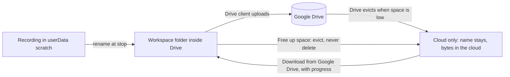

# Synced workspaces — a workspace connects to a folder in a cloud account

- **Status:** proposed (2026-11-22). Tracker: [NIW2-912](https://linear.app/niway/issue/NIW2-912/synced-workspaces-a-workspace-connects-to-a-folder-in-a-cloud-account).
- **ADRs:** [a workspace is the root, and accounts are optional connections](/architecture/decisions/0068-a-workspace-is-the-root-and-accounts-are-optional-connections/) (new) and [Kaipu syncs through the provider's own client, and frees space by evicting, never deleting](/architecture/decisions/0069-kaipu-syncs-through-the-providers-own-client-and-evicts-never-deletes/) (new).

## Summary (one minute)

A workspace stays Kaipu's root, as an Obsidian vault is. It can now be connected to a folder in a
cloud account on this Mac, for example Google Drive, `you@company.com`, `folder1/kaipu-assets`.
Captures land in that folder and Google Drive for desktop uploads them; Kaipu never talks to Google.
When Drive has freed a file's space, the Library says "Cloud only", and opening it offers
"Download from Google Drive" with progress. "Free up space" asks the provider to evict a file, never
deletes it. Kaipu warns when Drive is disconnected and when Drive made a conflict copy. The safety
rules for synced folders, built in [PR #483](https://github.com/niway-dev/kaipu-record/pull/483)
and never landed on main, come first and always run. Every visible part sits behind the
`synced-workspaces` flag and a per-workspace switch.

<!-- visual: synced-workspaces-mock -->

## What changes

| Thing                                                                               | Today                                                             | After                                                                                     |
| ----------------------------------------------------------------------------------- | ----------------------------------------------------------------- | ----------------------------------------------------------------------------------------- |
| Synced-folder safety (no partial uploads, no hard links, no reads of evicted files) | Built in #483, not on main: none of it runs                       | On main and always on, flag or not                                                        |
| Pointing a workspace at a cloud folder                                              | Pick any folder with the folder picker                            | "Connect a cloud folder…": choose an account, then a folder in it                         |
| A file Drive has evicted                                                            | Kaipu reads it like any file: the Library may hang or download it | "Cloud only", no thumbnail read, and "Download from Google Drive" with progress           |
| Freeing space                                                                       | Not possible from Kaipu                                           | "Free up space" evicts through macOS, or reveals the file in Finder for "Remove Download" |
| Provider closed or signed out                                                       | Nothing says so                                                   | A warning on the workspace, and new captures still land in the folder                     |
| Conflict copies                                                                     | Show as unrelated items                                           | Marked as a conflict copy of the original, with a warning                                 |
| Several cloud accounts                                                              | No notion of account                                              | Each account's folders are offered; one workspace per account folder                      |

## Decisions

| #   | Decision                                                                                                                                                                                                                                                                                                        | Why                                                                                                                                     | ADR                                                                                                                                     |
| --- | --------------------------------------------------------------------------------------------------------------------------------------------------------------------------------------------------------------------------------------------------------------------------------------------------------------- | --------------------------------------------------------------------------------------------------------------------------------------- | --------------------------------------------------------------------------------------------------------------------------------------- |
| 1   | The workspace is the root; connections are optional and belong to the workspace. An account never owns workspaces.                                                                                                                                                                                              | Kaipu works without an account, and every existing customer's Default workspace keeps working. Obsidian's vault plus Sync is the model. | 0068 (new)                                                                                                                              |
| 2   | A cloud-folder connection is a provider account plus a folder inside its synced root, recorded per Mac in the registry. One cloud folder per workspace; two accounts mean two workspaces.                                                                                                                       | A folder lives in one account. Another Mac may open the same folder at another path or without the provider.                            | 0068 (new)                                                                                                                              |
| 3   | Kaipu never calls Google, Microsoft or Apple cloud web APIs, and never streams. Downloads and evictions go through macOS File Provider.                                                                                                                                                                         | The provider's client already syncs; an API adds OAuth, app verification, quotas and a second sync engine.                              | 0069 (new)                                                                                                                              |
| 4   | "Free up space" evicts and never deletes. Deleting a file in a synced folder deletes it in the cloud and on every device.                                                                                                                                                                                       | The one irreversible mistake in this feature.                                                                                           | 0069 (new)                                                                                                                              |
| 5   | The safety rules always run when a workspace folder is synced, whatever the flag and the switch say. The flag and the per-workspace switch only gate what the user sees and the actions.                                                                                                                        | A user can put a workspace in Drive with Finder, without turning anything on.                                                           | reuses decision 15 of the [several workspaces spec](/specs/2026-10-29-several-workspaces-design/)                                       |
| 6   | Layer 1 lands #483 on main unchanged in behavior, before anything new is built on it.                                                                                                                                                                                                                           | It is reviewed code (two review rounds). Mixing it with new UI hides what a 1,500-commit rebase broke.                                  | —                                                                                                                                       |
| 7   | Downloading is an explicit action with progress and a message ("Downloading from Google Drive… 1.2 of 4 GB"). Opening a cloud-only item offers it instead of failing. Progress is measured from the file's allocated size; a macOS progress subscription replaces it only if layer 0 proves it works for Drive. | A download of 4 GB takes minutes; the user must know what is happening and why. Allocated size is observable for every provider.        | —                                                                                                                                       |
| 8   | Item states: "On this Mac" and "Cloud only" always; "Uploading" and "Uploaded" only if layer 0 proves macOS reports them for third-party providers. Kaipu never claims a file is uploaded without that signal.                                                                                                  | Apple documents the upload keys for iCloud only (research below). A wrong "uploaded" invites deleting the only copy.                    | —                                                                                                                                       |
| 9   | Cloud features are one per-workspace switch, "Cloud folder features", under Settings → Workspaces → Connections, off until the user turns it on, and only offered when the folder is synced. A user who never turns it on never sees Drive.                                                                     | The owner wants a modular workspace: whoever does not use Drive never learns about it.                                                  | —                                                                                                                                       |
| 10  | Providers are rows of data (detection rule, label, root layout, conflict-copy rule), not an adapter per provider. Unknown providers under `~/Library/CloudStorage` are "Synced folder".                                                                                                                         | Every provider here uses the same macOS File Provider mechanism; only names and paths differ. A platform layer waits for Windows.       | —                                                                                                                                       |
| 11  | Provider disconnected: a warning on the workspace ("Google Drive is not running. New captures stay on this Mac until it is back; cloud-only files cannot be downloaded."). Captures keep landing in the folder.                                                                                                 | Google documents that local files stay usable when Drive is not running and that downloads stop.                                        | —                                                                                                                                       |
| 12  | Conflict copies are recognized only by the patterns layer 0 observes for each provider, and are warned about, never merged or deleted.                                                                                                                                                                          | No provider documents its conflict-copy names (research below); a guessed pattern would mark real items as conflicts.                   | —                                                                                                                                       |
| 13  | Everything visible sits behind the release flag `synced-workspaces` (default off).                                                                                                                                                                                                                              | The owner's rule for this feature.                                                                                                      | reuses [flags are a typed registry](/architecture/decisions/0049-flags-are-a-typed-registry-with-state-in-our-api-labs-is-user-opt-in/) |
| 14  | A help page, "Keep a workspace in Google Drive, OneDrive or iCloud", is written last, from what the app really does, and linked from Connections.                                                                                                                                                               | The owner prefers a guide over a deeper integration; it must describe tested behavior.                                                  | —                                                                                                                                       |

## Layers

| #   | What it builds                                                                                                                                                                                                                                                                                                                         | Criteria  | Risk      | Depends on |
| --- | -------------------------------------------------------------------------------------------------------------------------------------------------------------------------------------------------------------------------------------------------------------------------------------------------------------------------------------- | --------- | --------- | ---------- |
| 0   | Spike on a real Google Drive (and OneDrive, iCloud if installed): rename of a 4 GB file into the folder, upload keys, coordinated-read download and its progress, evict and pin from a third-party process, partial reads of a cloud-only file, conflict-copy names, what a disconnected client looks like. Results go into this spec. | AC1       | 🟢 Low    | —          |
| 1   | Land #483's synced-folder safety and detection on main, with its visible labels behind the flag.                                                                                                                                                                                                                                       | AC2–AC5   | 🔴 High   | —          |
| 2   | Connection model: registry record (provider, account, relative folder), provider table, the "Cloud folder features" switch, the flag.                                                                                                                                                                                                  | AC6–AC8   | 🟡 Medium | 1          |
| 3   | "Connect a cloud folder…": account list from detected synced roots, folder picker rooted in the chosen account, create or adopt.                                                                                                                                                                                                       | AC9–AC10  | 🟢 Low    | 2          |
| 4   | Download from the cloud with progress, and the open-a-cloud-only-item flow in the Library, the item page and the editors.                                                                                                                                                                                                              | AC11–AC13 | 🟡 Medium | 0, 2       |
| 5   | Item states and "Free up space" (evict, or reveal in Finder when evict is not allowed).                                                                                                                                                                                                                                                | AC14–AC16 | 🟡 Medium | 0, 2       |
| 6   | Warnings: provider disconnected, conflict copies.                                                                                                                                                                                                                                                                                      | AC17–AC18 | 🟡 Medium | 0, 2       |
| 7   | Help page, linked from Connections.                                                                                                                                                                                                                                                                                                    | AC19      | 🟢 Low    | 3, 4, 5, 6 |

## Open questions

1. Answered by layer 0, and each changes a layer: does macOS report upload state for Drive files
   (layer 5), may a third-party process evict or pin (layer 5), does a coordinated read report
   progress (layer 4), can a player read ranges of a cloud-only file (out of scope here, input
   for the proxy design), what names do conflict copies get (layer 6).
2. Does the M5 have Google Drive for desktop signed in for layer 0? Default: run layer 0 there, in
   a scratch folder inside `My Drive`, touching nothing else.

## Out of scope

- **Proxy editing** (watch and edit from a small local copy while the original is cloud-only, export
  from the original): its own design, next.
- **Team collaboration**: shared notes on a video, shared edits, Kaipu Cloud teams as a workspace
  connection. Its own design; it reopens the [cloud product spec](/specs/2026-09-09-cloud-product/)
  non-goal "bidirectional editing sync".
- Any provider web API, OAuth, streaming or share links from Drive.
- Pinning the edit project or a proxy so the provider keeps them local, unless layer 0 finds a
  supported way.
- Windows.

## Failures this must protect against

- "Free up space" deletes a file instead of evicting it, and the cloud copy goes with it.
- Kaipu shows "Uploaded" for a file that is not in the cloud yet, and the user removes it.
- Rendering the Library downloads every cloud-only file it draws.
- A download that never finishes (provider closed, offline) leaves a spinner forever, or a
  half-downloaded file opens in the editor.
- A recording uploads half-written, or a drag-out hard link renames the item in Drive (NIW2-577).
- The rebase of #483 over 1,500 commits silently drops a guard (an eviction check, a copy instead
  of a link) while the tests still pass.
- A user without Drive sees Drive wording anywhere.
- A conflict-copy rule marks a real item as a conflict and hides it.
- Changing the account or folder of a workspace moves or copies the user's files.

## Acceptance criteria

- [ ] **AC1** The spike's results are written into this spec's "Platform facts" section, each with what was run and what was seen, and every open question above is answered or marked "not possible".
- [ ] **AC2** On main, a workspace under `~/Library/CloudStorage/GoogleDrive-…` records with no `.part` file inside the workspace folder, and the finished take appears there by `rename`.
- [ ] **AC3** Dragging an item out of a synced workspace leaves its media file's link count at 1.
- [ ] **AC4** A cloud-only file (`SF_DATALESS`) gets no thumbnail URL, `kaipu-media://` answers 409 for it without opening a stream, and opening the Library reads none of its bytes.
- [ ] **AC5** Every test #483 added passes on main, and a written list maps each #483 guard to the main file that holds it after the rebase.
- [ ] **AC6** With `synced-workspaces` off, no Drive, OneDrive or iCloud wording appears anywhere in the app, and AC2–AC4 still hold.
- [ ] **AC7** A workspace's connection (provider, account, relative folder) survives a restart, and an older build opens the same registry without error.
- [ ] **AC8** "Cloud folder features" is offered only for a synced workspace, is off by default, and turning it off hides every state, action and warning of this spec for that workspace.
- [ ] **AC9** "Connect a cloud folder…" lists one row per signed-in account found under `~/Library/CloudStorage` (plus iCloud Drive when present), and the folder picker opens inside the chosen account's root.
- [ ] **AC10** Choosing `folder1/kaipu-assets` of an account creates or adopts that exact folder as a workspace, and no file outside it is created, moved or copied.
- [ ] **AC11** Opening a cloud-only recording offers "Download from <provider>"; accepting shows the message and progress in bytes, and the item opens when the download completes.
- [ ] **AC12** A download that makes no progress for 30 s, or fails, ends with an error that names the provider and a Retry, never an endless spinner, and nothing opens a partially downloaded file.
- [ ] **AC13** Downloading one item downloads only that item's files (media, and its sidecar and thumbnail if they are cloud-only).
- [ ] **AC14** Each item of a synced workspace with the switch on shows "On this Mac" or "Cloud only", and "Uploading"/"Uploaded" only if AC1 proved the signal.
- [ ] **AC15** "Free up space" never calls `unlink` or `rm` on a synced file; a test asserts the call goes to the evict path or to Finder reveal.
- [ ] **AC16** When evicting is not allowed, "Free up space" reveals the file in Finder with the instruction "Right-click → Remove Download".
- [ ] **AC17** With the provider client quit, the workspace shows the disconnected warning within 10 s of the next Library refresh, and a new capture still lands in the folder.
- [ ] **AC18** A conflict copy produced as AC1 observed is shown linked to its original with a warning, and is never hidden or deleted.
- [ ] **AC19** The help page exists in the docs site, describes only behavior proven by AC2–AC18, and Connections links to it.

---

## Detail

### What the repo already says

- [Several workspaces spec](/specs/2026-10-29-several-workspaces-design/), decision 15: synced
  folders allowed, detected by path; scratch files in userData; copies instead of hard links;
  evicted files never read; conflict copies warned about. Decision 16: no provider API.
- [PR #483](https://github.com/niway-dev/kaipu-record/pull/483) (NIW2-602) built decision 15:
  `main/workspaces/synced-folder.ts` (path rules plus Google Drive's
  `com.google.drivefs.item-id#S` xattr, each step bounded at 2 s), `main/library/dataless.ts` (one
  `/usr/bin/stat -f '%f %N'` per listing), `main/library/safe-place.ts`, `drag-copies.ts`, the
  409 gate in `media-protocol.ts`, the copy-verify-delete path in `move-item.ts`. It left out the
  Download action, the conflict-copy warning and the one-time note, and every test mocks `stat`,
  the xattr and the provider.
- #483 was merged on 2026-11-02 at 06:30:15 into `feature/niw2-601-workspaces-part-3-settings`,
  21 seconds after that branch had merged to main as #482. Its merge commit `98e11ee8d` is not an
  ancestor of `origin/main` (checked 2026-11-22): 10 commits, about 3,800 lines in the desktop app.
  Main has moved by about 1,500 commits since; the busiest overlaps are the IPC wiring
  (`shared/types/ipc.ts`, `electron-api.ts`, `preload/index.ts`, `main/index.ts`) and
  `recording-hub.ts`.
- The edit project lives in the workspace folder, `.kaipu/<id>.edit.json`
  (`main/library/library-vault.ts:514`), so a synced workspace already carries edits to the other
  Mac. What it cannot do is merge two edits made at once: the provider keeps one and makes a
  conflict copy of the other. That is decision 12 here, and the team design later.

### Platform facts

Desk research on 2026-11-22 (a Sonnet worker). Layer 0 replaces "unknown" with what was observed.

| Question                                                        | Answer from the sources                                                                                                   | Source                                                                                                                                                                                |
| --------------------------------------------------------------- | ------------------------------------------------------------------------------------------------------------------------- | ------------------------------------------------------------------------------------------------------------------------------------------------------------------------------------- |
| Upload state ("uploading", "uploaded") for Drive/OneDrive files | Unknown, probably not: `ubiquitousItemIsUploadedKey` is documented for iCloud                                             | [Apple](https://developer.apple.com/tutorials/data/documentation/foundation/urlresourcekey/ubiquitousitemisuploadedkey.md), [forum](https://developer.apple.com/forums/thread/781427) |
| Trigger a download                                              | A coordinated read (`NSFileCoordinator`) downloads the file; plain reads materialize it too                               | [forum](https://developer.apple.com/forums/thread/763344)                                                                                                                             |
| Download progress                                               | `Progress.addSubscriber(forFileURL:)` unknown for third-party providers                                                   | —                                                                                                                                                                                     |
| Evict from a third-party app                                    | Unknown, probably not reliable: `fileproviderctl evict` options were removed; `evictItem` examples are the provider's own | [forum](https://developer.apple.com/forums/thread/845473), [forum](https://developer.apple.com/forums/thread/741529)                                                                  |
| Pin ("Keep Downloaded")                                         | No public API or attribute found for third parties                                                                        | —                                                                                                                                                                                     |
| Partial reads of a cloud-only file                              | The protocol exists (macOS 12.3+, POSIX range reads); unknown whether Drive or OneDrive implement it                      | [Apple](https://developer.apple.com/documentation/fileprovider/nsfileproviderpartialcontentfetching.md)                                                                               |
| Drive not running                                               | Local files stay usable; downloads stop while sync is paused                                                              | [Google](https://support.google.com/drive/answer/12178485?hl=en)                                                                                                                      |
| Conflict-copy names                                             | Not documented by Google, Microsoft or Apple                                                                              | [Microsoft](https://support.microsoft.com/en-us/onedrive/duplicate-files-in-onedrive)                                                                                                 |
| Stream vs Mirror                                                | Stream uses File Provider under `~/Library/CloudStorage`; Mirror keeps a full local copy; Shared drives can only stream   | [Google](https://support.google.com/drive/answer/13401938?hl=en)                                                                                                                      |
| `rename` into the domain                                        | Atomic at the POSIX level; how each provider treats it (upload of a moved-in file) is untested                            | —                                                                                                                                                                                     |

### Weak points and their answers

- **Layer 1 is a large rebase.** Answer: AC5 asks for a guard-by-guard map, and layer 1 is reviewed
  as its own PR before anything builds on it.
- **Most of the "nice" signals may not exist for third parties** (upload state, evict, pin).
  Answer: decisions 7, 8 and 12 define the fallback for each (allocated size, two states only,
  Finder reveal, no guessed conflict rule), so a "no" from layer 0 removes features, not safety.
- **Mirror mode never evicts.** Then every item is "On this Mac" and the Download action never
  appears, which is correct.
- **The account name comes from a folder name** (`GoogleDrive-<account>`). If a provider changes
  its layout, the account label degrades to the provider name; the connection still works because
  the absolute path is what Kaipu uses. That is a reopen condition of ADR 0068.
