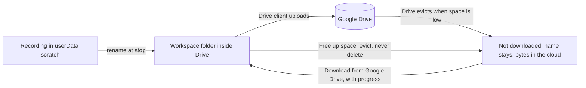

# Synced workspaces — a workspace connects to a folder in a cloud account

- **Status:** proposed (2026-11-22); layer 0 spike done the same day (see "Layer 0 spike, 2026-11-22"), with one decision open for the owner (open question 1). Tracker: [NIW2-912](https://linear.app/niway/issue/NIW2-912/synced-workspaces-a-workspace-connects-to-a-folder-in-a-cloud-account).
- **ADRs:** [a workspace is the root, and accounts are optional connections](/architecture/decisions/0068-a-workspace-is-the-root-and-accounts-are-optional-connections/) (new) and [Kaipu syncs through the provider's own client, and frees space by evicting, never deleting](/architecture/decisions/0069-kaipu-syncs-through-the-providers-own-client-and-evicts-never-deletes/) (new).

## Summary (one minute)

A workspace stays Kaipu's root, as an Obsidian vault is. It can now be connected to a folder in a
cloud account on this Mac, for example Google Drive, `you@company.com`, `folder1/kaipu-assets`.
Captures land in that folder and Google Drive for desktop uploads them; Kaipu never talks to Google.
When Drive has freed a file's space, the Library says "Not downloaded", and opening it offers
"Download from Google Drive" with progress. "Free up space" asks the provider to evict a file, never
deletes it. Kaipu warns when Drive is disconnected and when Drive made a conflict copy. The safety
rules for synced folders, built in [PR #483](https://github.com/niway-dev/kaipu-record/pull/483)
and never landed on main, come first and always run. Every new or provider-named part sits behind the
`synced-workspaces` flag and a per-workspace switch; with the switch off, only a neutral "Download"
for a cloud-only file remains, so a refusal is never silent. Layer 0 ran on 2026-11-22 against a real
Google Drive: rename, upload state and evict work, pin does not, and a download can be triggered two
ways, one with a progress bar and one about ten times faster without. Which one Kaipu uses is the
owner's call (open question 1).

<!-- visual: synced-workspaces-mock -->

## What changes

| Thing                                                                               | Today                                                             | After                                                                                     |
| ----------------------------------------------------------------------------------- | ----------------------------------------------------------------- | ----------------------------------------------------------------------------------------- |
| Synced-folder safety (no partial uploads, no hard links, no reads of evicted files) | Built in #483, not on main: none of it runs                       | On main and always on, flag or not                                                        |
| Pointing a workspace at a cloud folder                                              | Pick any folder with the folder picker                            | "Connect a cloud folder…": choose an account, then a folder in it                         |
| A file Drive has evicted                                                            | Kaipu reads it like any file: the Library may hang or download it | "Not downloaded", no thumbnail read, and "Download from Google Drive" with progress       |
| Freeing space                                                                       | Not possible from Kaipu                                           | "Free up space" evicts through macOS, or reveals the file in Finder for "Remove Download" |
| Provider closed or signed out                                                       | Nothing says so                                                   | A warning on the workspace, and new captures still land in the folder                     |
| Conflict copies                                                                     | Show as unrelated items                                           | Marked as a conflict copy of the original, with a warning                                 |
| Several cloud accounts                                                              | No notion of account                                              | Each account's folders are offered; one workspace per account folder                      |

## Decisions

| #   | Decision                                                                                                                                                                                                                                                                                                                                                                                                                                                                                                                                                                                                                                                                                                                                                                                                                                                                                                                                                                                                                                                                                                     | Why                                                                                                                                                                                         | ADR                                                                                                                                     |
| --- | ------------------------------------------------------------------------------------------------------------------------------------------------------------------------------------------------------------------------------------------------------------------------------------------------------------------------------------------------------------------------------------------------------------------------------------------------------------------------------------------------------------------------------------------------------------------------------------------------------------------------------------------------------------------------------------------------------------------------------------------------------------------------------------------------------------------------------------------------------------------------------------------------------------------------------------------------------------------------------------------------------------------------------------------------------------------------------------------------------------ | ------------------------------------------------------------------------------------------------------------------------------------------------------------------------------------------- | --------------------------------------------------------------------------------------------------------------------------------------- |
| 1   | The workspace is the root; connections are optional and belong to the workspace. An account never owns workspaces.                                                                                                                                                                                                                                                                                                                                                                                                                                                                                                                                                                                                                                                                                                                                                                                                                                                                                                                                                                                           | Kaipu works without an account, and every existing customer's Default workspace keeps working. Obsidian's vault plus Sync is the model.                                                     | 0068 (new)                                                                                                                              |
| 2   | A cloud-folder connection is a provider account plus a folder inside its synced root, recorded per Mac in the registry. One cloud folder per workspace; two accounts mean two workspaces.                                                                                                                                                                                                                                                                                                                                                                                                                                                                                                                                                                                                                                                                                                                                                                                                                                                                                                                    | A folder lives in one account. Another Mac may open the same folder at another path or without the provider.                                                                                | 0068 (new)                                                                                                                              |
| 3   | Kaipu never calls Google, Microsoft or Apple cloud web APIs, and never streams. Downloads and evictions go through macOS File Provider.                                                                                                                                                                                                                                                                                                                                                                                                                                                                                                                                                                                                                                                                                                                                                                                                                                                                                                                                                                      | The provider's client already syncs; an API adds OAuth, app verification, quotas and a second sync engine.                                                                                  | 0069 (new)                                                                                                                              |
| 4   | "Free up space" evicts and never deletes. Deleting a file in a synced folder deletes it in the cloud and on every device. In a synced workspace the three existing actions that remove media change too, always (with the safety rules of decision 5, whatever the flag says): Kaipu Cloud's "Remove local copy" (`removeLocalCopy`, which calls `rm`) no longer deletes, keeping its Kaipu Cloud upload check but never hashing a dataless file to run it (the action is not offered for a file that is already "Not downloaded", which has nothing to free), and setting no `localRemovedAt` (layer 1 reveals the file in Finder for "Remove Download"; layer 5 makes it evict where layer 0 proves that possible), so the item shows "Not downloaded" and downloads back from the provider; "Delete", and moving an item out of a synced workspace (which [ADR 0033](/architecture/decisions/0033-moving-an-item-between-workspaces/) already does as copy, verify, delete), say in their confirmation that the file is deleted from the cloud on every device (with the switch on, naming the provider). | The one irreversible mistake in this feature.                                                                                                                                               | 0069 (new)                                                                                                                              |
| 5   | The safety rules always run when a workspace folder is synced, whatever the flag and the switch say. The flag and the per-workspace switch only gate what the user sees and the actions.                                                                                                                                                                                                                                                                                                                                                                                                                                                                                                                                                                                                                                                                                                                                                                                                                                                                                                                     | A user can put a workspace in Drive with Finder, without turning anything on.                                                                                                               | reuses decision 15 of the [several workspaces spec](/specs/2026-10-29-several-workspaces-design/)                                       |
| 6   | Layer 1 lands #483 on main unchanged in its safety behavior, before anything new is built on it.                                                                                                                                                                                                                                                                                                                                                                                                                                                                                                                                                                                                                                                                                                                                                                                                                                                                                                                                                                                                             | It is reviewed code (two review rounds). Mixing it with new UI hides what a 1,500-commit rebase broke.                                                                                      | —                                                                                                                                       |
| 7   | Downloading is an explicit action with a message ("Downloading from Google Drive… 1.2 of 4 GB"). Opening a cloud-only item offers it instead of failing. How progress is measured depends on the trigger, which is open question 1 (amended pending owner OK): a plain read shows real progress, because the file's allocated size grows in 4 MB steps (proven by layer 0); the explicit macOS download call is about 10x faster but shows no growth, so its bar is indeterminate with elapsed time, unless a macOS progress subscription proves otherwise (option c of the question, one more small spike).                                                                                                                                                                                                                                                                                                                                                                                                                                                                                                 | A download of 4 GB takes minutes; the user must know what is happening and why. Layer 0 measured both triggers once on a 4 GB file on one link: 1103 s with progress against 110 s without. | —                                                                                                                                       |
| 8   | Item states, with the switch on (see "What shows when" below): "On this Mac" and "Not downloaded"; "Uploading" and "Uploaded", proven readable for Google Drive by layer 0 (no percentage; other providers unverified, so they show none). "Uploaded" needs `isUploaded` true; "not uploaded" means `isUploaded` false, never `isUploading` true, because a queued file reports neither flag. Kaipu never claims a file is uploaded without that signal. "Not downloaded" (the provider evicted the file; it is still there, dataless) is a different state from Kaipu Cloud's existing "Cloud only" (`localRemovedAt`: the media file was deleted and the copy is in Kaipu Cloud); the two cannot hold at once, because one needs the file present and the other absent, and they keep their own labels. "Not downloaded" replaces the wording "In the cloud — download to open" of [ADR 0033](/architecture/decisions/0033-moving-an-item-between-workspaces/) decision 13 and decision 15 of the several workspaces spec, for the same state.                                                             | Apple documents the upload keys for iCloud only (research below); layer 0 found they work for Google Drive. A wrong "uploaded" invites deleting the only copy.                              | —                                                                                                                                       |
| 9   | Cloud features are one per-workspace switch, "Cloud folder features", under Settings → Workspaces → Connections, and only offered when the folder is synced. It starts off for a folder that is synced by chance (moved there in Finder), and on for a workspace made with "Connect a cloud folder…", which is an explicit choice. With the flag on and the switch off, a cloud-only item still says "Not downloaded" and offers "Download", with no provider name: the refusal is never silent. A user who never turns it on never sees Drive.                                                                                                                                                                                                                                                                                                                                                                                                                                                                                                                                                              | The owner wants a modular workspace: whoever does not use Drive never learns about it.                                                                                                      | —                                                                                                                                       |
| 10  | Providers are rows of data (detection rule, label, root layout, conflict-copy rule), not an adapter per provider. Unknown providers under `~/Library/CloudStorage` are "Synced folder".                                                                                                                                                                                                                                                                                                                                                                                                                                                                                                                                                                                                                                                                                                                                                                                                                                                                                                                      | Every provider here uses the same macOS File Provider mechanism; only names and paths differ. A platform layer waits for Windows.                                                           | —                                                                                                                                       |
| 11  | Provider disconnected: a warning on the workspace ("Google Drive is not running. New captures stay on this Mac until it is back; cloud-only files cannot be downloaded."). Captures keep landing in the folder. Layer 0 showed `stat`, `ls` and xattrs cannot tell a dead client from a live one, so the warning rests on two signals: a pending upload that reports an upload error (`ubiquitousItemUploadingError`, code -1004), and a download or read of an evicted file that fails fast with "Operation timed out". With nothing pending and nothing attempted, Kaipu cannot know.                                                                                                                                                                                                                                                                                                                                                                                                                                                                                                                      | Google documents that local files stay usable when Drive is not running and that downloads stop. Layer 0 measured the failure: an evicted read errors after 4 to 6 s, it does not hang.     | —                                                                                                                                       |
| 12  | Conflict copies are recognized only by the patterns layer 0 observes for each provider, and are warned about, never merged or deleted.                                                                                                                                                                                                                                                                                                                                                                                                                                                                                                                                                                                                                                                                                                                                                                                                                                                                                                                                                                       | No provider documents its conflict-copy names (research below); a guessed pattern would mark real items as conflicts.                                                                       | —                                                                                                                                       |
| 13  | Every new or provider-named surface sits behind the release flag `synced-workspaces` (default off). The exceptions, always on, are the neutral safety messages: #483's "Not downloaded: download it in Finder" hint and the delete, move and "Remove local copy" guards of decision 4.                                                                                                                                                                                                                                                                                                                                                                                                                                                                                                                                                                                                                                                                                                                                                                                                                       | The owner's rule for this feature.                                                                                                                                                          | reuses [flags are a typed registry](/architecture/decisions/0049-flags-are-a-typed-registry-with-state-in-our-api-labs-is-user-opt-in/) |
| 14  | A help page, "Keep a workspace in Google Drive, OneDrive or iCloud", is written last, from what the app really does, and linked from Connections.                                                                                                                                                                                                                                                                                                                                                                                                                                                                                                                                                                                                                                                                                                                                                                                                                                                                                                                                                            | The owner prefers a guide over a deeper integration; it must describe tested behavior.                                                                                                      | —                                                                                                                                       |

## What shows when

| What                                                              | Flag off                                            | Flag on, switch off                                                  | Flag on, switch on                                  |
| ----------------------------------------------------------------- | --------------------------------------------------- | -------------------------------------------------------------------- | --------------------------------------------------- |
| Safety rules (no partial files, no hard links, no implicit reads) | Always                                              | Always                                                               | Always                                              |
| Delete guards of decision 4                                       | Always, neutral ("from the cloud")                  | Always, neutral                                                      | Always, naming the provider                         |
| A cloud-only item                                                 | #483's hint "Not downloaded: download it in Finder" | "Not downloaded" and "Download", progress and errors say "the cloud" | "Not downloaded" and "Download from Google Drive"   |
| "On this Mac", "Uploading", "Uploaded"                            | —                                                   | —                                                                    | Shown (upload states: proven for Google Drive only) |
| Provider label ("Synced by Google Drive")                         | —                                                   | —                                                                    | Shown                                               |
| "Free up space"                                                   | —                                                   | —                                                                    | Shown                                               |
| Disconnected and conflict-copy warnings                           | —                                                   | —                                                                    | Shown                                               |
| "Connect a cloud folder…" and the Connections switch              | —                                                   | Shown                                                                | Shown                                               |

Every layer that adds a screen, area or state (layers 2–6) adds it to `apps/kaipu-record/src/shared/ui-map.ts`, spreads `uiArea(...)` on its root and adds a catalog state per area, per [ADR 0046](/architecture/decisions/0046-a-typed-ui-map-declares-every-screen-area-and-state/).

## Layers

| #   | What it builds                                                                                                                                                                                                                                                                                                                                                                                                                                                                                                                                                                                                                                                                                                                                                                                                                                                                                                                                                                                                                                                                                                                                                                                                                                                                                                                                                                                                                                                                                                                                                                                                                                                                                                                                | Criteria            | Risk      | Depends on |
| --- | --------------------------------------------------------------------------------------------------------------------------------------------------------------------------------------------------------------------------------------------------------------------------------------------------------------------------------------------------------------------------------------------------------------------------------------------------------------------------------------------------------------------------------------------------------------------------------------------------------------------------------------------------------------------------------------------------------------------------------------------------------------------------------------------------------------------------------------------------------------------------------------------------------------------------------------------------------------------------------------------------------------------------------------------------------------------------------------------------------------------------------------------------------------------------------------------------------------------------------------------------------------------------------------------------------------------------------------------------------------------------------------------------------------------------------------------------------------------------------------------------------------------------------------------------------------------------------------------------------------------------------------------------------------------------------------------------------------------------------------------- | ------------------- | --------- | ---------- |
| 0   | **Done 2026-11-22 on Google Drive for desktop in Stream mode, one account (results in Platform facts).** Spike on a real Google Drive (and OneDrive, iCloud if installed). It also decides how Kaipu reaches File Provider: a plain `read` is a download trigger that needs nothing new, and `startDownloadingUbiquitousItem` is a faster one; evict and the fast trigger are Foundation calls that Electron's main process cannot make, so they need a small signed helper binary, built by `rebuild:native`-style explicit steps and never fetched by an install script (open question 1 decides how much the helper does for downloads). Checks: rename of a 4 GB file into the folder, upload keys, coordinated-read download and its progress (does the allocated size grow while a 4 GB file downloads?), evict and pin from a third-party process, partial reads of a cloud-only file, conflict-copy names, the names of the synced roots (several Google accounts, OneDrive personal and work, Shared drives), what a disconnected client looks like, what reading an evicted file does offline or with the client quit (an error, a hang or a wait, the item the several workspaces spec left unverified), whether `SF_DATALESS` clears only once the whole file is local, and where a Google Drive account in Mirror mode keeps its folder and whether detection recognizes it as synced (the safety rules must cover it too), whether a folder shared with two Google accounts carries the same item id attribute in both accounts' roots, whether the native folder panel opened at a provider root, with the client running and quit, opens without hanging. Results go into this spec. Not run: see the spike's "Not run" list. | AC1                 | 🟢 Low    | —          |
| 1   | Land #483's synced-folder safety and detection on main. One deliberate change: its labels move behind a gate, registering the `synced-workspaces` flag (default off) so its visible labels sit behind it. #483's provider label ("Synced by Google Drive") is shown only with the flag on and the switch on, once layer 2 builds the switch; until then, flag on only. With the switch off only the neutral "Not downloaded" wording of decision 9 shows. It also ships decision 4's delete guards in their first form: "Remove local copy" reveals in Finder instead of deleting, and the neutral delete and move warnings. It may start before layer 0: `rename` into Drive was proven on 2026-10-30 (see Platform facts); layer 0 proved it at 4 GB on Google Drive (same inode, uploaded in 521 s), so no fallback is needed there; if another provider rejects it at 4 GB, the stop step falls back to the copy-and-verify path `move-item.ts` already has.                                                                                                                                                                                                                                                                                                                                                                                                                                                                                                                                                                                                                                                                                                                                                                              | AC2–AC5b            | 🔴 High   | —          |
| 2   | Connection model: registry record (provider, account, relative folder), provider table, the "Cloud folder features" switch (the flag already exists from layer 1). The provider table starts with the rows already known (Google Drive's `GoogleDrive-<account>` root, from the 2026-10-30 spike, and iCloud Drive's fixed path); layer 0 could not add or correct the OneDrive and Shared drive rows (neither is present on this Mac), so those rows stay unverified and show as "Synced folder" until someone with that provider checks them.                                                                                                                                                                                                                                                                                                                                                                                                                                                                                                                                                                                                                                                                                                                                                                                                                                                                                                                                                                                                                                                                                                                                                                                               | AC6–AC8, AC20, AC23 | 🟡 Medium | 1          |
| 3   | "Connect a cloud folder…": account list from detected synced roots, folder picker rooted in the chosen account, create or adopt. Its labels come from the provider table, so a provider layer 0 has not checked shows as "Synced folder" until it has. Detection and the connection logic tolerate a folder with no provider item id yet: layer 0 saw a new Google Drive folder carry none for its first minutes, so the id may confirm a match but its absence never decides that a folder is not synced.                                                                                                                                                                                                                                                                                                                                                                                                                                                                                                                                                                                                                                                                                                                                                                                                                                                                                                                                                                                                                                                                                                                                                                                                                                    | AC9–AC10, AC22      | 🟢 Low    | 0, 2       |
| 4   | Download from the cloud with progress, and the open-a-cloud-only-item flow in the Library, the item page and the editors. The trigger and the progress bar follow open question 1; the read always runs in a killable child process, because a read of an evicted file queues behind a running upload.                                                                                                                                                                                                                                                                                                                                                                                                                                                                                                                                                                                                                                                                                                                                                                                                                                                                                                                                                                                                                                                                                                                                                                                                                                                                                                                                                                                                                                        | AC11–AC13           | 🟡 Medium | 0, 2       |
| 5   | Item states and "Free up space" (evict, or reveal in Finder when evict is not allowed). Layer 0 proved: "Uploading"/"Uploaded" are readable for Google Drive (no percentage); `FileManager.evictUbiquitousItem(at:)` evicts and is refused (-2008) while the file is not uploaded; there is no pin. Evict is a Foundation call, so it runs in the native helper.                                                                                                                                                                                                                                                                                                                                                                                                                                                                                                                                                                                                                                                                                                                                                                                                                                                                                                                                                                                                                                                                                                                                                                                                                                                                                                                                                                              | AC14–AC16           | 🟡 Medium | 0, 2       |
| 6   | Warnings: provider disconnected, conflict copies. The disconnected signal is an upload error or a fast-failing evicted read, not `stat` (decision 11).                                                                                                                                                                                                                                                                                                                                                                                                                                                                                                                                                                                                                                                                                                                                                                                                                                                                                                                                                                                                                                                                                                                                                                                                                                                                                                                                                                                                                                                                                                                                                                                        | AC17–AC18, AC21     | 🟡 Medium | 0, 2       |
| 7   | Help page, linked from Connections.                                                                                                                                                                                                                                                                                                                                                                                                                                                                                                                                                                                                                                                                                                                                                                                                                                                                                                                                                                                                                                                                                                                                                                                                                                                                                                                                                                                                                                                                                                                                                                                                                                                                                                           | AC19                | 🟢 Low    | 3, 4, 5, 6 |

## Open questions

1. **Owner decision (open): how does Kaipu download a cloud-only file?** Layer 0 measured two triggers on a 4 GB file, once each, on one link. A plain read took 1103 s and shows progress (allocated size grows in 4 MB steps). `startDownloadingUbiquitousItem` took 110 s, about 10 times faster, but allocated size stays 0 until the last second, so there is no byte progress. It is a Foundation call that Electron's main process cannot make, so it needs a native helper. Options:
   - (a) Plain read only. A real progress bar, about 10x slower on the measured link, no helper for downloads.
   - (b) A helper that calls `startDownloadingUbiquitousItem`. Fast, with an indeterminate bar, elapsed time and "Downloading from Google Drive…".
   - (c) A helper that starts the fast download and also tries `NSProgress` / `Progress.addSubscriber(forFileURL:)` for file progress, falling back to (b) if no progress is published. Needs one more small spike first.

   **Recommendation: (c).** The owner asked for a progress bar and the speed gap is large. The helper is built in the repo and signed with the app, never fetched by an install script (the rule in the ADR stays). Strongest argument against: a native helper adds a build and signing step and leaves a Windows and Linux story to write. Weakening that argument (our inference, not a measurement): layer 5's evict is also a Foundation call, so a helper is needed there too if "Free up space" evicts instead of revealing in Finder. [ADR 0069](/architecture/decisions/0069-kaipu-syncs-through-the-providers-own-client-and-evicts-never-deletes/) decision 2 is marked "amended pending owner OK" until this is answered.

2. Open after layer 0, each changing a layer: what names conflict copies get (layer 6, needs a second client editing the same file while this one is offline); whether two Google accounts see the same folder with the same item id (AC22); where Mirror mode keeps its folder and whether detection sees it; OneDrive's, iCloud's and Shared drives' root names; whether the native folder panel opens at a root without hanging (a manual check).
3. A read of an evicted file can queue behind a running upload (a 1 MB read did not return in 60 s during a 4 GB upload). AC12's stall rule counts a signal that does not move for 60 s as a stall, which would also fire for that queue. Should the error say "waiting for uploads" instead of a plain failure? Not decided here; layer 4 needs the answer.

## Out of scope

- **Proxy editing** (watch and edit from a small local copy while the original is cloud-only, export
  from the original): its own design, next.
- **Team collaboration**: shared notes on a video, shared edits, Kaipu Cloud teams as a workspace
  connection. Its own design; it reopens the [cloud product spec](/specs/2026-09-09-cloud-product/)
  non-goal "bidirectional editing sync".
- Any provider web API, OAuth, streaming or share links from Drive.
- Pinning the edit project or a proxy so the provider keeps them local, unless layer 0 finds a
  supported way.
- Windows.

## Failures this must protect against

- "Free up space" deletes a file instead of evicting it, and the cloud copy goes with it.
- "Remove local copy", "Delete" or a move out of a synced workspace removes the file from the provider on every
  device without the user being told.
- Kaipu shows "Uploaded" for a file that is not in the cloud yet, and the user removes it.
- Rendering the Library downloads every cloud-only file it draws.
- A download that never finishes (provider closed, offline) leaves a spinner forever, or a
  half-downloaded file opens in the editor.
- A recording uploads half-written, or a drag-out hard link renames the item in Drive (NIW2-577).
- The rebase of #483 over 1,500 commits silently drops a guard (an eviction check, a copy instead
  of a link) while the tests still pass.
- A user without Drive sees Drive wording anywhere.
- A conflict-copy rule marks a real item as a conflict and hides it.
- Changing the account or folder of a workspace moves or copies the user's files.

## Acceptance criteria

- [x] **AC1** Done 2026-11-22. The spike's results are written into this spec's "Platform facts" section, each with what was run and what was seen. Not run, and named there with the reason: the same item id across two accounts, conflict-copy names, Mirror mode, OneDrive, iCloud, Shared drives and the native folder panel at a root.
- [ ] **AC2** On main, a workspace under `~/Library/CloudStorage/GoogleDrive-…` records with no `.part` file inside the workspace folder, and the finished take appears there by `rename`.
- [ ] **AC3** Dragging an item out of a synced workspace leaves its media file's link count at 1.
- [ ] **AC4** A cloud-only file (`SF_DATALESS`) gets no thumbnail URL, `kaipu-media://` answers 409 for it without opening a stream, and opening the Library reads none of its bytes.
- [ ] **AC5** Every test #483 added passes on main, and a written list maps each #483 guard to the main file that holds it after the rebase. The only tests that may change are the ones asserting the `Synced by <provider>` label is always shown; the list names each of them and the gate it now asserts.
- [ ] **AC5b** In a synced workspace, with the flag off and on, "Remove local copy" never calls `rm` on the media (layer 1: it reveals the file in Finder; layer 5: it evicts where AC1 proved that possible) and sets no `localRemovedAt`; "Delete" and a move out of the workspace warn that the file is deleted from the cloud on every device. A test asserts each. Layer 1 also lists every whole-file reader on main (content hashing, reconcile, Kaipu Cloud upload, export) and gates each on `SF_DATALESS`, so none of them downloads an evicted file implicitly.
- [ ] **AC6** With `synced-workspaces` off, no Drive, OneDrive or iCloud wording appears anywhere in the app, AC2–AC4 still hold, and a refused cloud-only file still shows the neutral hint #483 built ("Not downloaded: download it in Finder"), never a silent failure.
- [ ] **AC7** A workspace's connection (provider, account, relative folder) survives a restart, and survives an older build opening and writing the registry: the connection is stored under its own `workspaceConnections` key of `preferences.json`, keyed by workspace id, which an older build keeps because it spreads the file it read, not inside the `workspaces` entries that its `parseEntry` rebuilds.
- [ ] **AC8** "Cloud folder features" is offered only for a synced workspace, starts off for a folder that became synced outside Kaipu and on for one connected through "Connect a cloud folder…" (closes with layer 3), and turning it off hides every provider name, item state, "Free up space" and warning of this spec for that workspace (closes with layer 6). What survives the switch: the safety rules, and the neutral "Not downloaded" with "Download" of decision 9, whose progress and errors say "the cloud" instead of a provider ("Could not download from the cloud").
- [ ] **AC9** "Connect a cloud folder…" lists one row per synced root found under `~/Library/CloudStorage` (plus iCloud Drive when present), labelled as AC1 recorded for its provider, and the folder picker opens inside the chosen account's root (or at the fallback AC1 recorded) without blocking the main process.
- [ ] **AC10** Choosing `folder1/kaipu-assets` of an account creates or adopts that exact folder as a workspace, and no file outside it is created, moved or copied.
- [ ] **AC11** Opening a cloud-only recording offers "Download" (with the switch on: "Download from Google Drive", the provider's name); accepting shows the message and progress, and the item opens when the download completes.
- [ ] **AC12** A download never ends in an endless spinner and nothing opens a partially downloaded file. It ends with an error and a Retry (the error names the provider with the switch on and says "the cloud" with it off, as AC8 has it) when the provider reports an error or, where there is a progress signal, when that signal does not move for 60 s. AC1 proved one for the plain-read path (allocated size) and none for the fast `startDownloadingUbiquitousItem` path, unless option (c) of open question 1 finds a progress subscription. Without a progress signal there is no time cap: the bar is indeterminate with elapsed time, because a 4 GB file on a slow link can take an hour. The read runs in a child process that Kaipu can kill, never in the main process's file threadpool, so Cancel and the stall rule end it; Cancel stops Kaipu waiting, not the provider. Retry first checks whether the file is already local or still downloading, and re-attaches to that download instead of starting a second one.
- [ ] **AC13** Downloading one item downloads only that item's files: its media file plus the companions in `companionPaths()` (`main/library/library-vault.ts`). Every companion has a class: the media, the webcam video, the edit project (`editSession` and `editMeta`) and the cursor track must be local before the editor opens; the sidecar is a small `.kaipu/` file, read with a timeout when evicted (ADR 0069 decision 5); the thumbnail is never read while evicted (no image URL, the placeholder shows, as decision 15 of the several workspaces spec has it) and is downloaded with the item; the text cache, transcript, canvas document and assets folder are downloaded on first use; `cursorTrackTemp` is a leftover temp and is skipped. None is read implicitly while drawing the Library, and a test fails when `companionPaths()` gains a key that has no class.
- [ ] **AC14** As the "What shows when" table has it, each item of a synced workspace with the switch on shows "On this Mac" or "Not downloaded", and "Uploading"/"Uploaded", which AC1 proved readable for Google Drive (no percentage). "Uploaded" means `isUploaded` is true; anything else is "Uploading" or queued, never inferred from `isUploading` alone.
- [ ] **AC15** "Free up space" never calls `unlink` or `rm` on a synced file; a test asserts the call goes to the evict path or to Finder reveal.
- [ ] **AC16** When evicting is not allowed, "Free up space" reveals the file in Finder with the instruction "Right-click → Remove Download".
- [ ] **AC17** With the provider client quit, the workspace shows the disconnected warning within 10 s of the next Library refresh when a signal exists: a pending upload that reports an upload error (-1004), or an attempted read or download of an evicted file that fails with "Operation timed out". `stat`, `ls` and xattrs do not change when the client is down (AC1 measured this), so with no pending upload and no attempted read Kaipu shows no warning. A new capture still lands in the folder. A download in progress when the client quits ends with the AC12 error.
- [ ] **AC18** A conflict copy produced as AC1 observed is shown linked to its original with a warning, and is never hidden or deleted.
- [ ] **AC19** The help page exists in the docs site, describes only behavior proven by AC2–AC18, and Connections links to it.
- [ ] **AC20** "Change folder…" on a connected workspace touches no file, re-detects the provider and root of the new path, and clears the connection (and turns the switch off) when the new path is not synced.
- [ ] **AC21** An item whose name only resembles a conflict copy but matches no rule AC1 recorded (for example `Demo (1).mp4` recorded on purpose) lists as a normal item, with no warning.
- [ ] **AC22** Connecting a folder whose identity is already registered on this Mac at another available path never rewrites its identity without asking when the folder is inside a synced root. Where both paths carry the same provider item id (a folder shared with a second account; AC1 could not verify this, only one account was signed in), Kaipu creates no second entry, writes nothing into the folder and offers to switch to the registered workspace. Where the ids differ or there is none, Kaipu asks (a fresh folder has no id for its first minutes, so a missing id is "none", never an error and never a reason to wait): "Open the workspace already registered" or "This is a copy: give it its own identity". Outside a synced root a copy gets a new id, as the several workspaces spec has it.
- [ ] **AC23** On load, each `workspaceConnections` record is checked against its registry entry: the provider and root are re-derived from the entry's current path, a record that no longer matches it (an older build changed the folder) is cleared and its switch turned off, and a record with no entry (an older build removed the workspace) is dropped.

---

## Detail

### What the repo already says

- [Several workspaces spec](/specs/2026-10-29-several-workspaces-design/), decision 15: synced
  folders allowed, detected by path; scratch files in userData; copies instead of hard links;
  evicted files never read; conflict copies warned about. Decision 16: no provider API.
- [PR #483](https://github.com/niway-dev/kaipu-record/pull/483) (NIW2-602) built decision 15:
  `main/workspaces/synced-folder.ts` (path rules plus Google Drive's
  `com.google.drivefs.item-id#S` xattr, each step bounded at 2 s), `main/library/dataless.ts` (one
  `/usr/bin/stat -f '%f %N'` per listing), `main/library/safe-place.ts`, `drag-copies.ts`, the
  409 gate in `media-protocol.ts`, the copy-verify-delete path in `move-item.ts`. It left out the
  Download action, the conflict-copy warning and the one-time note, and every test mocks `stat`,
  the xattr and the provider.
- #483 was merged on 2026-11-02 at 06:30:15 into `feature/niw2-601-workspaces-part-3-settings`,
  21 seconds after that branch had merged to main as #482. Its merge commit `98e11ee8d` is not an
  ancestor of `origin/main` (checked 2026-11-22): 10 commits, about 3,800 lines in the desktop app.
  Main has moved by about 1,500 commits since; the busiest overlaps are the IPC wiring
  (`shared/types/ipc.ts`, `electron-api.ts`, `preload/index.ts`, `main/index.ts`) and
  `recording-hub.ts`.
- The edit project lives in the workspace folder, `.kaipu/<id>.edit.json`
  (`main/library/library-vault.ts:514`), so a synced workspace already carries edits to the other
  Mac. What it cannot do is merge two edits made at once: the provider keeps one and makes a
  conflict copy of the other. That is decision 12 here, and the team design later.

### Platform facts

Already proven on the owner's Mac on 2026-10-30 (Google Drive for desktop, DriveFS 133, macOS 26.6),
recorded in the [several workspaces spec](/specs/2026-10-29-several-workspaces-design/), "Spike results":

- `rename()` from `~/Movies` or `/tmp` into Drive works, is atomic, and the file uploads (small files). Superseded for size on 2026-11-22: 4 GB behaves the same (see below).
- A hard link to a Drive file renames the cloud item or leaves it unsynced.
- `SF_DATALESS` is reliable; zero blocks has a false positive.
- `read`, `link` and `copyFile` download an evicted file; `stat`, `open`, `readdir` and xattrs do not.
- **Listing the provider root (`~/Library/CloudStorage/GoogleDrive-…`) with `ls` or `xattr` hung
  for more than 3 minutes while `stat` answered.** So: the account list of layer 3 reads only
  `~/Library/CloudStorage` itself (the parent, one entry per root), the folder picker is the native
  macOS panel opened at the root, shown as a sheet so the main process never blocks on it (if layer 0
  sees the panel hang at a root, it opens at the user's last folder there and accepts a typed
  relative path instead), and the disconnected check of layer 6 uses `stat` with a timeout,
  never a listing.
- Small `.kaipu/` files (identity, settings, sidecars, `tags.json`) may be read even when evicted,
  with a timeout, as that spec allows; a failed read lists the item read-only and writes nothing.

Desk research on 2026-11-22 (a Sonnet worker) for what was still open. For Google Drive, the layer 0 spike below supersedes the rows on upload state, evict, download trigger and progress, partial reads and `rename`; the rest stay as desk research.

| Question                                                        | Answer from the sources                                                                                                   | Source                                                                                                                                                                                |
| --------------------------------------------------------------- | ------------------------------------------------------------------------------------------------------------------------- | ------------------------------------------------------------------------------------------------------------------------------------------------------------------------------------- |
| Upload state ("uploading", "uploaded") for Drive/OneDrive files | Unknown, probably not: `ubiquitousItemIsUploadedKey` is documented for iCloud                                             | [Apple](https://developer.apple.com/tutorials/data/documentation/foundation/urlresourcekey/ubiquitousitemisuploadedkey.md), [forum](https://developer.apple.com/forums/thread/781427) |
| Trigger a download                                              | A coordinated read (`NSFileCoordinator`) downloads the file; plain reads materialize it too                               | [forum](https://developer.apple.com/forums/thread/763344)                                                                                                                             |
| Download progress                                               | `Progress.addSubscriber(forFileURL:)` unknown for third-party providers                                                   | —                                                                                                                                                                                     |
| Evict from a third-party app                                    | Unknown, probably not reliable: `fileproviderctl evict` options were removed; `evictItem` examples are the provider's own | [forum](https://developer.apple.com/forums/thread/845473), [forum](https://developer.apple.com/forums/thread/741529)                                                                  |
| Pin ("Keep Downloaded")                                         | No public API or attribute found for third parties                                                                        | —                                                                                                                                                                                     |
| Partial reads of a cloud-only file                              | The protocol exists (macOS 12.3+, POSIX range reads); unknown whether Drive or OneDrive implement it                      | [Apple](https://developer.apple.com/documentation/fileprovider/nsfileproviderpartialcontentfetching.md)                                                                               |
| Drive not running                                               | Local files stay usable; downloads stop while sync is paused                                                              | [Google](https://support.google.com/drive/answer/12178485?hl=en)                                                                                                                      |
| Conflict-copy names                                             | Not documented by Google, Microsoft or Apple                                                                              | [Microsoft](https://support.microsoft.com/en-us/onedrive/duplicate-files-in-onedrive)                                                                                                 |
| Stream vs Mirror                                                | Stream uses File Provider under `~/Library/CloudStorage`; Mirror keeps a full local copy; Shared drives can only stream   | [Google](https://support.google.com/drive/answer/13401938?hl=en)                                                                                                                      |
| `rename` into the domain (4 GB, OneDrive, iCloud)               | Atomic at the POSIX level; how each provider treats it (upload of a moved-in file) is untested                            | —                                                                                                                                                                                     |

### Layer 0 spike, 2026-11-22

Run on the M5 (macOS 26.6, Google Drive for desktop in Stream mode, one account) in a scratch folder
inside `My Drive`, deleted afterwards. The provider root was only `stat`ed, never listed, and every
Drive command ran under a timeout. Link rates varied (about 8 MB/s for the 4 GB upload, about 27 MB/s
for 600 MB), and the download timings were measured once per method on one link.

| Question                                                                                       | Answer                                                                                      | Evidence                                                                                                                                                                                                                                                                                                                                                                                 |
| ---------------------------------------------------------------------------------------------- | ------------------------------------------------------------------------------------------- | ---------------------------------------------------------------------------------------------------------------------------------------------------------------------------------------------------------------------------------------------------------------------------------------------------------------------------------------------------------------------------------------- |
| Is a 4 GB `rename` into Drive atomic, and does it upload?                                      | Yes. Supersedes the 2026-10-30 small-file result.                                           | Same device and inode before and after, 0 s, no copy; uploaded in 521 s (about 8 MB/s) and was readable the whole time.                                                                                                                                                                                                                                                                  |
| Can a third party read upload state?                                                           | Yes, "uploaded" and "uploading", with no progress.                                          | `URLResourceValues` (`ubiquitousItemIsUploaded`, `ubiquitousItemIsUploading`), `mdls kMDItemIsUploaded`, `fileproviderctl evaluate`. `kMDItemIsUploading` never goes to 1 and `stat` never changes.                                                                                                                                                                                      |
| Is there a third state between queued and uploading?                                           | Yes: right after the `mv` a file shows neither flag. So "not uploaded" means `!isUploaded`. | Seen at t=0 of the 600 MB test.                                                                                                                                                                                                                                                                                                                                                          |
| Can a third party evict?                                                                       | Yes, `FileManager.evictUbiquitousItem(at:)`.                                                | Worked on 200 MB, 600 MB and 4 GB; `SF_DATALESS` set, blocks 0, name and size kept. `brctl` is iCloud only and `fileproviderctl` has no evict.                                                                                                                                                                                                                                           |
| Is evict safe against data loss?                                                               | Yes, it is refused while the file is not uploaded.                                          | Error -2008 "cannot be evicted" right after a `mv`; the file stayed local and uploaded.                                                                                                                                                                                                                                                                                                  |
| Can a third party pin ("Keep Downloaded")?                                                     | No.                                                                                         | No API; writing the pin xattr was accepted but `isKeepDownloaded` stayed 0.                                                                                                                                                                                                                                                                                                              |
| Does a plain read download an evicted file, and with progress?                                 | Yes, with progress, slowly.                                                                 | 4 GB in 1103 s (about 3.9 MB/s); allocated blocks grew in 4 MB steps, so allocated size is a progress meter for a sequential read. `isDownloading` flickers and is not reliable.                                                                                                                                                                                                         |
| Does `startDownloadingUbiquitousItem` download, and with progress?                             | Yes, about 10x faster, with no progress.                                                    | Returns at once, starts after 3 to 5 s; 4 GB in 110 s (about 39 MB/s); blocks stay 0 and jump to full in the last second. It is a Foundation call, so Electron's main process needs a native helper to make it.                                                                                                                                                                          |
| Does `SF_DATALESS` clear before the file is complete?                                          | No.                                                                                         | Set in all 856 samples of the plain-read download; cleared in the same second the blocks completed.                                                                                                                                                                                                                                                                                      |
| Can a player read ranges of a cloud-only file? (input for the proxy design, out of scope here) | Yes, in 4 MB chunks, and the file stays dataless.                                           | A 1 MB read raised blocks by 8192 (4 MB), twice, flags unchanged. Allocated size is not progress for non-sequential access.                                                                                                                                                                                                                                                              |
| What does reading an evicted file do while the client is down?                                 | It fails fast, it does not hang.                                                            | `dd` ended with "Operation timed out" after 3.9 s and 6.3 s. `startDownloadingUbiquitousItem` returned OK and did nothing.                                                                                                                                                                                                                                                               |
| Is a disconnected client visible to `stat`?                                                    | No.                                                                                         | With the client killed, `stat`, `ls -lO` and `xattr` answered from cache and local reads and writes worked. Pending uploads reported `ubiquitousItemUploadingError` -1004 ("couldn't connect to the server"). The client was force-killed (it ignored a quit and SIGTERM), which is a crash, not a menu quit. After a restart it uploaded everything written offline without any action. |
| Does a read of an evicted file wait behind an upload?                                          | Yes.                                                                                        | A 1 MB read did not return in 60 s while a 4 GB upload ran; it took about 2 s afterwards. The read must run in a killable process (AC12).                                                                                                                                                                                                                                                |
| Does a folder carry `com.google.drivefs.item-id#S`?                                            | Yes, but only after its first sync.                                                         | Absent at about 1 s after `mkdir`, present a few minutes later. New files get it when their upload completes. A modified synced file keeps it, so it is no "uploaded" signal for edits.                                                                                                                                                                                                  |
| Which provider-root facts did it add?                                                          | The account folder is `GoogleDrive-<email>`, and this mode is Stream.                       | `ls ~/Library/CloudStorage`; `DriveFS/.../my-drive` is a symlink into it and the Mirror `roots` table is empty. `stat` of the root answers at once, with the client running and killed.                                                                                                                                                                                                  |

**Not run**, with the reason:

- The same item id across two accounts: only one Google account was signed in. AC22 stays unverified.
- Conflict-copy names: a conflict needs a second client editing the same file; offline edits and
  delete-and-recreate uploaded as normal edits, with no copy. AC18 and AC21 stay unwritten.
- Mirror mode: it cannot be switched without changing the owner's setup, so where Mirror keeps its
  folder and whether detection sees it as synced is unknown.
- OneDrive and iCloud Drive: neither is installed on this Mac.
- Shared drives: this account has no `Shared drives` entry, so the name and layout are unknown.
  `Other computers` exists and was not explored.
- The native folder panel at a root: it needs a manual check, since the spike could not click.
- Progress through `NSProgress`: not tried; it is the small spike option (c) of open question 1 needs.

### Weak points and their answers

- **Layer 1 is a large rebase.** Answer: AC5 asks for a guard-by-guard map, and layer 1 is reviewed
  as its own PR before anything builds on it.
- **Most of the "nice" signals may not exist for third parties** (upload state, evict, pin).
  Answer: decisions 7, 8 and 12 define the fallback for each (allocated size, two states only,
  Finder reveal, no guessed conflict rule), so a "no" from layer 0 removes features, not safety. Layer 0 result for Google Drive: upload state and evict exist; pin does not, and the fast download has no byte progress.
- **Mirror mode never evicts.** Then every item is "On this Mac" and the Download action never
  appears, which is correct.
- **The account name comes from a folder name** (`GoogleDrive-<account>`). If a provider changes
  its layout, the account label degrades to the provider name; the connection still works because
  the absolute path is what Kaipu uses. That is a reopen condition of ADR 0068.
